# 中級會計學｜第一次段考複習

> 上層：[[首頁]]｜同學期：[[貨幣銀行學｜期中考複習]]


## 助教題目閱讀提醒

凡本筆記用到的助教題號，已在對應位置補上完整原題圖，包括跨頁資料與全部小題。E5.27 另重排為可直接閱讀的中英對照表。標成「自編變形」的數字不可當成助教原題條件；承購商分錄與未明列範圍的小題雖保留在原圖，仍按本次公告決定是否必練。

## 新版讀法｜先懂中文，再做英文真題

**本版以 112-1（卷面 Fall 2023）與 113-1（卷面 Fall 2024）的期中考為主要練習。**先讀中文概念與例子，再看每節的「中文 → 英文 → 解題動作」，接著直接做穿插的真題，最後展開詳細解答。

- **教學**：每個題型開頭的「教學」段先講這個制度為什麼存在、道理是什麼；每一題前面的「先懂這題的道理」框，說明這一題用到哪個道理。
- **真題**：保留原卷英文、數字、選項與來源題號；相同題目只完整放一次，標示兩年對照。
- **解答**：中文逐步推理，重要科目附英文，分錄提供能對照英文考卷的科目名稱。點開「展開詳解」才看到答案。
- **自編題**：保留作為第二輪加練，不再當主要題庫。
- **本次範圍優先**：歷屆的 14 題選擇、58／68 分計算及 180 分鐘，都是當年規則；本次公告是 **13 題選擇 39 分、6 題計算 61 分**，考試時間請依本次安排，不能沿用舊卷。

目前兩卷的計算第 1、3、4、5、6 題核心資料相同；第 2 題 113-1 增加有限追索。112-1 第 7 題雖然當年是加分題，有限追索已在本次公告內，因此這裡保留作為主題的進階練習。

### 兩卷對照：讀哪一節，就做哪一題

| 概念 | 113-1 | 112-1 | 本筆記安排 |
|---|---|---|---|
| 銀行調節 | 計算 1 | 計算 1 | 題型一末尾 |
| 無追索、完全追索、有限追索 | 計算 2，含三小題 | 計算 2＋加分 7 | 題型二末尾 |
| 指定應收帳款借款 | 計算 3 | 計算 3 | 題型三末尾 |
| 損益、前期錯誤、保留盈餘 | 計算 4 | 計算 4 | 題型四末尾 |
| 權益各組成 | 計算 5 | 計算 5 | 題型五末尾 |
| FIFO、定期加權平均、毛利 | 計算 6；選擇 2 | 同題號 | 題型六末尾 |
| 衡量原則 | 選擇 4 | 第 4 題改考繼續經營 | 選擇一；舊題差異放附錄 |
| 流動分類 | 選擇 3、8 | 同題號 | 選擇二 |
| 現金、備抵、票據 | 選擇 11、14、9 | 11、14 相同；9 改考盤差 | 選擇三至五 |
| 存貨範圍、成本、錯誤 | 選擇 1、5、6、7、10、12 | 同概念；另有 9、13 | 選擇七 |
| 服務資產／負債 | 未見直接題目 | 未見直接題目 | 本次公告明列，仍保留教材例題 |
| 存貨成本與淨變現價值孰低 | 選擇 13 | 未見同題 | 本次公告未明列，放附錄低優先 |


## 快速目錄

- [[#第一部分｜先練 61 分：六類計算與分錄題]]
- [[#題型一｜銀行調節表]]
- [[#題型二｜應收帳款出售與追索權]]
- [[#題型三｜指定應收帳款作擔保借款]]
- [[#題型四｜損益表項目與保留盈餘]]
- [[#題型五｜股東權益：分欄算，再加總]]
- [[#題型六｜FIFO 與平均成本法【基礎解說＋歷屆真題】]]
- [[#第二部分｜守住 39 分：選擇題概念]]
- [[#第三部分｜第二輪自編加練：13 題選擇＋6 題計算]]
- [[#最後一頁｜複習節奏與待補教材]]

## 先看這頁：10 月 14 日怎麼準備最有效

這份依老師本次公告及你補充的兩份歷屆試題整理。**選擇題 13 題，共 39 分；計算與分錄題 6 題，共 61 分。**老師沒有公布每一道計算題的配分，也沒有公布各章選擇題的題數，所以不要把下面的練習順序當成配分預測。

讀法很簡單：**先看白話概念 → 跟著例題算一次 → 看教材原圖 → 蓋住答案自己寫 → 訂正原因。**分錄第一次讀不懂沒關係，先抓住「公司拿到什麼、失去什麼、還欠什麼」。

### 考試地圖與閱讀順序

| 次序 | 必會內容 | 考試位置 | 現有資料 |
|---|---|---|---|
| 1 | 銀行調節表：分銀行端與公司端 | 61 分計算題 | 第 5 章＋助教講義 |
| 2 | 應收帳款出售：無追索、完全追索、有限追索 | 61 分分錄題，只寫公司 | 第 5 章＋助教講義 |
| 3 | 指定應收帳款作擔保借款 | 61 分分錄題，只寫公司 | 助教 E5.15 |
| 4 | 損益表項目、保留盈餘 | 61 分計算題 | 第 2 章＋助教講義 |
| 5 | 股東權益與權益變動表 | 61 分計算題 | 助教 E2.18 |
| 6 | FIFO、平均成本法的期末存貨與銷貨成本 | 61 分計算題 | 第 6 章投影片 part 1＋歷屆真題 |
| 7 | 衡量原則、流動分類、現金、備抵、票據、服務資產／負債、存貨範圍與錯誤 | 39 分選擇題 | 第 1、3、5、6 章已有 |

**本版不安排公告未列的補充題作為必讀。**例如完整品質特性、零用金撥補、應收帳款週轉率、IFRS 18 補充，都不再占用主要複習篇幅。第 2 章雖未列在選擇題章次，損益、保留盈餘、股東權益已明列為計算題，仍要讀。

### 圖片與範圍說明

教材圖片取自原頁；歷屆題圖則擷取對應題目區域。圖文均標示來源。教材圖保留圖表、箭頭及分錄排版，並標示來源與 PDF 頁碼。原頁如果含其他小題，只讀本節指明的部分，不代表整頁都在考試範圍。英文公告的 serving asset/liability 在教材中寫作 **servicing asset/liability（服務資產／負債）**。

第 6 章已依老師投影片 part 1（6.1～6.4）補上教學與例題。兩份原卷都考「永續 FIFO＋定期加權平均」，先練熟這組；投影片也教了永續盤存的移動平均，要會算。

## 英文讀題固定順序：不要逐字翻譯

1. **先找問什麼**：compute／determine＝算出；prepare a journal entry＝寫分錄；which is NOT＝找錯的／不屬於的。
2. **圈日期與期間**：at December 31＝期末時點；for the year＝一整年；during＝期間內；due＝到期。先判斷問哪一年。
3. **圈方向詞**：increase／decrease＝增／減；overstated／understated＝高估／低估；credit／debit balance＝貸／借餘。
4. **圈限制詞**：without／with recourse、does not surrender、not included、net of tax。這些小字常直接改變答案。
5. **最後才代數字**：把每筆數字旁寫用途，例如「面額」「帳面」「手續費基礎」「保證公允價值」，不要看到百分比就乘最近的數字。

分錄中的 **Dr.＝Debit＝借方；Cr.＝Credit＝貸方**。英文科目先認意思，再對照中文解說；不要用「借錢／貸款」去理解借貸方向。


# 第一部分｜先練 61 分：六類計算與分錄題

## 起步：分錄到底在寫什麼

### 為什麼每一筆分錄的借方一定等於貸方？
**因為「資產＝負債＋權益」這條等式在每一筆交易之後都必須成立，分錄就是把一筆交易對等式兩邊的影響同時寫下來。**
- 資產是公司控制、未來能帶來經濟效益的資源；負債是公司欠別人、將來要付出資源的義務；權益是資產扣掉負債後屬於股東的部分。
- 收入讓權益增加，費用讓權益減少，所以收入和權益記在同一邊（貸方），費用和資產記在同一邊（借方）。
- 借方就是左邊，貸方就是右邊；資產增加記左邊、負債和權益增加記右邊，這個規則保證左右合計永遠相等。
- 收到客戶欠款 1,000：現金增加 1,000、應收帳款減少 1,000，都是資產，一增一減，等式不變。


借方、貸方只是左邊、右邊，並不是借錢或貸款。先認科目，再判斷增減。

| 科目 | 增加寫哪邊 | 減少寫哪邊 |
|---|---|---|
| 資產：現金、應收帳款、應收票據 | 借方 | 貸方 |
| 負債：借款、保證負債 | 貸方 | 借方 |
| 權益、收入 | 貸方 | 借方 |
| 費用、損失 | 借方 | 貸方 |

例：收到客戶欠的 1,000。現金增加寫借方；應收帳款減少寫貸方。最後一定檢查**借方合計＝貸方合計**。

# 題型一｜銀行調節表

## 教學｜銀行調節表在解決什麼問題？

### 為什麼銀行對帳單的餘額和公司帳上的現金會不一樣？
**同一個銀行帳戶由公司和銀行各記一本帳，兩邊記帳的時間點不同，月底一定有些交易只有一邊記了。**
- 公司開支票付款，當天就減少帳上現金；銀行要等收款人拿支票去兌現才扣錢。
- 公司把錢存進銀行，當天就記增加；銀行要等款項實際入帳才記。
- 銀行代收票據、扣手續費、客戶支票存款不足被退回，是銀行先記，公司要看到對帳單才知道。
- 另外兩邊都可能把數字記錯。

### 調節的目標是哪一個數字？
**目標是月底公司「真正擁有」的銀行存款；這個數字兩本帳都沒有直接顯示，要從兩端各自修正後算出來。**
- 只有一邊記了的交易，要調在「還沒記的那一邊」；兩邊都記了的交易不用處理。
- 未兌現支票是公司已減、銀行未減，所以在銀行端減。
- 銀行手續費是銀行已減、公司未減，所以在公司端減。
- 兩端修正後必須相等，相等就代表沒有漏項，這是自我檢查。

### 為什麼只有公司端的項目要寫分錄？
**分錄是在修正公司自己的帳；銀行端的差異下個月銀行入帳或兌現後就自然消失，公司不用動。**
- 在途存款、未兌現支票，公司早就記過了，再記一次就重複。
- 代收票據、手續費、退票和公司自己記錯的金額，公司帳上還沒有，補完分錄後公司帳就等於正確餘額。


## 先懂中文，再認英文

| 中文概念      | 英文題目會怎麼寫                         | 看到它要做什麼          |
| --------- | -------------------------------- | ---------------- |
| 銀行調節表     | Bank reconciliation              | 銀行、公司分兩欄         |
| 銀行／公司帳面餘額 | Balance per bank / per books     | 這是起點，不是答案        |
| 在途存款      | Deposits in transit              | 公司已加、銀行未加 → 加銀行端 |
| 未兌現支票     | Outstanding checks               | 公司已減、銀行未減 → 減銀行端 |
| 客戶存款不足退票  | NSF check / non-sufficient funds | 公司現金減少，恢復應收款     |
| 銀行代收票據    | Note collected by bank           | 公司增加現金；本金與利息分開   |
| 更正後餘額     | Corrected cash balance           | 兩端最後應相同          |


## 銀行調節表：先問誰還沒記，再決定加減

把銀行與公司的帳想成兩份不同步的紀錄。

| 項目         | 哪邊需要調整 | 方向      |
| ---------- | ------ | ------- |
| 在途存款       | 銀行端    | 加       |
| 未兌現支票      | 銀行端    | 減       |
| 銀行代收款、存款利息 | 公司端    | 加       |
| 銀行手續費      | 公司端    | 減       |
| NSF （客戶）退票 | 公司端    | 減（沒收到錢） |
| 銀行記錯       | 銀行端    | 依錯誤判斷   |
| 公司記錯       | 公司端    | 依錯誤判斷   |

### 為什麼未兌現支票調銀行端？

公司開出支票時，已經減少現金。

銀行還沒看到對方兌現，所以銀行餘額尚未減少。要把銀行端扣掉這筆差額。

**公司已經記過，不要再做一次付款分錄。**

### 一題完整示範

銀行餘額 100,000，公司帳面餘額 93,000：

- 在途存款 20,000。
- 未兌現支票 15,000。
- 銀行代收票據本金 13,000。
- 手續費 500。
- NSF 退票 500。

銀行端：

$$
100,000＋20,000－15,000＝105,000
$$

公司端：

$$
93,000＋13,000－500－500＝105,000
$$

公司需要做的分錄：

```text
借：現金                  13,000
    貸：應收票據                13,000

借：銀行手續費               500
    貸：現金                       500

借：應收帳款                 500
    貸：現金                       500
```

**NSF 不等於確定壞帳。**它先代表原本以為收到的錢沒有收到，因此恢復應收款。

### 公司錯誤怎麼判斷？

實際付款 491，卻記成 419：

- 原本現金只減 419。
- 正確應減 491。
- 所以現金還要減 72。

別硬背「錯誤加或減」，直接比較**正確餘額與目前餘額**。

### 進階：用上月與本月倒推未達帳

在本課典型題型、且沒有其他混入項目的情況：

$$
期末在途存款
＝期初在途存款＋本期公司存款－本期銀行入帳存款
$$

$$
期末未兌現支票
＝期初未兌現支票＋本期公司開票－本期銀行兌現
$$

### 助教 E5.27｜完整題目：銀行調節表與調整分錄

> [!tip] 先懂這題的道理
> **這題沒有直接給七月底的在途存款和未兌現支票，要先用「六月底留下的＋七月新增的－七月已同步的」算出來，再做一般的兩端調節。**
> - 六月底在途的 1,540，七月會被銀行入帳，所以銀行七月入帳的 4,500 裡含有這 1,540。
> - 直接拿公司七月存款 5,810 減銀行七月入帳 4,500，會漏掉這段重疊，所以要先把 1,540 加回來。
> - 未兌現支票同理：銀行七月兌現的 4,000 裡，含有六月開出的 2,000。
> - 代收票據、手續費、退票只有銀行記了，所以放公司端，也只有這三項要寫公司分錄。


先不要看下方解答。這題要做兩件事：**(a) 把銀行與公司的餘額調到同一個正確數字；(b) 補上公司尚未記錄的分錄。**

#### 英文題幹與完整資料

> **E5.27 Bank Reconciliation and Adjusting Entries**
>
> Kipling plc deposits all receipts and makes all payments by check. The following information is available from the cash records.

意思是：Kipling 把收款都存入銀行，付款都開支票。以下是六月底調節表，以及七月銀行與公司的記帳資料。金額單位均為 **£**。

**June 30 Bank Reconciliation（六月三十日銀行調節表）**

| 原題項目 | 中文意思 | 金額 |
|---|---|---:|
| Balance per bank | 銀行餘額 | 7,000 |
| Add: Deposits in transit | 加：在途存款 | 1,540 |
| Deduct: Outstanding checks | 減：未兌現支票 | 2,000 |
| Balance per books | 公司帳面餘額 | 6,540 |

六月底已調好：7,000＋1,540−2,000＝6,540。**1,540、2,000 是六月底留下來的差額，不能直接當七月底的差額。**

**Month of July Results（七月資料）**

| 英文項目 | 中文意思 | Per Bank 銀行端 | Per Books 公司端 |
|---|---|---:|---:|
| Balance July 31 | 七月三十一日餘額 | 8,650 | 9,250 |
| July deposits | 七月存款 | 4,500 | 5,810 |
| July checks | 七月支票 | 4,000 | 3,100 |
| July note collected (not included in July deposits) | 七月代收票據，**未包含在上面存款數字中** | 1,500 | — |
| July bank service charge | 七月銀行手續費 | 15 | — |
| July NSF check from a customer, returned by the bank (recorded by bank as a charge) | 客戶存款不足退票，銀行已扣款 | 335 | — |

`—` 表示公司尚未記錄該項；不代表沒有發生。July checks 在銀行欄是已兌現金額，在公司欄是已開票金額。

**Required（作答要求）**

> a. Prepare a bank reconciliation going from balance per bank and balance per book to correct the cash balance.
>
> b. Prepare the general journal entry or entries to correct the Cash account.

(a) 編七月三十一日銀行調節表，從兩端原餘額算到正確現金餘額。(b) 編必要的公司調整分錄。

**原文校對註記：**目前助教 PDF 的 (b) 末尾印成 “Cash accou”，文字截斷；上面依該題語意補全為 “Cash account”。其餘資料依原表，不自行新增條件。

**助教 E5.27 完整原題**｜來源：[助教講義 PDF 第 32 頁](附件/TA%20Handout%20-%20Ch%205.pdf#page=32)。下圖保留完整英文題幹、表格與全部小題，未包含解答。


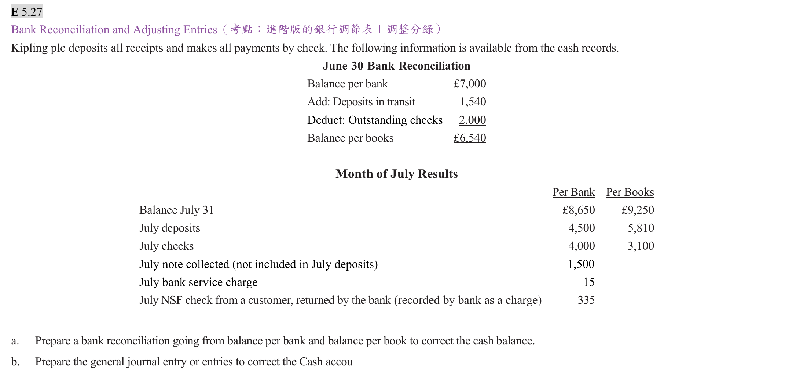

> [!success]- 展開詳解｜先自己做，再核對
> #### 第一步：先算七月底還沒到銀行的存款
>
> 六月在途 1,540＋七月公司存入 5,810−七月銀行入帳 4,500＝**2,850**。
>
> 白話：原本在路上的，加上本月新存的，扣銀行本月實際收到的，就是月底仍未入帳的。題目特別說代收票據 1,500 **not included in July deposits**，所以不要再從 4,500 裡扣掉 1,500。
>
> #### 第二步：算七月底還沒兌現的支票
>
> 六月未兌現 2,000＋七月公司開票 3,100−七月銀行兌現 4,000＝**1,100**。
>
> 銀行七月兌現的可能包括六月開的票，所以 4,000 大於 3,100 不矛盾。助教的逐批解釋假設六月未兌現支票在七月兌現；用上面餘額滾動公式即可核對期末總額。
>
> #### 第三步：完成 (a) 兩端調節
>
> | 銀行端 Bank side | 金額 | 公司端 Book side | 金額 |
> |---|---:|---|---:|
> | 原餘額 | 8,650 | 原餘額 | 9,250 |
> | ＋在途存款 | 2,850 | ＋代收票據 | 1,500 |
> | −未兌現支票 | (1,100) | −銀行手續費 | (15) |
> |  |  | −NSF 退票 | (335) |
> | **正確現金餘額** | **10,400** | **正確現金餘額** | **10,400** |
>
> 這才是完整的銀行調節表答案。2,850 和 1,100 是中間計算結果，不是本題的全部答案。
>
> #### 第四步：完成 (b) 公司調整分錄
>
> 公司還沒記的有三件事，先分三筆理解：
>
> ```text
> 銀行代收票據：
> 借：現金 Cash                         1,500
>     貸：應收票據 Notes Receivable             1,500
>
> 銀行收手續費：
> 借：辦公費用—銀行手續費 Office Expense   15
>     貸：現金 Cash                                15
>
> 客戶支票退票：
> 借：應收帳款 Accounts Receivable        335
>     貸：現金 Cash                               335
> ```
>
> 退票只代表這次沒收到錢，要把客戶欠款恢復，不是直接認壞帳。
>
> 助教解答把三筆合併成一筆：現金淨增加＝1,500−15−335＝**1,150**。
>
> ```text
> Dr. Cash                              1,150
> Dr. Office Expense (Bank Charges)        15
> Dr. Accounts Receivable                 335
>     Cr. Notes Receivable                      1,500
> ```
>
> 兩種寫法效果相同。借方 1,150＋15＋335＝貸方 1,500。
>
> **最後自查：**在途存款與未兌現支票，公司已經記過，不再做公司分錄。兩端都調成 10,400，公司現金的淨增加則是 1,150，這兩個數字回答不同問題。


**陷阱：代收票據、利息或記帳錯誤若混入比較數字，要先拆開。**

另注意：若公司 Cash 帳含庫存現金，題目可能像 P5.13 一樣，把庫存現金加在銀行端調到「總現金」。如果只是調節銀行存款，就不能隨便把零用金加進去。


> [!tip] 先懂這題的道理
> **這題公司的「現金」帳戶包含沒有存進銀行的庫存現金，所以銀行端要把庫存現金加上去，兩端比較的才是同一個範圍。**
> - 銀行對帳單只知道銀行裡的錢，不知道公司保險箱裡的錢。
> - 調節表兩端必須衡量同一個東西；公司帳包含什麼，銀行端就補到同樣的範圍。
> - 題目沒有明列庫存現金時，不要自己加。

> [!example]- 展開助教 P5.13 完整原題（含所有條件與要求）
> **助教 P5.13 完整原題**｜來源：[助教講義 PDF 第 8、9 頁](附件/TA%20Handout%20-%20Ch%205.pdf#page=8)。下圖保留完整英文題幹、表格與全部小題，未包含解答。
>
> 這裡引用的是銀行調節與現金範圍，優先練 (b)、(c)；(a) 零用金撥補未在本次公告明列，保留完整原題供核對，不額外列為必讀。
>
> 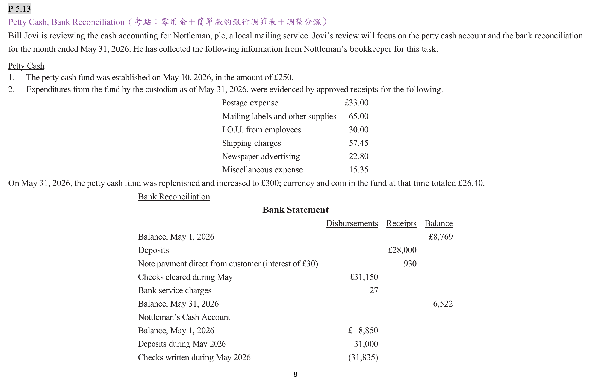
>
> 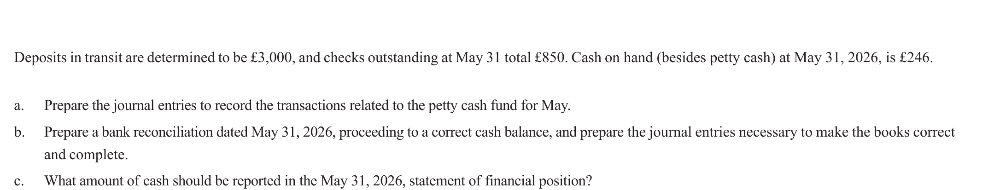
> [!success]- 展開 P5.13 的銀行調節與現金範圍詳解
> P5.13 的銀行端＝6,522＋在途 3,000−未兌現 850＋另存庫存現金 246＝**8,918**。
>
> 公司端原餘額＝8,850＋31,000−31,835＝8,015；加代收款 930、減手續費 27，得到 **8,918**。原題另列零用金 300，因此報表現金合計 **9,218**。
>
> 代收 930 含票據本金 900 與利息 30：借 Cash 930，貸 Notes Receivable 900、Interest Revenue 30。手續費：借 Office Expense 27，貸 Cash 27。246 是題目另外明列的庫存現金；不是每題都能自行在銀行端加零用金。


### 教材原圖｜把兩邊調到同一個正確現金餘額

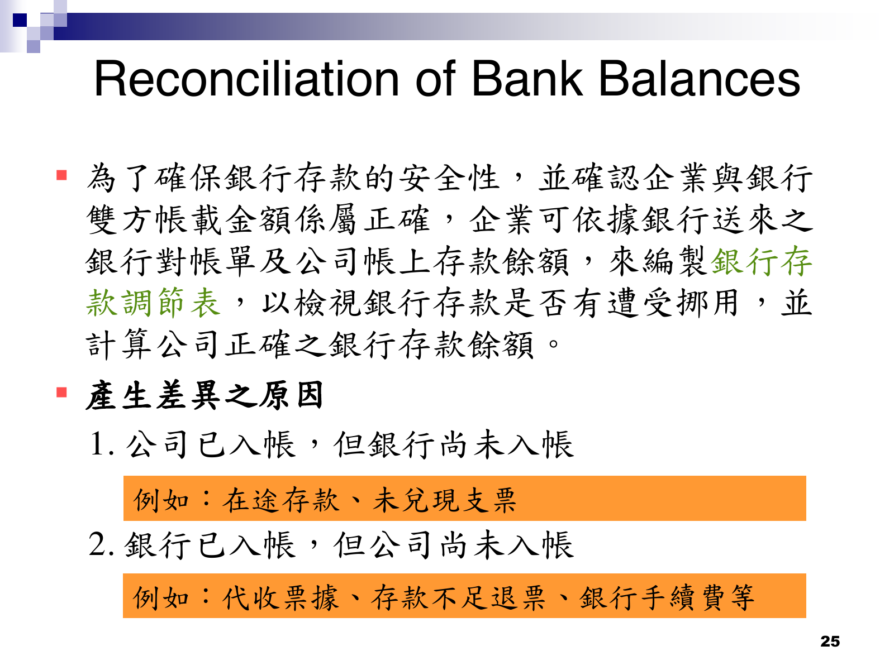

來源：[Ch 05_Cash and Receivables.pdf，PDF 第 25 頁](附件/Ch%2005_Cash%20and%20Receivables.pdf#page=25)。先讀上面的白話步驟，再對照原圖；點圖可放大。


### 拿分順序

1. 先畫銀行端與公司端兩欄，抄原始餘額。
2. 每個條件先標「誰還沒記／誰記錯」，再寫正負。
3. 兩端調整後必須相等；不相等先檢查退票、錯誤差額。
4. 只有公司端需要補公司分錄。代收票據如果含利息，本金貸應收票據，利息貸利息收入。

## 真題實戰｜113-1 計算第 1 題：先倒推未達帳，再調兩端

> [!tip] 先懂這題的道理
> **和 E5.27 同一種題型：先算四月底的在途存款和未兌現支票，再兩端調節；這題要讀懂的條件是代收票據「不包含在四月存款中」。**
> - 銀行代收的票據不是公司存進去的錢，本來就不該拿來和公司的存款數字比。
> - 如果銀行的存款數字裡含有它，要先扣掉，否則它會被誤算進在途存款。
> - 題目寫 not included，代表銀行的存款數字已經不含它，直接用即可。


112-1 也有相同核心題目；此處以 113-1 原題練習，不重複做一遍。兩年小題配分可能不同，本次仍依老師公告。

[113-1 原卷，PDF 第 5 頁](附件/歷屆試題/113-1%20Midterm%20I%20with%20ans_posted.pdf#page=5)。下圖只保留題目，已避開原卷解答。

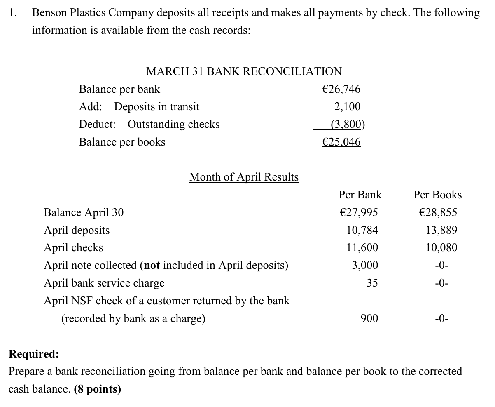

**讀題抓詞：**上月（March 31）、本月（April）、不包含在存款中（not included in April deposits）都要圈起來。

先自己圈出日期、金額、問題要求，再寫算式或分錄。

> [!success]- 展開詳解｜先寫完，再看推理與答案
> ### 先用中文理解題目
>
> 銀行與公司月底的錢對不起來。題目沒有直接給四月底的在途存款和未兌現支票，而是給三月底留下的差額與四月兩邊的記錄，所以要先算「月底還剩多少沒同步」。
>
> ### 第一步：四月底在途存款（Deposits in transit）
>
> 三月底 2,100＋四月公司記存款 13,889−四月銀行入帳存款 10,784＝**5,205**。
>
> 為什麼加上月？銀行這個月入帳的 10,784，含部分公司上個月就存的款；不能直接拿本月兩欄相減。題目特別說代收票據 3,000 不在 April deposits 裡，這裡不用再扣掉它。
>
> ### 第二步：四月底未兌現支票（Outstanding checks）
>
> 三月底 3,800（題目表示為減項是為了表示bank to book，實際有3800沒兌現為正）＋四月公司開票 10,080−四月銀行兌現 11,600＝**2,280**。
>
> 銀行本月兌現會含上月開出的支票，所以金額大於本月開票並不奇怪。
>
> ### 第三步：編銀行端
>
> | Bank side | 金額 |
> |---|---:|
> | Balance per bank | 27,995 |
> | Add: Deposits in transit | ＋5,205 |
> | Less: Outstanding checks | −2,280 |
> | Corrected cash balance | **30,920** |
>
> ### 第四步：編公司端
>
> | Book side | 金額 |
> |---|---:|
> | Balance per books | 28,855 |
> | Add: Note collected | ＋3,000 |
> | Less: Bank service charge | −35 |
> | Less: NSF check | −900 |
> | Corrected cash balance | **30,920** |
>
> ### 自編延伸：若再問公司分錄
>
> 原題只要求調節表。以下幫你連到分錄，並非原題多了一小題。
>
> ```text
> Dr. Cash                         3,000
>     Cr. Notes Receivable                 3,000
> Dr. Bank Service Charge Expense     35
>     Cr. Cash                                35
> Dr. Accounts Receivable            900
>     Cr. Cash                               900
> ```
>
> Cash＝現金；NSF 是客人支票跳票，欠款恢復，所以借 Accounts Receivable。不要對 5,205、2,280 再記一次公司分錄。
>
> **最後自查：兩邊都是 30,920，而不是直接選銀行或公司的原餘額。**


# 題型二｜應收帳款出售與追索權

## 教學｜把應收帳款轉給別人，什麼時候算「賣掉」、什麼時候算「借錢」？

### 公司為什麼要轉讓應收帳款？
**為了提早拿到現金：客戶幾十天後才付款，公司現在就把收款權利轉給承購商（factor，專門買應收帳款的金融機構），扣掉手續費後先拿錢。**
- 之後由承購商向客戶收款，或由公司代收後轉交。
- 會計上這筆交易只有兩種本質：公司把一項資產賣掉了，或公司拿應收帳款當擔保借了一筆錢。

### 判斷是賣掉還是借錢，看什麼？
**看「客戶不付錢」的風險最後由誰承擔；風險還留在公司身上，就代表公司沒有真的賣掉。**
- 擁有一項資產，就是承擔它的好處和壞處；應收帳款的壞處就是收不回來。
- 無追索（without recourse）：客戶倒帳由承購商自己吞，風險和報酬都移轉了，公司把應收帳款從帳上移除，這叫除列（derecognition）。
- 完全追索（with recourse，保證全部信用損失）：客戶倒帳公司要全額賠，風險完全沒移出去；公司只是先拿錢、之後負責還，本質是借款，應收帳款留在帳上，另記一筆負債。
- 有限追索（只保證到某個上限）：風險一部分移出、一部分留下，這時要再看第二個問題：控制。
- 看實質不看名稱：投影片的例子是合約寫「無追索」，但銀行收到客戶的錢才付給公司，收款風險其實還在公司。

### 有限追索為什麼還要看「控制」？
**控制指承購商能不能自由把這批帳款再賣給別人；承購商不能賣，代表公司實質上還綁在這批帳款上，所以保證範圍內的部分要繼續留在帳上。**
- 放棄控制（surrender control）：帳款全部除列，只另記一筆財務保證負債。
- 保留控制（does not surrender control）：保證範圍內的應收帳款留帳，同時記一筆等額的持續參與相關負債（continuing involvement liability），其餘除列。
- 兩種情況都要記財務保證負債，金額是這個保證「現在值多少」，也就是保證的公允價值，不是最高保證額。

### 手續費和保留款為什麼處理方式不同？
**手續費是公司付出去、拿不回來的代價，所以是損失或利息費用；保留款是承購商暫時扣住、之後會還的錢，所以是公司的資產。**
- 承購商扣保留款，是為了抵之後客戶的退貨或折讓，沒用到就退還公司。
- 賣掉的情況，手續費記「出售應收帳款損失」；借款的情況，手續費本質是借錢的成本，記利息費用。
- 下面 A 到 D 的分錄，都是這三個判斷（風險、控制、保證公允價值）的結果。


## 先懂中文，再認英文

| 中文概念       | 英文題目會怎麼寫                                           | 看到它要做什麼           |
| ---------- | -------------------------------------------------- | ----------------- |
| 應收帳款讓售     | Factoring / transfer of receivables                | 先判斷是出售或借款         |
| 無追索／有追索    | Without recourse / with recourse                   | 誰承擔信用損失？          |
| 有限追索       | Limited recourse / limited guarantee               | 最大保證額與保證公允價值分開    |
| 放棄控制／未放棄控制 | Surrender control / does not surrender control     | 注意 does not 會翻轉答案 |
| 除列         | Derecognition                                      | 從帳上移除，不是沖銷壞帳      |
| 保留款／應收承購商款 | Amount retained / Due from Factor                  | 仍是資產，不是手續費        |
| 持續參與相關負債   | Continuing Involvement Liability                   | 本課保留控制題與保留的應收款對應  |
| 財務保證負債     | Recourse Liability / financial guarantee liability | 有限追索用保證公允價值       |


## 應收帳款移轉：高分關鍵是風險與控制

先別急著算，依序判斷：

1. 是否已移轉收款權利，或符合轉付安排？
2. 幾乎所有風險與報酬是否移轉？
3. 若既未全部移轉、也未全部保留，再看控制。

本課常見題型可整理成：

| 情況 | 應收帳款 |
|---|---|
| 無追索且符合出售條件 | 全部除列 |
| 完全保證信用損失，保留幾乎所有風險 | 不除列，按融資處理 |
| 有限保證，既未移轉也未保留幾乎所有風險，且放棄控制 | 全部除列，另認保證負債 |
| 同上，但保留控制 | 在持續參與範圍內保留，其餘除列 |

**不能只看到合約標題「無追索」就決定。**老師投影片有案例：名義上無追索，但銀行收得到客戶款項才付錢給公司，實際收款風險仍可能留在公司。

### A. 無追索出售：保留款不是費用

應收帳款 400,000，手續費 1.5%，銀行保留 4%：

- 手續費＝6,000。
- 保留款＝16,000。
- 現金＝400,000－6,000－16,000＝378,000。

```text
借：現金                 378,000
借：應收承購商款          16,000
借：出售應收帳款損失       6,000
    貸：應收帳款                400,000
```

**保留款仍是公司對承購商的權利，不是直接認損失。**

### B. 完全追索：看起來出售，實質是借款

應收帳款 200,000，收現 190,000，保證全部信用損失：

```text
借：現金                 190,000
借：利息費用              10,000
    貸：應收帳款移轉負債        200,000
```

**原本的應收帳款 200,000 留在帳上。**


> [!tip] 先懂這題的道理
> **有限追索又保留控制，所以帳款拆成兩塊：保證範圍內的 80,000 留在帳上，其餘 720,000 除列；保證義務本身另記一筆按公允價值的負債。**
> - 80,000 是公司最多可能要賠的金額，代表公司還綁在這批帳款上的部分，所以它決定留帳多少、持續參與負債多少。
> - 18,000 是這個保證義務現在的公允價值，也就是預期要賠多少的估計，所以它決定財務保證負債的金額。
> - 損失是公司為了賣掉帳款付出的全部代價：手續費 8,000 加上新承擔的保證義務 18,000。

**助教 E5.20 完整原題**｜來源：[助教講義 PDF 第 19 頁](附件/TA%20Handout%20-%20Ch%205.pdf#page=19)。下圖保留完整英文題幹、表格與全部小題，未包含解答。

原題 (a) 為公司 Brubaker；(b) 為承購商 Calder。本次只練 (a)，但原題兩小題完整保留。下方 C-0 的「放棄控制」是自編變形；原題明寫 retained control。

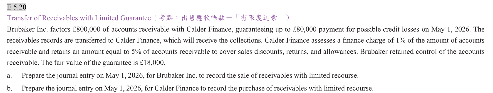


### C-0. 有限追索但已放棄控制：全額除列

沿用下方 E5.20 的數字，但**改成放棄控制**，且題目已判定既未保留、也未移轉幾乎所有風險與報酬：

```text
借：現金                  752,000
借：應收承購商款           40,000
借：出售應收帳款損失       26,000
    貸：應收帳款                 800,000
    貸：財務保證負債              18,000
```

80,000 是最大保證額，不是直接認列的保證負債。放棄控制時不保留這 80,000 應收款，也不另認持續參與相關負債。真正認列的保證負債使用題目給的**公允價值 18,000**。

### C. 有限追索且保留控制：兩種負債不要混

助教 E5.20：

- 應收帳款 800,000。
- 最大保證 80,000。
- 保證公允價值 18,000。
- 手續費 8,000。
- 保留款 40,000。
- 保留控制。

**第一步：現金。**

800,000－8,000－40,000＝752,000。

**第二步：保留與除列金額。**

- 持續參與保留的應收款＝80,000。
- 除列＝800,000－80,000＝720,000。

**第三步：負債。**

- 持續參與相關負債＝80,000。
- 財務保證負債＝18,000。

```text
借：現金                 752,000
借：應收承購商款          40,000
借：出售應收帳款損失      26,000
    貸：應收帳款                720,000
    貸：持續參與相關負債         80,000
    貸：財務保證負債             18,000
```

**最常扣分：把最大保證額 80,000，跟保證公允價值 18,000 當成同一個數字。**

### D. 保證責任結束時

假設原認保證負債 40,000，最後實際賠 120,000：

```text
借：財務保證負債           40,000
借：保證清償損失           80,000
    貸：現金                    120,000
```

若之前保留控制，還要將尚留存的應收款與持續參與相關負債結清。

**本課保證責任到期且無其他剩餘義務的題型中**，若最後沒有賠款，原保證負債轉為保證收入；若賠款小於保證負債，差額為收入。

另外要分清：

- 「最多替壞帳賠 200,000」
- 「保證至少能收到 200,000」

後者的實際賠款是最低保證收款額與實收的差額。老師第 92～94 頁就是這種變形題。


### 教材原圖｜先走除列判斷流程，再寫分錄

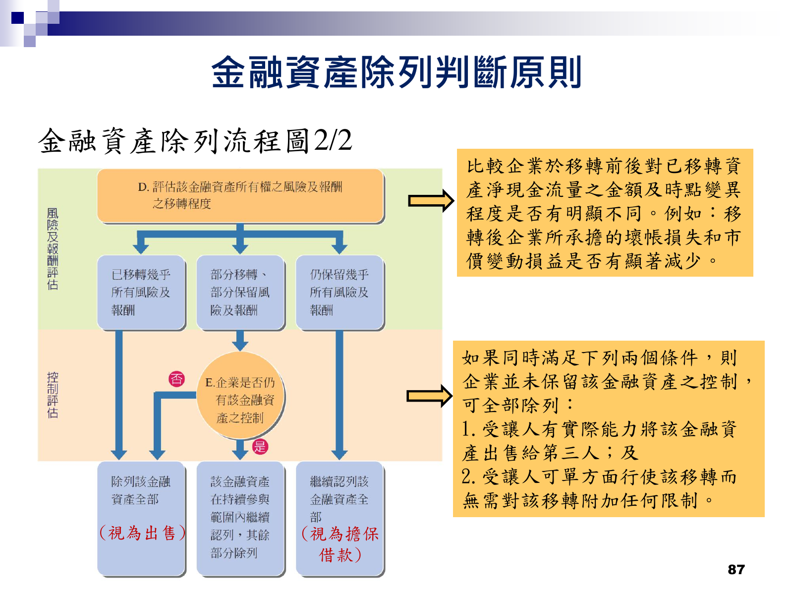

來源：[Ch 05_Cash and Receivables.pdf，PDF 第 87 頁](附件/Ch%2005_Cash%20and%20Receivables.pdf#page=87)。先讀上面的白話步驟，再對照原圖；點圖可放大。


### 教材原圖｜有限追索原題：分清最大保證額與保證公允價值

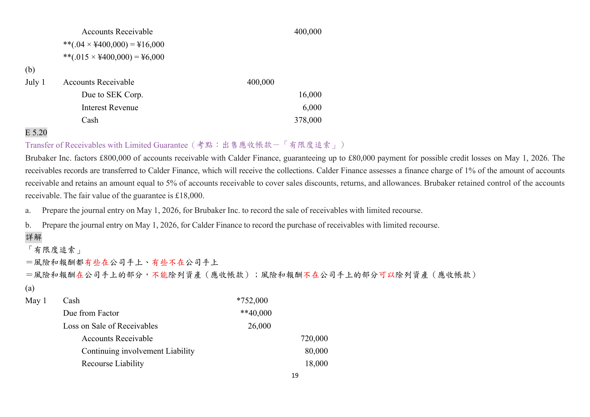

來源：[TA Handout - Ch 5.pdf，PDF 第 19 頁](附件/TA%20Handout%20-%20Ch%205.pdf#page=19)。先讀上面的白話步驟，再對照原圖；點圖可放大。


### 有限追索的後續分錄，也要練到會

用剛才保留控制的 E5.20 數字做自編變化：最大保證 80,000、原保證負債 18,000；到期實際賠 25,000，保證責任全部結束，沒有其他未清項目。

第一步：結清保留的應收款與持續參與相關負債。第二步：沖掉原保證負債。第三步：付出現金。差 7,000 才是新增損失。

```text
借：持續參與相關負債       80,000
借：財務保證負債           18,000
借：保證清償損失            7,000
    貸：應收帳款                  80,000
    貸：現金                      25,000
```

如果最初已放棄控制，就沒有上面 80,000 這一組結清；只處理 18,000、7,000 與 25,000。

### 無追索的保留款，最後怎麼收尾

保留款 16,000，最後沒有退貨折讓，承購商全數退還：借現金 16,000，貸應收承購商款 16,000。若發生由保留款扣除的銷貨退回 3,000：先借銷貨退回 3,000、貸應收承購商款 3,000；收到剩下款項時，借現金 13,000、貸應收承購商款 13,000。這裡只示範應收款端；題目若另給退貨成本，還要處理存貨端。

## 真題實戰｜113-1 計算第 2 題：同一筆帳款，三種追索條件

> [!tip] 先懂這題的道理
> **三小題的現金和保留款完全相同，因為承購商付多少錢不受會計判斷影響；會改變的只有「應收帳款要不要移除」和「手續費叫損失還是利息」。**
> - 無追索：風險已移轉，是出售，帳款全部移除，手續費是出售損失。
> - 完全追索：風險全在公司，是借款，帳款留著，貸記一筆負債，手續費是借錢的利息。
> - 有限追索、未放棄控制：保證的 300,000 留帳並記等額負債，另記保證公允價值 40,000 的負債。
> - 第 (3) 小題損失＝交出的帳款 800,000－拿回的淨對價（現金 736,000＋保留款 16,000－新承擔的保證 40,000）＝88,000。


112-1 也有相同核心題目；此處以 113-1 原題練習，不重複做一遍。兩年小題配分可能不同，本次仍依老師公告。

[113-1 原卷，PDF 第 6 頁](附件/歷屆試題/113-1%20Midterm%20I%20with%20ans_posted.pdf#page=6)。下圖只保留題目，已避開原卷解答。

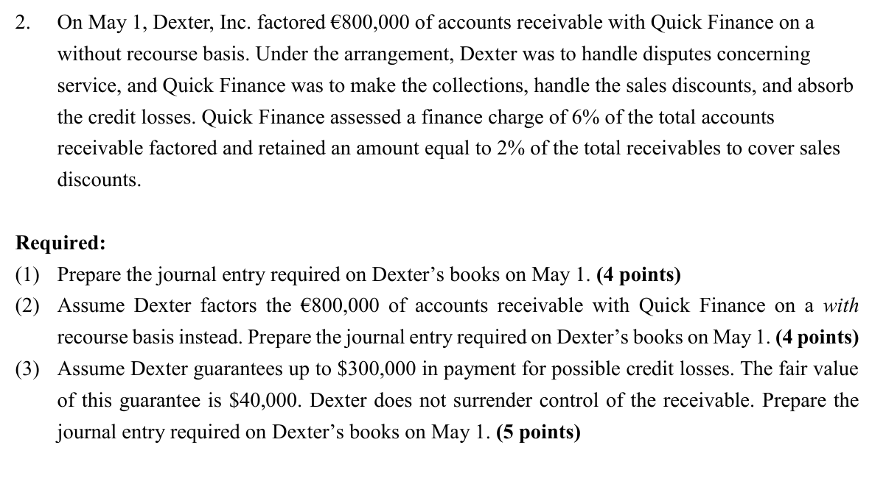

**讀題抓詞：**without recourse＝無追索；with recourse＝完全追索題型；does not surrender control＝未放棄控制。

先自己圈出日期、金額、問題要求，再寫算式或分錄。

> [!success]- 展開詳解｜先寫完，再看推理與答案
> ### 先把每種情境共用的數字算好
>
> 1. 應收帳款（Accounts Receivable）＝800,000。
> 2. 手續費（Finance charge）＝800,000 × 6%＝**48,000**。
> 3. 保留款（Due from Factor）＝800,000 × 2%＝**16,000**。
> 4. 實收現金（Cash）＝800,000−48,000−16,000＝**736,000**。
>
> 保留款是承購商暫時扣住、之後用於折扣結算的錢，仍是公司的應收權利，不是第二筆費用。原題第 (3) 小題改用 $ 符號，主幹用 €；原解答直接沿用金額計算，這裡也不自行引入匯率。
>
> ### (1) 無追索：應收帳款全部移出
>
> 承購商承擔信用損失（absorb the credit losses），本題按真正出售。
>
> ```text
> Dr. Cash                         736,000
> Dr. Due from Factor               16,000
> Dr. Loss on Sale of Receivables    48,000
>     Cr. Accounts Receivable               800,000
> ```
>
> 借方依序是現金、應收承購商款、出售損失；貸方移除原應收帳款。三個借方合計 800,000。
>
> ### (2) 完全追索：本課按擔保借款
>
> 公司還承擔全部信用風險，應收帳款繼續留帳。錢拿到了，但同時欠承購商，所以貸負債。
>
> ```text
> Dr. Cash                         736,000
> Dr. Due from Factor               16,000
> Dr. Interest Expense              48,000
>     Cr. Recourse Liability                800,000
> ```
>
> **科目用字提醒：原卷這題把整筆移轉負債寫成 Recourse Liability 800,000。**前面的教學稱「應收帳款移轉負債」；要靠交易性質分辨。下一小題同樣的 Recourse Liability 則只有保證公允價值 40,000，兩者不能混淆。英文作答可依本卷解答的科目名稱，中文理解要記清楚用途。
>
> ### (3) 有限追索、保留控制
>
> 本題依課程有限追索處理，先確認保留控制（does not surrender control）。
>
> 1. 最大保證金額（guarantees up to）＝300,000。
> 2. 保留的應收款＝min(800,000, 300,000)＝300,000。
> 3. 本次除列應收款＝800,000−300,000＝**500,000**。
> 4. 持續參與相關負債＝**300,000**。
> 5. 財務保證負債依公允價值＝**40,000**，不是 300,000。
> 6. 損失＝48,000 手續費＋40,000 新保證負債＝**88,000**。
>
> ```text
> Dr. Cash                         736,000
> Dr. Due from Factor               16,000
> Dr. Loss on Sale of Receivables    88,000
>     Cr. Accounts Receivable               500,000
>     Cr. Continuing Involvement Liability  300,000
>     Cr. Recourse Liability                 40,000
> ```
>
> 借方 840,000＝貸方 840,000。資產負債表上仍有 300,000 應收款；不是帳款面額改成 500,000。
>
> ### 自編變形：如果改成 surrendered control
>
> 若仍屬既未移轉也未保留幾乎全部風險、但已放棄控制，就全額除列 800,000，不認 300,000 持續參與負債；仍認 40,000 保證負債，現金、保留款與損失不變。這個小變形是理解練習，不是原題。


## 真題實戰｜112-1 計算第 7 題：有限追索的後續結清

> [!tip] 先懂這題的道理
> **保證責任一結束，公司和這批帳款的牽連也結束，所以當初留帳的應收帳款和對應負債一起沖掉；當初估計的保證負債沒有用上，轉成收入。**
> - 「保證至少收回 80%」等於公司承諾補足到 320,000，所以持續參與的金額是 320,000，不是 80,000。
> - 客戶全數付款給銀行，公司不用賠，保證負債 7,200 消失又不用付錢，就是一筆利益（保證收入）。
> - 錢是銀行收的，公司在結清時不會再借記現金。


[112-1 原卷，PDF 第 11 頁](附件/歷屆試題/112-1%20Midterm%20I%20with%20sol_posted.pdf#page=11)。下圖只保留題目，已避開原卷解答。

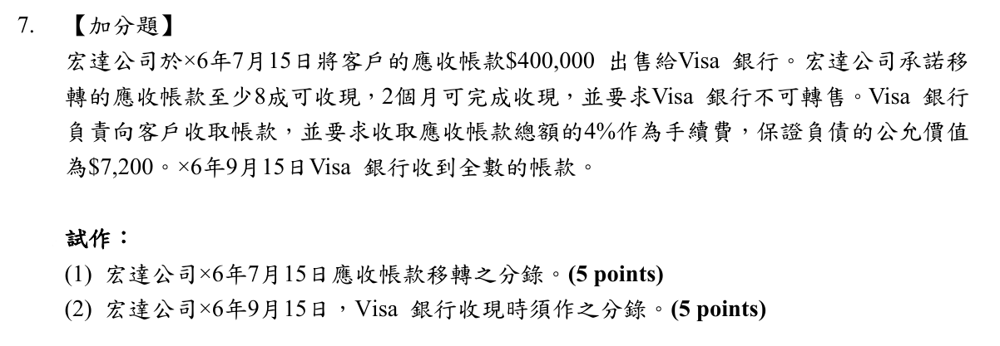

**讀題抓詞：**至少八成可收現＝guarantees collection of at least 80%；不得轉售＝the bank is not allowed to resell。這是原中文題的英文對照，不冒充原卷英文。

先自己圈出日期、金額、問題要求，再寫算式或分錄。

> [!success]- 展開詳解｜先寫完，再看推理與答案
> ### 先釐清原題的小歧義
>
> 第 (2) 小題文字提到 Visa 銀行收現，但附解答寫的是宏達公司的帳。**本次公告只要求 company side，所以此處跟著原解答，練宏達公司端。**「銀行向客戶收錢」不等於宏達公司再收到一次現金。
>
> ### 移轉日：先找還保證多少
>
> 1. 帳款 400,000；最低保證收回 80%＝**320,000**。
> 2. 銀行不得轉售，本題保留控制（retains control）。
> 3. 持續參與範圍＝min(400,000, 320,000)＝**320,000**。
> 4. 除列部分＝400,000−320,000＝**80,000**。
> 5. 手續費＝400,000 × 4%＝16,000；收現＝**384,000**。
> 6. 財務保證公允價值＝7,200；損失＝16,000＋7,200＝**23,200**。
>
> ```text
> 借：現金 Cash                             384,000
> 借：出售金融資產損失 Loss on Transfer      23,200
>     貸：應收帳款 Accounts Receivable               80,000
>     貸：金融資產移轉負債 Transfer Liability        320,000
>     貸：保證負債 Guarantee Liability                7,200
> ```
>
> 這裡的 Transfer Liability 對應本課持續參與部分。英文名稱是學習對照，原題與解答本身是中文。
>
> ### 兩個月後：銀行全部收到了
>
> 沒有壞帳，宏達不用賠錢；保證責任結束。將保留的應收款與負債沖掉，原估計的 7,200 保證義務不再需要，轉為保證收入。
>
> ```text
> 借：金融資產移轉負債 Transfer Liability    320,000
> 借：保證負債 Guarantee Liability            7,200
>     貸：應收帳款 Accounts Receivable              320,000
>     貸：保證收入 Guarantee Revenue                  7,200
> ```
>
> 這筆**沒有借現金 400,000**，因為那是 Visa 向客戶收到，不是宏達收的。
>
> **最容易誤讀：**「至少收回 320,000」是最低收款承諾，不是「最多只賠 80,000」。如果客戶一毛都沒付，公司在此保證下可能得補足 320,000。


# 題型三｜指定應收帳款作擔保借款

## 教學｜拿應收帳款去擔保借錢，為什麼應收帳款不動？

### 這和「出售應收帳款」差在哪裡？
**擔保只是把應收帳款押給銀行，收款權利和倒帳風險都還在公司，所以應收帳款照樣留在帳上，另外多一筆借款負債。**
- 公司仍然自己向客戶收款，收到後再拿去還銀行。
- 銀行只有在公司還不出錢時，才能動用這批應收帳款。
- 所以帳上同時有兩個獨立關係：客戶欠公司（應收帳款），公司欠銀行（應付票據）。

### 手續費和利息為什麼用不同的數字去乘？
**手續費是「借款當天」一次收的費用，計算基準「由題目指定」（應收帳款或借款金額）

；利息隨時間累積，一定是「還欠的本金×年利率×期間」。**
- 「手續費＝利息費用」，因為它本質上也是借錢的成本。
- 還款時沖的是「應付票據」變成欠銀行；沖「應收帳款」只發生在「客戶付錢給公司」的時候（只衝這個，其他的不管）。

手續費母數看題目
利息母數看借款金額（不是應收帳款）


## 先懂中文，再認英文

| 中文概念      | 英文題目會怎麼寫                                  | 看到它要做什麼      |
| --------- | ----------------------------------------- | ------------ |
| 指定應收帳款作擔保 | Assigns accounts receivable as collateral | 原應收帳款不消失     |
| 擔保借款      | Secured borrowing                         | 認借款負債        |
| 借款本金／應付票據 | Loan principal / Notes Payable            | 還本金借記負債      |
| 手續費       | Finance charge                            | 先圈按應收款還是借款計算 |
| 年利率       | Interest rate on the loan                 | 按借款餘額與期間算    |
| 繼續收款      | Continue to collect the receivables       | 收客戶款與還銀行分開   |


> [!tip] 先懂這題的道理
> **這題分三個時間點，每個時間點只處理一個關係：借款日處理公司和銀行，收款日處理公司和客戶，還款日再處理公司和銀行。**
> - 借款日：手續費按應收帳款 500,000 的 2% 計，從借到的 300,000 裡先扣掉。
> - 收款日：客戶付的錢只沖應收帳款，和銀行借款無關。
> - 還款日：利息按借款本金 300,000、年利率 10%、借了 3 個月計算，連同本金一起付。

**助教 E5.15 完整原題**｜來源：[助教講義 PDF 第 16 頁](附件/TA%20Handout%20-%20Ch%205.pdf#page=16)。下圖保留完整英文題幹、表格與全部小題，未包含解答。

原題年利率 **10%**，4/1 借款、7/1 還款，共 **3 個月**，並要求 (a) 借款、(b) 收款、(c) 還款三個階段。

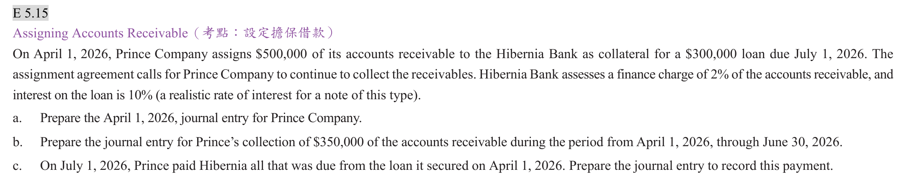

> [!success]- 展開詳解｜先自己做，再核對
> (a) 手續費＝500,000 × 2%＝10,000；借 Cash 290,000、Interest Expense 10,000，貸 Notes Payable 300,000。
>
> (b) 收客戶貨款：借 Cash 350,000、貸 Accounts Receivable 350,000，不影響銀行借款本金。
>
> (c) 7/1 還款利息＝300,000 × 10% × 3/12＝**7,500**；借 Notes Payable 300,000、Interest Expense 7,500，貸 Cash **307,500**。
>
> 下方若以 12%、一個月示範，屬自編變形，不是本題 (c) 原答案。


## 擔保借款：應收帳款還在，另外多一筆借款

公司拿 500,000 應收帳款作擔保，借到 300,000。

手續費按應收帳款 2% 收取：

$$
手續費＝500,000×2\%＝10,000
$$

依本課 E5.15 的處理：

```text
借：現金          290,000
借：利息費用       10,000
    貸：應付票據         300,000
```

**應收帳款不除列。**

之後向客戶收到 350,000：

```text
借：現金          350,000
    貸：應收帳款         350,000
```

還銀行借款則是另一筆交易。

**兩個陷阱：**

- 手續費可能按「應收帳款」或「借款」計算，要讀題目。
- 收到客戶款項與償還銀行借款不是同一筆分錄；若合約要求專款還款，要另外處理。

### 自編變形｜改成 12%、一個月；不是 E5.15 原題條件

延續借款 300,000 的例子，假設借款年利率 12%，一個月後還清本金：

利息＝300,000 × 12% × 1/12＝3,000。

```text
借：應付票據              300,000
借：利息費用                3,000
    貸：現金                     303,000
```

收到客戶款項會沖應收帳款；還銀行才會沖借款。**兩個債務人不同，所以不能混在一起。**本課手續費依助教 E5.15 的分錄列利息費用；不要把借款本金當收入。


### 教材原圖｜擔保借款原題與公司端處理

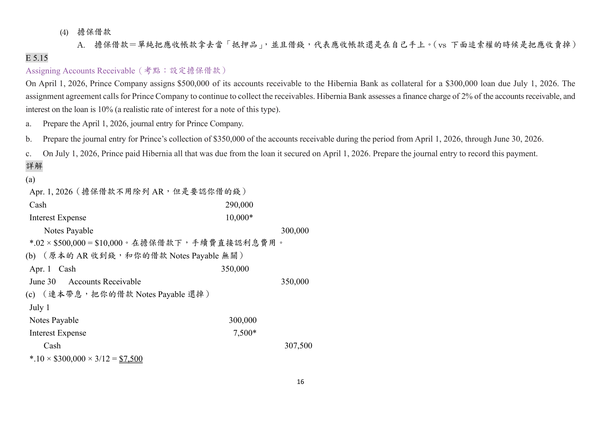

來源：[TA Handout - Ch 5.pdf，PDF 第 16 頁](附件/TA%20Handout%20-%20Ch%205.pdf#page=16)。先讀上面的白話步驟，再對照原圖；點圖可放大。


## 真題實戰｜113-1 計算第 3 題：手續費乘應收款，利息乘借款

> [!tip] 先懂這題的道理
> **手續費按題目指定的應收帳款計算；利息按「這個月實際欠銀行的本金」計算，月底才還 200,000，所以整個月都欠 425,000。**
> - 收到客戶的 200,000 沖應收帳款，拿這筆錢還銀行才沖應付票據，兩件事分開記。
> - 還款後剩 225,000，下個月才按 225,000 計息。


112-1 也有相同核心題目；此處以 113-1 原題練習，不重複做一遍。兩年小題配分可能不同，本次仍依老師公告。

[113-1 原卷，PDF 第 7 頁](附件/歷屆試題/113-1%20Midterm%20I%20with%20ans_posted.pdf#page=7)。下圖只保留題目，已避開原卷解答。

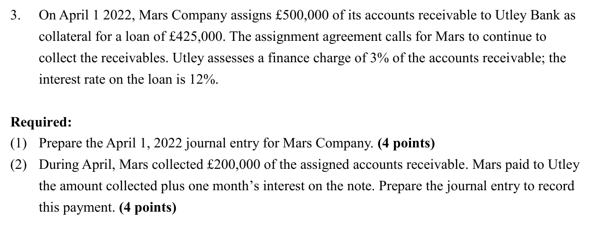

**讀題抓詞：**assigns＝指定作擔保；as collateral＝作擔保品；amount collected plus one month’s interest＝收款金額加一個月利息。

先自己圈出日期、金額、問題要求，再寫算式或分錄。

> [!success]- 展開詳解｜先寫完，再看推理與答案
> ### 用中文講一次整段故事
>
> Mars 有客戶欠它 500,000，把收款權拿去擔保，向銀行借 425,000。銀行先扣手續費；之後 Mars 自己向客戶收回 200,000，再把這 200,000 拿去還部分本金，外加一個月利息。
>
> ### (1) 借款日
>
> 手續費按應收款（3% of the accounts receivable），所以是 500,000 × 3%＝**15,000**，不是 425,000 × 3%。
>
> 實收現金＝425,000−15,000＝**410,000**。
>
> ```text
> Dr. Cash                 410,000
> Dr. Interest Expense      15,000
>     Cr. Notes Payable             425,000
> ```
>
> 依本課原解答，手續費列 Interest Expense。應收帳款尚未出售，不貸記 Accounts Receivable。
>
> ### 中間的收款：把邏輯補完整
>
> ```text
> Dr. Cash                 200,000
>     Cr. Accounts Receivable       200,000
> ```
>
> 這是向客戶收錢；原題第 (2) 要求的是接下來的付款分錄，所以原答案沒有另外列此筆。理解時分開兩個事件，就不會把還銀行也寫成沖應收款。
>
> ### (2) 還部分本金及利息
>
> 本題在月末還 200,000，四月計息本金仍是 **425,000**。
>
> 利息＝425,000 × 12% × 1/12＝**4,250**。
> 現金支出＝200,000＋4,250＝**204,250**。
>
> ```text
> Dr. Notes Payable        200,000
> Dr. Interest Expense       4,250
>     Cr. Cash                      204,250
> ```
>
> 還款後借款餘額＝425,000−200,000＝**225,000**。若未來再算下月利息且無其他變動，才使用剩餘本金。


# 題型四｜損益表項目與保留盈餘

## 教學｜損益表為什麼要一層一層算？

### 損益表要回答什麼？
**它回答「今年賺多少，以及從哪一種活動賺來」；分層是為了讓讀者分清楚本業賺多少、哪些部分以後不會再有。**
- 毛利＝銷貨淨額－銷貨成本，看產品本身賺不賺錢。
- 營業利益再扣銷售和管理費用、加減其他收益費損，看本業整體賺多少。
- 稅前淨利再扣利息等財務成本；利息取決於公司怎麼籌錢，和經營本業是兩件事。
- 繼續營業單位稅後淨利，是未來還會持續的獲利。
- 停業單位（公司決定關閉或出售的一整個部門）的損益放在最後單獨列，因為它以後不會再有，混在一起會誤導對未來獲利的判斷。

### 為什麼停業單位要用稅後金額單獨列？
**它要和繼續營業的部分完全分開，連它造成的所得稅影響也一起帶走，所以列稅後淨額（net of tax）。**
- 稅前損失 260,000、稅率 30%：這筆損失讓公司少繳 78,000 的稅，對淨利的實際影響是 182,000。
- 繼續營業的所得稅只用繼續營業的稅前淨利計算。
- 題目已寫 net of tax，代表稅已經算好，不能再乘一次。

### 為什麼股利和前期錯誤都不進今年的損益表？
**損益表只放今年為了賺錢而發生的收入和費用；股利是賺到之後分給股東，前期錯誤是以前年度的事，兩者都直接調整保留盈餘。**
- 保留盈餘是公司歷年累積的淨利，減去歷年宣告的股利，所以期末保留盈餘＝期初＋本期淨利－本期宣告股利。
- 以前年度少記折舊，代表以前的淨利多算了，累積進期初保留盈餘也多算了；更正時直接調低期初保留盈餘。
- 更正金額用稅後，因為當年少記費用也讓當年的所得稅費用跟著多算，兩者一起更正。
- 如果把它放進今年的費用，今年淨利會被錯誤壓低。


## 先懂中文，再認英文

| 中文概念     | 英文題目會怎麼寫                                    | 看到它要做什麼                    |
| -------- | ------------------------------------------- | -------------------------- |
| 毛利       | Gross profit                                | Sales − Cost of Goods Sold |
| 營業利益     | Income from operations / operating income   | 按本課報表格式分類                  |
| 繼續營業單位   | Continuing operations                       | 與停業損益分開                    |
| 停業單位處分損失 | Loss on disposal of discontinued operations | 確認 pre-tax 或 net of tax    |
| 稅前／稅後    | Pre-tax / net of tax                        | 已稅後不再乘一次稅率                 |
| 少列折舊     | Understatement of depreciation expense      | 看年份，前期錯誤調期初                |
| 保留盈餘     | Retained earnings, RE                       | 更正後期初＋淨利−宣告股利              |
| 已宣告股利    | Dividends declared                          | 不以付現日期決定扣除                 |
| 單位為千元    | In thousands                                | 全題保持同一單位                   |


先想成兩個問題：「今年賺多少？」用損益表；「歷年賺的錢，扣掉分給股東後還留多少？」用保留盈餘。兩張表靠本期淨利接起來。


## 損益表：從銷貨一路算到淨利

依本課助教習題使用的格式：

```text
銷貨收入
－銷貨退回、折讓與折扣
＝銷貨淨額
－銷貨成本
＝毛利
－銷售費用
－管理費用
＋其他收益－其他費損
＝營業利益
－財務成本／利息費用
＝稅前淨利
－所得稅費用
＝繼續營業單位稅後淨利
＋停業單位稅後損益
＝本期淨利
```


> [!tip] 先懂這題的道理
> **先把每個項目分到損益表的層級，再由上往下算；兩筆停業損失已經是稅後，直接放在繼續營業稅後淨利之下。**
> - 銷貨和銷貨成本決定毛利；銷售、管理費用和其他收益費損決定營業利益；利息費用在營業利益之後才扣。
> - 所得稅 1,244,000 題目已給，不用自己乘稅率。
> - 股利在保留盈餘表才扣，不進損益表。

**助教 P2.2 完整原題**｜來源：[助教講義 PDF 第 3 頁](附件/TA%20Handout%20-%20Ch%202%20(1).pdf#page=3)。下圖保留完整英文題幹、表格與全部小題，未包含解答。

原題要求損益表及保留盈餘表，不能只看淨利答案。注意兩筆停業損失都已是 net of tax；期初保留盈餘 980,000，普通股與特別股股利合計 330,000。

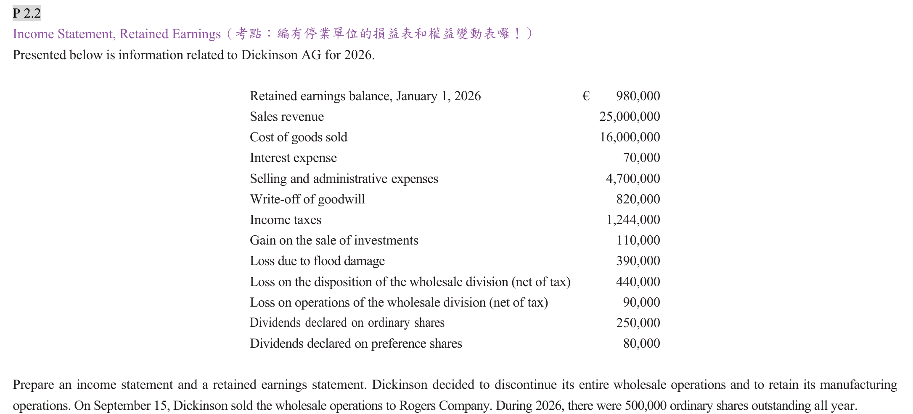


### 用助教 P2.2 拆一次

這裡以「千元」表示：

| 步驟       | 計算             |        結果 |
| -------- | -------------- | --------: |
| 毛利       | 25,000－16,000  |     9,000 |
| 扣銷管費用    | 9,000－4,700    |     4,300 |
| 其他收益及費損  | ＋110－390－820   |    －1,100 |
| 營業利益     | 4,300－1,100    |     3,200 |
| 稅前淨利     | 3,200－70       |     3,130 |
| 繼續營業稅後淨利 | 3,130－1,244    |     1,886 |
| 停業單位損失   | －440－90，題目已是稅後 |      －530 |
| 本期淨利     | 1,886－530      | **1,356** |

**分數藏在哪裡？**毛利、營業利益、稅前淨利、繼續營業淨利、最終淨利都可能各有分數，所以不要只寫最後一個數字。

### 三個容易失分的地方

1. **股利不放進損益表當費用。**
2. **已標示 net of tax 的數字，不要再乘一次稅後比例。**
3. **異常損失不等於停業單位損失。**水災損失、商譽減損，並不因為不常發生就自動變成停業單位。

另外，助教所說的「業外只有利息費用」，適合用來記這組習題的格式，**不能背成適用所有財報的通則**；老師投影片另有臺灣格式與 IFRS 18 的介紹。

## 費用分類：同樣是薪資，位置可能不同

**性質別：看花的是什麼。**

例如薪資、折舊、租金。

**功能別：看花在哪裡。**

例如銷貨成本、銷售費用、管理費用。

同樣是折舊：

- 工廠生產設備折舊：通常先進產品成本。
- 業務部門設備折舊：銷售費用。
- 總公司行政設備折舊：管理費用。

**陷阱：產品成本不一定當期全變費用。**產品還沒賣出，相關成本可能仍在存貨；賣出後才轉成銷貨成本。

### 稅前、稅後要分開算

停業單位損益在本課損益表列為稅後金額。假設停業營業損失 50,000、處分利益 10,000，兩者都是稅前，且均適用 20% 稅率：稅前損失 40,000，稅後損失＝40,000 × 80%＝32,000。

題目已寫 **net of tax** 的數字直接使用，不要再乘一次稅率。

### 教材 P2.2：把大題拆成小算式

1. 毛利＝25,000,000－16,000,000＝9,000,000。
2. 本課格式的營業利益＝9,000,000－4,700,000＋110,000－390,000－820,000＝3,200,000。
3. 稅前淨利＝3,200,000－70,000＝3,130,000。
4. 繼續營業稅後淨利＝3,130,000－1,244,000＝1,886,000。
5. 停業兩項都已是稅後：淨利＝1,886,000－440,000－90,000＝**1,356,000**。
6. 保留盈餘＝980,000＋1,356,000－250,000－80,000＝**2,006,000**。

股利在第 6 步才扣。它是分配獲利，不是賺取收入的費用。原圖下方 EPS 不作本次獨立必練題。


### 教材原圖｜沿著毛利、營業利益、稅前淨利一路往下

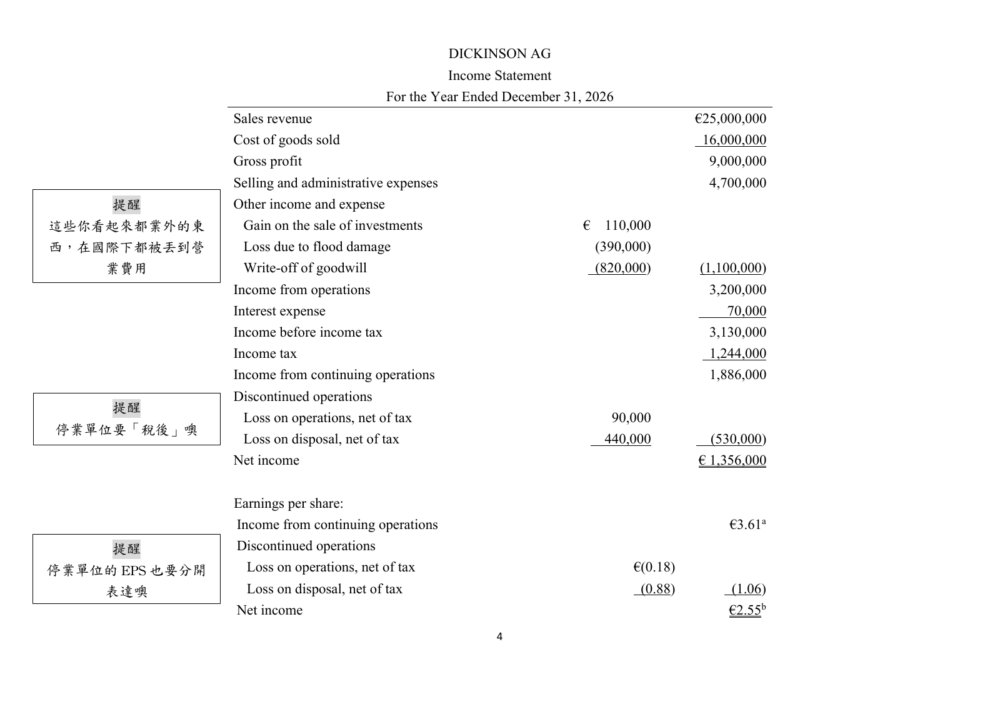

來源：[TA Handout - Ch 2 (1).pdf，PDF 第 4 頁](附件/TA%20Handout%20-%20Ch%202%20(1).pdf#page=4)。先讀上面的白話步驟，再對照原圖；點圖可放大。


### 保留盈餘固定算法

**期末保留盈餘＝更正後期初保留盈餘＋本期淨利－本期宣告股利。**

去年漏記折舊，會讓去年淨利和今年期初保留盈餘太高。若題目要求前期錯誤更正，先調期初，不要又當今年費用扣一次。

例：期初保留盈餘 500,000；去年漏列折舊 20,000，適用稅率 20%；本期淨利 100,000；宣告股利 30,000。

1. 更正金額＝20,000 × 80%＝16,000。
2. 更正後期初＝500,000－16,000＝484,000。
3. 期末＝484,000＋100,000－30,000＝**554,000**。

股利看宣告，不是只看今年付現多少。保留盈餘若提撥為受限制用途，通常是保留盈餘內部分類，總額不因此減少。

## 真題實戰｜113-1 計算第 4 題：先分今年、以前年度，再算稅

> [!tip] 先懂這題的道理
> **先判斷每筆資料屬於「今年的損益」、「停業單位」還是「以前年度」，因為三者放進報表的位置不同，稅的算法也不同。**
> - 今年的收入和費用進損益表，所得稅按繼續營業稅前淨利×30%。
> - 停業單位損失題目寫稅前，要乘 (1－30%) 變成稅後再單列。
> - 2020 年少記的折舊屬於以前年度，影響的是期初保留盈餘，按稅後金額調整，不碰今年淨利。
> - 股利最後在保留盈餘扣。


112-1 也有相同核心題目；此處以 113-1 原題練習，不重複做一遍。兩年小題配分可能不同，本次仍依老師公告。

[113-1 原卷，PDF 第 8 頁](附件/歷屆試題/113-1%20Midterm%20I%20with%20ans_posted.pdf#page=8)。下圖只保留題目，已避開原卷解答。

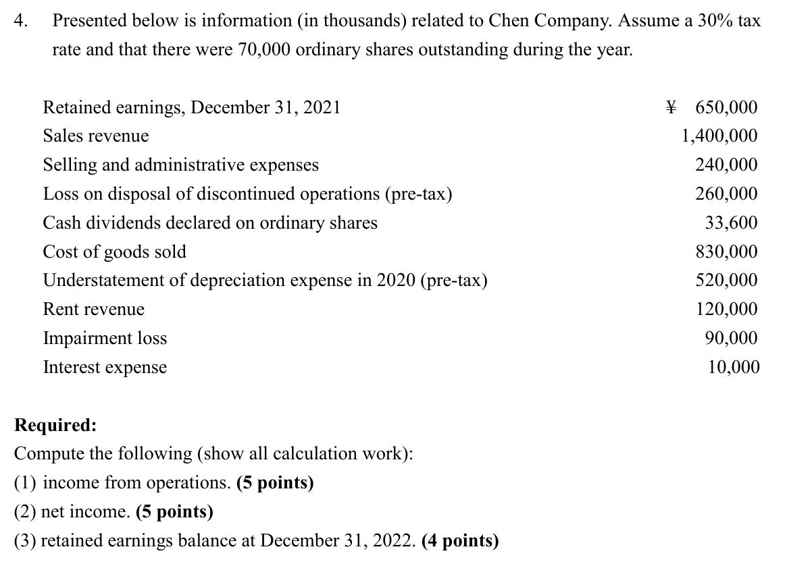

**讀題抓詞：**in thousands＝單位為千；pre-tax＝稅前；understatement in 2020＝以前年度漏列，不是今年費用。

先自己圈出日期、金額、問題要求，再寫算式或分錄。

> [!success]- 展開詳解｜先寫完，再看推理與答案
> ### 第零步：先把資料分成三堆
>
> | 哪一堆 | 本題項目 | 放哪裡 |
> |---|---|---|
> | 本期一般損益 | Sales、COGS、銷管費、Rent revenue、Impairment loss、Interest expense | 本期損益表 |
> | 停業單位 | Loss on disposal of discontinued operations 260,000 | 轉稅後後加減本期淨利 |
> | 權益與前期錯誤 | 期初 RE、2020 漏折舊、股利 | 保留盈餘計算 |
>
> 全題以題目標示的千元計算，最後答案也是千元。普通股 70,000 股在本題三個要求中用不到，不要看到股數就自動算 EPS。
>
> ### (1) 營業利益（Income from operations）
>
> 按本課原卷格式，租金收入與減損損失放入營業利益計算：
>
> 1,400,000−830,000−240,000＋120,000−90,000＝**360,000**。
>
> Interest expense 在下一步才扣。前期漏折舊不是本期 impairment loss，也不是今年的費用。
>
> ### (2) 本期淨利（Net income）
>
> 1. 繼續營業稅前＝360,000−10,000＝350,000。
> 2. 所得稅＝350,000 × 30%＝105,000。
> 3. 繼續營業稅後＝350,000−105,000＝245,000。
> 4. 停業損失寫 pre-tax，所以稅後損失＝260,000 × (1−30%)＝182,000。
> 5. 本期淨利＝245,000−182,000＝**63,000**。
>
> ### (3) 期末保留盈餘（Ending retained earnings）
>
> 2020 年少列折舊，代表以前淨利太高，累積到期初保留盈餘也太高，要扣回稅後影響：
>
> 前期更正＝520,000 × 70%＝**364,000**。
> 更正後期初＝650,000−364,000＝286,000。
> 期末＝286,000＋63,000−33,600＝**315,400**。
>
> ### 最後檢查
>
> - 63,000 是今年淨利，不是保留盈餘。
> - 520,000 的稅後更正只扣期初一次，沒有再扣本期淨利。
> - 股利 33,600 不是費用，最後才扣。
> - 答案保留題目單位：營業利益 360,000、淨利 63,000、期末 RE 315,400，均為千元。


# 題型五｜股東權益：分欄算，再加總

## 教學｜權益變動表為什麼要分欄算？

### 股東權益由哪幾塊組成？
**股東權益是資產扣掉負債後屬於股東的部分，依來源分成：股東投入的（股本、股份溢價）、公司賺來留下的（保留盈餘）、還沒進本期淨利的評價變動（累積其他綜合損益），再扣掉公司買回的自家股票（庫藏股）。**
- 股本是面額×發行股數；發行價格高於面額的部分叫股份溢價。
- 其他綜合損益（OCI）是準則規定不放進本期淨利、直接進權益的利益或損失，例如本課題目中非交易目的權益投資的未實現評價損益。
- 每年的 OCI 累積起來叫累積其他綜合損益（AOCI），就像每年的淨利累積成保留盈餘。

### 為什麼要分欄，而不是只算總數？
**每一欄代表不同的來源，題目會分別問各欄的期末餘額；分欄可以避免把 OCI 算進保留盈餘、或把股利扣在股本。**
- 淨利只進保留盈餘；OCI 只進 AOCI；發行股票只進股本和股份溢價；庫藏股是權益的減項。
- 總權益＝各欄加總，最後再用「期初總額＋所有變動」橫向驗一次。


## 先懂中文，再認英文

| 中文概念     | 英文題目會怎麼寫                                     | 看到它要做什麼     |
| -------- | -------------------------------------------- | ----------- |
| 股東權益合計   | Total equity / stockholders’ equity          | 不是只算保留盈餘    |
| 普通股股本    | Share capital—ordinary                       | 股東投入的權益     |
| 股份溢價     | Share premium                                | 發行超過面額的部分   |
| 累積其他綜合損益 | Accumulated other comprehensive income, AOCI | 期初累積＋本期 OCI |
| 未實現持有損失  | Unrealized holding loss                      | 先看題目指定資產分類  |
| 庫藏股      | Treasury shares / treasury stock             | 權益減項，不是資產   |


股東權益不只保留盈餘。把它想成幾個抽屜：股東投入的錢、公司留下的獲利、累積其他綜合損益，以及庫藏股減項。

| 交易 | 影響的抽屜 | 是否影響本期淨利 |
|---|---|---|
| 發行股票 | 股本、可能有股份溢價 | 否 |
| 本期淨利 | 保留盈餘增加 | 本身就是淨利 |
| 宣告股利 | 保留盈餘減少 | 否 |
| 題目指定列 OCI 的利益／損失 | 累積其他綜合損益 AOCI | 否 |
| 買回庫藏股 | 股東權益減項 | 否 |

不是所有「未實現」都進 OCI，要看題目指定的金融資產分類；本課 E2.18 的 non-trading equity securities 未實現損失列 OCI。


> [!tip] 先懂這題的道理
> **權益變動表就是把每一筆權益變動依來源放進對應的欄位，再把各欄加總。**
> - 發行股票是股東投入，進股本欄。
> - 淨利進保留盈餘欄，股利從保留盈餘欄扣。
> - 非交易目的權益投資的未實現損失，依本題列 OCI，進 AOCI 欄。

**助教 E2.18 完整原題**｜來源：[助教講義 PDF 第 11 頁](附件/TA%20Handout%20-%20Ch%202%20(1).pdf#page=11)。下圖保留完整英文題幹、表格與全部小題，未包含解答。

原題的股本、RE、AOCI 期初數及本年四項變動全部列在下圖；要求編製 statement of changes in equity（權益變動表）。

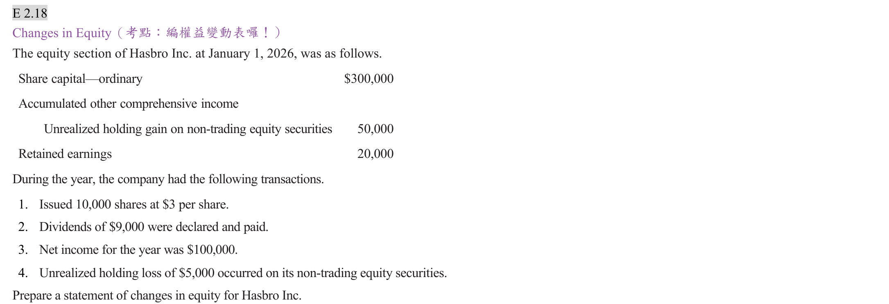


### E2.18 一步一步算

| 項目     |       普通股股本 |        保留盈餘 |       AOCI |        權益合計 |
| ------ | ----------: | ----------: | ---------: | ----------: |
| 期初     |     300,000 |      20,000 |     50,000 |     370,000 |
| 發行股票   |     ＋30,000 |           0 |          0 |     ＋30,000 |
| 本期淨利   |           0 |    ＋100,000 |          0 |    ＋100,000 |
| OCI 損失 |           0 |           0 |     −5,000 |      −5,000 |
| 股利     |           0 |      −9,000 |          0 |      −9,000 |
| 期末     | **330,000** | **111,000** | **45,000** | **486,000** |

再用橫向驗算：370,000＋30,000＋100,000－5,000－9,000＝486,000。

**綜合損益＝淨利＋OCI。**這題綜合損益＝100,000－5,000＝95,000；不能把 95,000 全部加到保留盈餘。


### 教材原圖｜看清楚每筆變動應該放在哪一欄

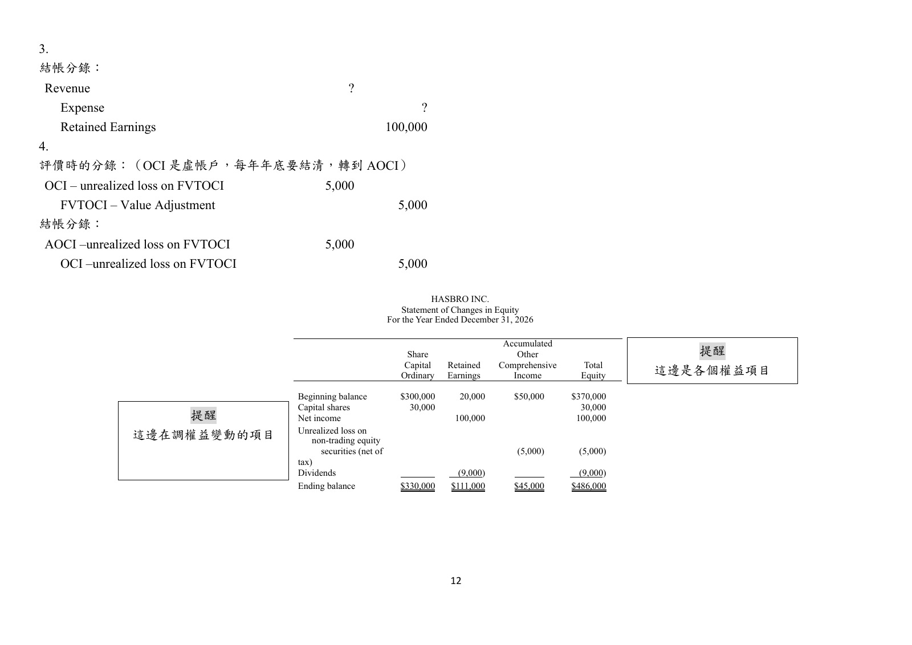

來源：[TA Handout - Ch 2 (1).pdf，PDF 第 12 頁](附件/TA%20Handout%20-%20Ch%202%20(1).pdf#page=12)。先讀上面的白話步驟，再對照原圖；點圖可放大。


### 變形題：用資產負債倒推淨利

在沒有其他更正或特殊變動時：

**淨利＝權益增加－股東投入＋股利－OCI。**

先用資產－負債算期初、期末權益。假設權益增加 150、投入 100、股利 40、OCI 利益 10：淨利＝150－100＋40－10＝80。OCI 損失則帶負號，減負數會變成加。

## 真題實戰｜113-1 計算第 5 題：權益分抽屜：淨利進 RE、OCI 進 AOCI

> [!tip] 先懂這題的道理
> **題目問總權益，所以股本、保留盈餘、AOCI 三欄都要算出期末再加總；只算保留盈餘是最常見的失分。**
> - 淨利和股利只動保留盈餘；稅後的 OCI 損失只動 AOCI；本題沒有發行股票，股本不變。


112-1 也有相同核心題目；此處以 113-1 原題練習，不重複做一遍。兩年小題配分可能不同，本次仍依老師公告。

[113-1 原卷，PDF 第 9 頁](附件/歷屆試題/113-1%20Midterm%20I%20with%20ans_posted.pdf#page=9)。下圖只保留題目，已避開原卷解答。

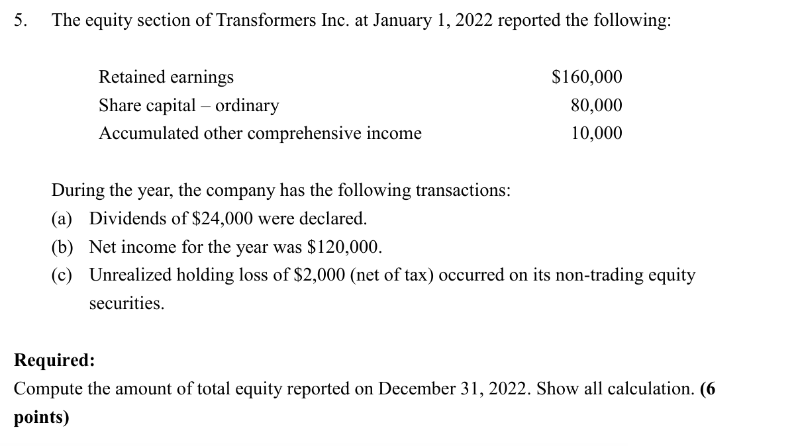

**讀題抓詞：**total equity＝全部權益；net of tax＝已經稅後；unrealized holding loss on non-trading equity securities＝本題列 OCI 的損失。

先自己圈出日期、金額、問題要求，再寫算式或分錄。

> [!success]- 展開詳解｜先寫完，再看推理與答案
> ### 第一步：先列期初三個抽屜
>
> 股本（Share capital—ordinary）80,000；保留盈餘（Retained earnings）160,000；AOCI 10,000。合計 250,000。
>
> ### 第二步：把每筆交易放對欄
>
> | 變動 | 股本 | RE | AOCI |
> |---|---:|---:|---:|
> | 本期淨利 120,000 | 0 | ＋120,000 | 0 |
> | 宣告股利 24,000 | 0 | −24,000 | 0 |
> | 本題 OCI 損失 2,000，已稅後 | 0 | 0 | −2,000 |
> | 期末餘額 | **80,000** | **256,000** | **8,000** |
>
> ### 第三步：加總權益
>
> 80,000＋256,000＋8,000＝**344,000**。
>
> 用另一個方向驗：250,000＋120,000−24,000−2,000＝344,000。
>
> **易錯點：**把 2,000 也扣進 RE，會讓個別欄位錯誤；漏掉股本會只算出 264,000。net of tax 表示不要再把 2,000 乘稅率。


# 題型六｜FIFO 與平均成本法【基礎解說＋歷屆真題】

## 教學｜同一批貨，為什麼會算出不同的銷貨成本？

### 問題從哪裡來？
**同一種商品分批用不同價格買進，賣出一件時帳上要決定「這件的成本算哪一批的價格」；這個決定同時決定銷貨成本和期末存貨。**
- 可供銷售商品成本（期初存貨＋本期進貨）是固定的總數，要分成兩堆：賣掉的變成銷貨成本，留下的是期末存貨。
- 分法不同，兩堆的大小就不同，毛利和淨利也跟著不同。
- 這種分法叫成本流程假設（cost flow assumption），它只是計算上的假設，不必和貨物實際搬動的順序一致。

### 準則允許哪幾種分法？
**國際會計準則第 2 號（IAS 2，存貨）允許個別認定、先進先出（FIFO）、加權平均三種，不允許後進先出（LIFO）。**
- 個別認定（specific identification）：逐件追蹤成本，只能用在不能互相替代的貨，例如訂製品或專案產品；大量可替代的貨不准用，因為公司可以挑高成本或低成本的那件「賣出」來操縱損益。
- 先進先出：假設先買的先賣，期末留下的是最近買的，所以期末存貨接近現在的價格，但銷貨成本是最舊的價格。
- 加權平均：把所有可賣的貨混在一起算一個平均單位成本，比較不容易被操縱。
- 性質和用途相似的存貨必須用同一種方法，而且各期一致；只因存放地點或適用稅法不同，不可以改用不同方法。
- 臺灣上市櫃公司 2022 年有 95.2% 採加權平均（[第 6 章投影片第 54 頁](附件/Ch%2006_Inventory%20(part%201)%206.1-6.4.pdf#page=54)）。

### 永續盤存和定期盤存差在哪？為什麼只影響平均法？
**永續盤存每次買賣都即時更新存貨和銷貨成本；定期盤存平時不記銷貨成本，期末盤點後才倒推。平均法的平均是「在哪個時點算」會因此不同，FIFO 則不受影響。**
- 永續盤存制（perpetual）：進貨借記存貨；每次銷貨同時借記銷貨成本、貸記存貨。
- 定期盤存制（periodic）：進貨借記「進貨」帳戶；銷貨時只記收入；期末用「可供銷售商品成本－盤點的期末存貨」得出銷貨成本。
- 先進先出不論何時算，賣掉的都是最早那幾批，所以兩種制度結果相同。
- 平均法在定期盤存下，期末用全期所有貨算一次加權平均；在永續盤存下，每次進貨後就重算平均（移動平均），賣出時用當時的平均，所以結果不同。
- 老師的分錄對照（[投影片第 37 頁](附件/Ch%2006_Inventory%20(part%201)%206.1-6.4.pdf#page=37)）：期初 100 件@6，進貨 900 件@6，賣出 600 件@12。

```text
永續盤存                              定期盤存
進貨：借 Inventory 5,400              借 Purchases 5,400
      貸 Accounts Payable 5,400          貸 Accounts Payable 5,400
銷貨：借 Accounts Receivable 7,200    借 Accounts Receivable 7,200
      貸 Sales Revenue 7,200             貸 Sales Revenue 7,200
      借 Cost of Goods Sold 3,600     （銷貨時不記成本）
      貸 Inventory 3,600
期末：不用分錄，帳上存貨 2,400         借 Inventory（期末盤點）2,400
                                      借 Cost of Goods Sold 3,600
                                         貸 Purchases 5,400
                                         貸 Inventory（期初）600
```

### 物價上漲時，選不同方法有什麼後果？
**物價上漲時，先進先出把便宜的舊成本先轉成銷貨成本，所以銷貨成本較低、淨利較高、所得稅也較高；平均法相反。物價下跌時方向全部相反。**
- 老師投影片的例子：銷貨 60,000，平均法銷貨成本 18,000、先進先出 16,000，淨利分別 19,200 和 20,400。
- 進貨和銷貨的實際收付現金兩種方法完全一樣，差別只來自所得稅：平均法少繳 800 的稅，期末現金反而多 800（[投影片第 58 頁](附件/Ch%2006_Inventory%20(part%201)%206.1-6.4.pdf#page=58)）。


## 先懂中文，再認英文

| 中文概念   | 英文題目會怎麼寫                   | 看到它要做什麼         |
| ------ | -------------------------- | --------------- |
| 先進先出法  | First-in, first-out, FIFO  | 舊成本先進銷貨成本       |
| 永續盤存   | Perpetual inventory system | 每次買賣更新存貨        |
| 定期盤存   | Periodic inventory system  | 期末盤點後計算         |
| 加權平均成本 | Weighted-average cost      | 整期總成本÷總數量       |
| 移動平均   | Moving-average cost        | 每次進貨重新平均        |
| 期末存貨成本 | Cost of ending inventory   | 留下來的貨用成本衡量      |
| 銷貨成本   | Cost of goods sold, COGS   | 賣掉的貨的成本         |
| 每單位    | Per unit / @               | 進貨列是成本；銷貨列通常是售價 |


## 6-1 先理解：分的是成本，不是售價

公司買貨先形成存貨，賣掉的那一部分才轉成銷貨成本。商品售價用來算收入，不拿來替代進貨單位成本。

**期初存貨＋本期淨進貨及應計入成本＝可供銷售商品成本。**
**可供銷售商品成本－期末存貨＝銷貨成本。**

計算前先驗数量：期初數量＋進貨數量－銷出數量＝期末數量。

## 6-2 同一題，用三種方法做

下面是自編題，沒有退貨、折扣或運費；金額單位為元。

| 日期 | 交易 | 數量 | 單位成本 | 成本總額 |
|---|---|---:|---:|---:|
| 10/1 | 期初 | 100 | 10 | 1,000 |
| 10/5 | 進貨 | 100 | 14 | 1,400 |
| 10/10 | 銷售 | 120 | 待決定 | 待決定 |
| 10/20 | 進貨 | 100 | 20 | 2,000 |
| 10/25 | 銷售 | 60 | 待決定 | 待決定 |

可供銷售共 300 件、成本 4,400。總共賣 180 件，留下 **120 件**。三種方法都必須符合「期末存貨＋銷貨成本＝4,400」。

### 方法一：FIFO 先進先出

白話：先買的成本先當成賣掉；留下較後面進貨的成本。不代表實際搬貨必須這樣搬。

1. 10/10 賣 120 件：100 × 10＋20 × 14＝1,280。
2. 此時剩 80 件，每件 14。
3. 10/20 進 100 件，每件 20。
4. 10/25 賣 60 件，先用 14 元層：60 × 14＝840。
5. 期末剩 20 × 14＋100 × 20＝**2,280**。
6. 銷貨成本＝1,280＋840＝**2,120**。

定期盤存也可從期末倒抓最新的 120 件，得到相同 FIFO 結果。

### 方法二：定期盤存的加權平均

白話：到期末才把整期可賣的貨混在一起，算一個平均成本。

1. 平均成本＝4,400 ÷ 300＝14.666666…。
2. 期末存貨＝120 × 14.666666…＝**1,760**。
3. 銷貨成本＝180 × 14.666666…＝**2,640**。

不能算 (10＋14＋20) ÷ 3，除非各批數量剛好相同；通用作法永遠是**總成本除以總數量**。這題剛好同量也不要養成錯誤習慣。

### 方法三：永續盤存的移動平均

白話：每次買進新貨，就把新貨和當時剩貨重新平均；賣出時使用當時的平均，不用未來進貨的價格。

| 時點 | 算法 | 結果 |
|---|---|---|
| 10/5 進貨後 | (1,000＋1,400) ÷ 200 | 平均 12 |
| 10/10 銷貨 | 120 × 12 | 銷貨成本 1,440；剩 80 件、960 |
| 10/20 進貨後 | (960＋2,000) ÷ (80＋100) | 平均 16.444444… |
| 10/25 銷貨 | 60 × 16.444444… | 銷貨成本 986.666… |
| 期末 | 120 × 16.444444… | 存貨 **1,973.33** |

銷貨成本合計＝1,440＋986.666…＝**2,426.67**。保留中間小數，最後才依題目規定四捨五入。

### 三種結果放在一起看

| 方法 | 期末存貨 | 銷貨成本 | 合計 |
|---|---:|---:|---:|
| FIFO | 2,280 | 2,120 | 4,400 |
| 定期加權平均 | 1,760 | 2,640 | 4,400 |
| 永續移動平均 | 1,973.33 | 2,426.67 | 4,400 |

看到 average cost 先找 periodic 或 perpetual。FIFO 在此類一般題下兩種盤存制度結果相同；平均法則可能不同。價格一路上升時，FIFO 留下較貴的存貨，銷貨成本通常較低，毛利較高；這是有價格趨勢等前提的比較，不是所有情境都成立。


## 老師例題練習｜Call-Mart：換一組數字，四種方法各算一次

這是第 6 章投影片第 43～53 頁貫穿用的例題。先自己算，再展開核對。

| 日期   | 事件  |    數量 |  單位成本 |
| ---- | --- | ----: | ----: |
| 3/2  | 進貨  | 2,000 | €4.00 |
| 3/15 | 進貨  | 6,000 | €4.40 |
| 3/19 | 銷售  | 4,000 |     — |
| 3/30 | 進貨  | 2,000 | €4.75 |

期末剩 6,000 件。請算：個別認定（期末 6,000 件中 1,000 件來自 3/2、3,000 件來自 3/15、2,000 件來自 3/30）、先進先出、定期加權平均、永續移動平均的期末存貨與銷貨成本。

> [!success]- 展開答案｜先自己算，再核對
> 可供銷售商品成本＝8,000＋26,400＋9,500＝**43,900**。四種方法都必須符合「期末存貨＋銷貨成本＝43,900」。
>
> | 方法 | 期末存貨 | 銷貨成本 | 關鍵算式 |
> |---|---:|---:|---|
> | 個別認定 | 26,700 | 17,200 | 1,000×4＋3,000×4.4＋2,000×4.75 |
> | 先進先出（兩種制度相同） | 27,100 | 16,800 | 期末留最新：2,000×4.75＋4,000×4.4 |
> | 定期加權平均 | 26,340 | 17,560 | 43,900÷10,000＝4.39；6,000×4.39 |
> | 永續移動平均 | 26,700 | 17,200 | 3/15 後平均 34,400÷8,000＝4.30；3/30 後 (4,000×4.30＋9,500)÷6,000＝4.45 |
>
> 移動平均和個別認定在這題剛好同為 26,700，是數字巧合，不是規則。

## 真題實戰｜113-1 計算第 6 題：先按日期重排，再分成本與售價

> [!tip] 先懂這題的道理
> **永續盤存先進先出要知道「每次賣出時倉庫裡有哪幾批」，所以第一步是把進貨和銷貨按日期排在一起；定期盤存平均法只看全期總數，不需要排順序。**
> - 題目把 Purchased 和 Sold 分開列，@ 後面的數字意義不同：進貨列是單位成本，銷貨列是單位售價。
> - 銷貨成本只能用成本算；售價只用來算銷貨收入和毛利。
> - 平均法要照題目指定的定期盤存，用全期加權平均，不是每次進貨重算。


112-1 也有相同核心題目；此處以 113-1 原題練習，不重複做一遍。兩年小題配分可能不同，本次仍依老師公告。

[113-1 原卷，PDF 第 10 頁](附件/歷屆試題/113-1%20Midterm%20I%20with%20ans_posted.pdf#page=10)。下圖只保留題目，已避開原卷解答。

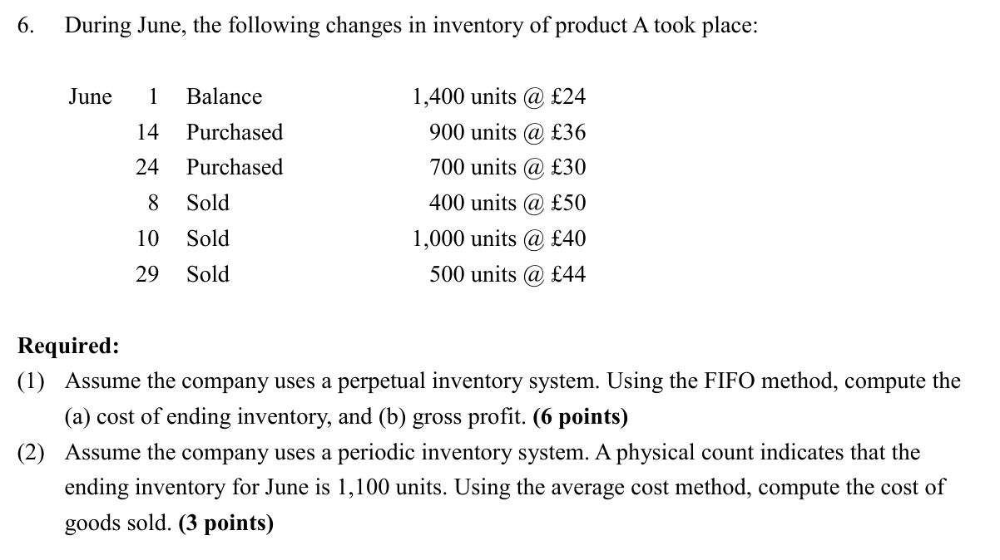

**讀題抓詞：**Purchased＝買進、後面 @ 是成本；Sold＝賣出、後面 @ 是售價；gross profit＝收入減銷貨成本。

先自己圈出日期、金額、問題要求，再寫算式或分錄。

> [!success]- 展開詳解｜先寫完，再看推理與答案
> ### 第零步：原題刻意把進貨和銷貨分開列，先按日期重排
>
> | 日期 | 事件 | 數量 | 每件金額 | 這個金額的意思 |
> |---|---|---:|---:|---|
> | 6/1 | 期初 | 1,400 | 24 | 成本 |
> | 6/8 | 銷售 | 400 | 50 | 售價 |
> | 6/10 | 銷售 | 1,000 | 40 | 售價 |
> | 6/14 | 進貨 | 900 | 36 | 成本 |
> | 6/24 | 進貨 | 700 | 30 | 成本 |
> | 6/29 | 銷售 | 500 | 44 | 售價 |
>
> 可供銷售數量＝1,400＋900＋700＝3,000。
> 銷售數量＝400＋1,000＋500＝1,900。
> 期末數量＝**1,100**，和題目盤點相符。
>
> ### (1a) 永續盤存 FIFO：逐次把最舊成本賣掉
>
> - 6/8：400 × 24＝9,600，期初批剩 1,000 件。
> - 6/10：1,000 × 24＝24,000，期初批全賣完。
> - 6/14：進貨 900 件，每件 36。
> - 6/24：再進貨 700 件，每件 30。
> - 6/29：先賣比較早的 6/14 那批，500 × 36＝18,000。
>
> 期末剩 6/14 的 400 件與 6/24 的 700 件：
> **Ending inventory＝400 × 36＋700 × 30＝35,400**。
>
> **COGS＝9,600＋24,000＋18,000＝51,600**。
>
> 不要因為 30 比 36 便宜就先用 30。FIFO 依進貨時間，不依價格高低。
>
> ### (1b) 毛利：現在才使用銷售單價
>
> Sales＝400 × 50＋1,000 × 40＋500 × 44＝**82,000**。
> Gross profit＝82,000−51,600＝**30,400**。
>
> 35,400 是留著的成本，30,400 是已賣出商品賺的毛利，兩個問題不同。
>
> ### (2) 定期盤存平均成本：整期平均一次
>
> | 批次 | 成本 |
> |---|---:|
> | 期初 1,400 × 24 | 33,600 |
> | 進貨 900 × 36 | 32,400 |
> | 進貨 700 × 30 | 21,000 |
> | 可供銷售商品成本 | **87,000** |
>
> Weighted-average cost per unit＝87,000 ÷ 3,000＝**29**。
> COGS＝1,900 × 29＝**55,100**。
> 順便驗算期末存貨＝1,100 × 29＝31,900；31,900＋55,100＝87,000。
>
> 原題第 (2) 明寫 periodic，所以不要套每次進貨重算的 moving average。原題只問這小題的 COGS，額外期末數字是用來驗算。


## 真題小練習｜113-1 選擇第 2 題：用銷貨成本倒推價格趨勢

> [!tip] 先懂這題的道理
> **先進先出的銷貨成本用最早買進的成本，平均法用全期平均；先進先出的銷貨成本比較高，代表早期成本比平均還貴，價格是往下走。**
> - 平均成本一定介於最早和最晚的價格之間。
> - 價格上漲時早期最便宜，先進先出的銷貨成本最低；下跌時相反。


[113-1 原卷，PDF 第 1 頁](附件/歷屆試題/113-1%20Midterm%20I%20with%20ans_posted.pdf#page=1)。112-1 第 2 題也考同一概念。英文原題如下，已移除答案顏色提示。

> 2. Assuming no beginning inventory, what can be said about the trend of inventory prices if cost   
> of goods sold computed when inventory is valued using the FIFO method exceeds cost of   
> goods sold when inventory is valued using the average cost method?   
> (A) Prices decreased.   
> (B) Prices increased.   
> (C) Prices remained unchanged.   
> (D) Price trend cannot be determined from information given.  

> [!success]- 展開詳解｜先寫完，再看推理與答案
> **答案 A：Prices decreased（價格下降）。**
>
> 1. FIFO 先把較早的進貨成本列為費用。
> 2. 題目說 FIFO 的 COGS 比平均法還高（exceeds），表示較早的成本比較貴。
> 3. 按這類題目的整體價格趨勢假設，較早貴、較晚便宜，就是下降。
>
> 用兩件商品想：先買 10、後買 6，賣一件。FIFO 成本 10，平均成本 8，確實 FIFO 較高。B 上升會是相反方向；C 不變應相同。本題是在典型單向趨勢比較下問方向，不代表能從一個差額重建每筆實際價格。
>
> **核對原卷（紅字是原解答）：**
>
> 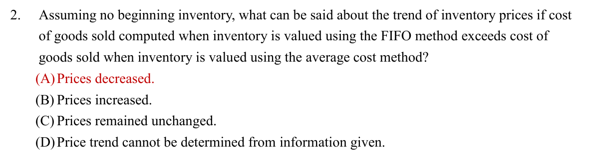


# 第二部分｜守住 39 分：選擇題概念

# 選擇一｜第 1 章衡量原則

## 教學｜「衡量」在問什麼？

### 衡量和認列差在哪？
**認列決定一個項目要不要放進財報，衡量決定放多少金額；衡量基礎就是「用哪一種價格當金額」。**
- 歷史成本：用取得當時實際付出的代價，「包含為了完成取得而發生的交易成本」（例如佣金、過戶費）；之後不隨市價調整，但仍會折舊或減損。
- 現時價值：用衡量日當下的情況重新估價，包括公允價值、使用價值、履約價值、現時成本。

### 四種現時價值各從誰的角度看？
**公允價值從市場的角度看；使用價值和履約價值從公司自己的角度看；現時成本看的是今天重新買進要花多少。**
- 公允價值：衡量日市場參與者之間有秩序交易下，賣出資產會收到、或移轉負債會付出的價格；交易成本是買賣這個動作的花費，不是資產本身的價值，所以不包含在內。

- 使用價值：公司繼續使用這項資產，預期能收回的現金流量現值。

- 履約價值：公司履行一項義務，預期要付出的資源現值。

- 現時成本：今天取得一項相同資產要付的價格，「包含今天會發生的交易成本」。


## 先懂中文，再認英文

| 中文概念 | 英文題目會怎麼寫 | 看到它要做什麼 |
|---|---|---|
| 衡量原則／基礎 | Measurement principle / basis | 選用什麼金額入帳 |
| 歷史成本 | Historical cost | 原始取得成本及相關交易成本 |
| 公允價值 | Fair value | 市場參與者的現在交易價格 |
| 使用價值 | Value in use | 企業繼續使用的未來現金流現值 |
| 履約價值 | Fulfilment / Fulfillment value | 履行義務所需資源現值 |
| 交易成本 | Transaction costs | 不是公允價值本身 |


## 1-1 先問：用哪一個時間點、哪一個角度的價格

「認列」是要不要放進帳上；「衡量」是放多少錢。本次公告特別指 measurement principle，所以先熟悉歷史成本與公允價值，不要把整章名詞都等量背誦。

| 概念 | 白話意思 | 解題線索 |
|---|---|---|
| 歷史成本 Historical cost | 以當初交易成本為基礎 | 購入價格、取得成本；不是看到漲價就自動調高 |
| 公允價值 Fair value | 衡量日市場參與者間有序交易的出售資產／移轉負債價格 | 現在、市場角度、出售／移轉 |
| 使用價值 Value in use | 公司繼續用資產，預計收回現金流的現值 | 公司自己的使用方式 |
| 履約價值 Fulfilment value | 履行義務所需付出資源的現值 | 清償義務、公司角度 |
| 現時成本 Current cost | 今天取得相當資產的成本 | 現在買進，而非現在賣出 |

例：土地當初買 100 萬，年底市場價格 130 萬。題目指定歷史成本且沒有其他調整，不能因漲價就改成 130 萬；若指定公允價值模式，才依該模式處理。**歷史成本不代表所有資產永遠保持原價**，設備仍可能折舊、減損。


> [!tip] 先懂這題的道理
> **B 說「買進後的公允價值變動不入帳」，這正是歷史成本的定義；H 說「某些情況允許用公允價值」，對應公允價值原則。**
> - 歷史成本在取得後就固定，不追著市價調整。
> - 公允價值原則讓部分項目（例如交易目的證券）每期按市價重新衡量。

> [!example]- 展開助教 E1.6 完整原題（含所有條件與要求）
> **助教 E1.6 完整原題**｜來源：[助教講義 PDF 第 6、7 頁](附件/TA%20Handout%20-%20Ch%201.pdf#page=6)。下圖保留完整英文題幹、表格與全部小題，未包含解答。
>
> 這題跨兩頁，第二張補上 I 小題。依本次範圍先練 B、H 的衡量原則；其餘保留作完整原題參照。
>
> 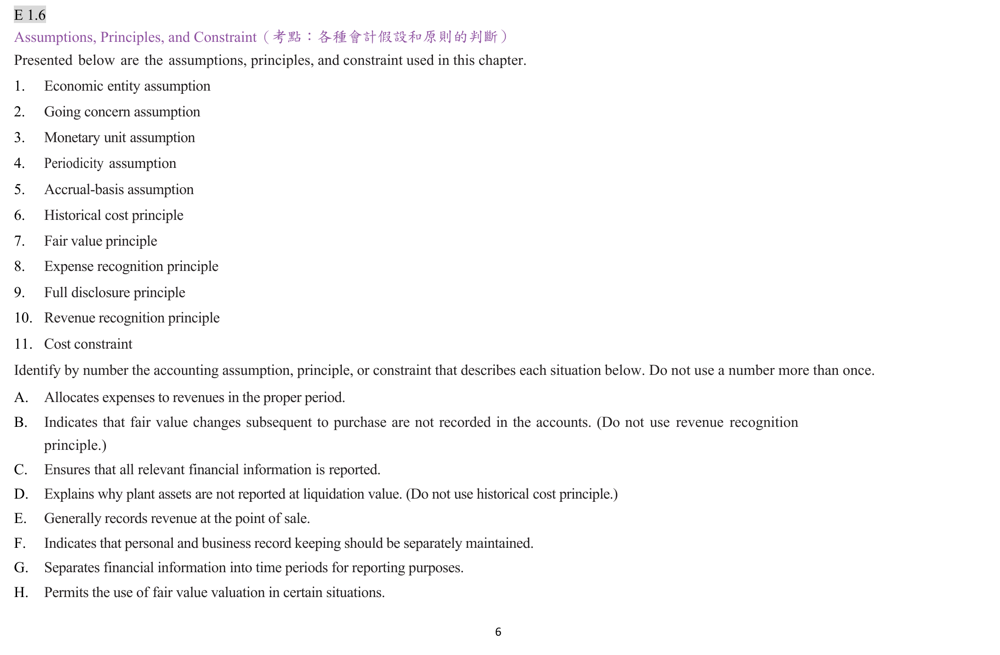
>
> 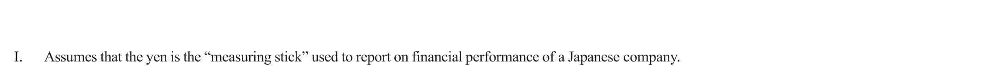


先練助教 E1.6 的 B、H：B 對應歷史成本，H 對應公允價值。其他三種衡量基礎先知道差別；老師第 1 章正式投影片尚缺，補到後再確認細節深度。


### 教材原圖｜只先抓 B、H 的衡量原則線索


來源：[TA Handout - Ch 1.pdf，PDF 第 6 頁](附件/TA%20Handout%20-%20Ch%201.pdf#page=6)。先讀上面的白話步驟，再對照原圖；點圖可放大。


## 真題小練習｜113-1 選擇第 4 題：衡量金額是否包含原始交易成本

> [!tip] 先懂這題的道理
> **交易成本是取得資產時為了完成交易付出的錢，只有以「取得時實際付出的代價」為基礎的歷史成本會把它算進去。**
> - 公允價值是市場上資產本身的價格，交易成本屬於買賣動作的花費。
> - 使用價值、履約價值看的是未來現金流量的現值，和當初交易花多少無關。


[113-1 原卷，PDF 第 2 頁](附件/歷屆試題/113-1%20Midterm%20I%20with%20ans_posted.pdf#page=2)。英文原題如下，已移除答案顏色提示。

> 4. Which of the following measurement includes transaction costs incurred at the time of the   
> original exchange transaction?    
> (A) Historical cost   
> (B) Fair value   
> (C) Value in use   
> (D) Fulfillment value  

> [!success]- 展開詳解｜先寫完，再看推理與答案
> **答案 A：Historical cost（歷史成本）。**
>
> 1. 先翻譯問題：哪個衡量基礎包含「原始交換交易當時發生的交易成本」？
> 2. 歷史成本看取得資產所付對價及相關取得交易成本，因此選 A。
> 3. 公允價值（Fair value）反映資產或負債本身的市場價格；交易成本不是公允價值本身的一部分。
> 4. 使用價值、履約價值是未來現金流／履行義務的現值角度，不是本題原始交易成本的衡量基礎。
>
> 不要把「有些金融資產的入帳金額可能是公允價值加交易成本」混成「公允價值這個衡量值本身包含交易成本」；那是不同層次的問題。
>
> **核對原卷（紅字是原解答）：**
>
> 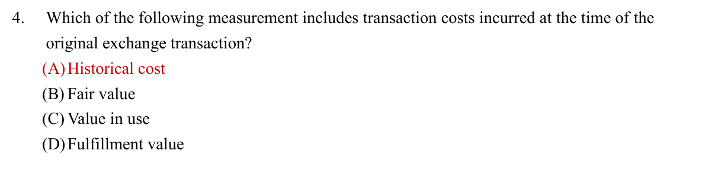


# 選擇二｜第 3 章流動資產與流動負債

## 教學｜資產負債表為什麼要分流動和非流動？

### 分類是為了回答什麼問題？
**讀者要知道公司短期內有多少資源可以變成現金、短期內又要還多少債，藉此判斷公司會不會周轉不靈；所以分類標準是「多快會變現或要清償」。**
- 期限標準是「一個正常營業週期或十二個月，取較長者」；營業週期是從買進存貨、賣出、到收回現金所需的時間。

- 資產符合任一條件就是流動：預期在正常營業週期內變現或耗用、主要為交易目的持有、預期報導日後十二個月內實現、或是不受限制的現金及約當現金。

- 負債的條件是對稱的：預期在營業週期內清償、主要為交易目的、報導日後十二個月內到期，或公司在報導日沒有權利把清償延後超過十二個月。

### 哪些項目看起來像負債，其實不是？
**備抵呆帳和累計折舊是資產的減項，庫藏股是權益的減項；三者都不欠任何人，所以都不是負債。**
- 備抵呆帳把應收帳款調成預計收得回的淨額，累計折舊把設備調成剩餘的帳面金額。
- 庫藏股是公司買回自己發行的股票；公司不能自己欠自己，所以列權益減項。


## 先懂中文，再認英文

| 中文概念 | 英文題目會怎麼寫 | 看到它要做什麼 |
|---|---|---|
| 流動／非流動 | Current / non-current | 不要只背一年 |
| 正常營業週期 | Normal operating cycle | 可能超過十二個月 |
| 四年後到期 | Due in four years | 通常不是流動應收款 |
| 預付廣告費 | Prepaid advertising | 本題視為短期預付資產 |
| 交易目的證券 | Trading securities | 流動資產 |
| 預收收入 | Unearned revenue | 尚未履約，通常是流動負債 |
| 長期負債一年內到期部分 | Currently maturing portion of long-term debt | 這一部分轉列流動 |


## 流動資產：不要只背「一年內」

符合流動分類的常見理由：

- 預期在正常營業週期內出售、消耗或實現。
- 主要為交易目的持有。
- 預期在報導日後十二個月內實現。
- 符合條件的現金及約當現金。

### 為什麼有「營業週期」？

造船公司可能兩年才完成、交船、收款。

在這個正常週期內的在製船舶存貨，仍可能是流動資產。不能只因為超過一年就判非流動。

但**不能把公司的兩年營業週期套到所有投資或借款**；要看是否與正常營業週期有關。

### 必會分類

| 項目 | 本課一般情境下的分類 |
|---|---|
| 應收帳款、存貨、短期預付費用 | 流動資產 |
| 交易目的證券 | 流動資產 |
| 自用土地、建物、設備 | 非流動資產：不動產、廠房及設備 |
| 專利權、商譽 | 非流動資產：無形資產 |
| 供長期債務清償的償債基金 | 非流動資產 |
| 備抵呆帳 | 應收款的減項 |
| 累計折舊 | 相關固定資產的減項 |

**備抵呆帳與累計折舊不是負債。**它們是在告訴你：資產原本的金額需要扣掉多少。


### 教材原圖｜符合任一流動條件即可

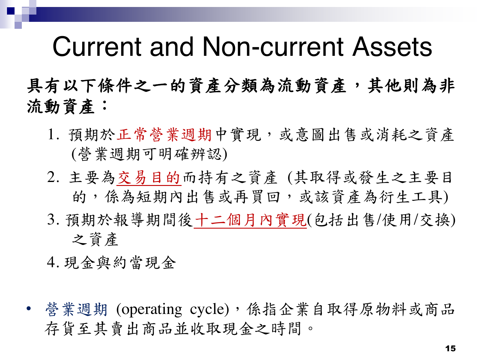

來源：[Ch 03_Balance Sheet.pdf，PDF 第 15 頁](附件/Ch%2003_Balance%20Sheet.pdf#page=15)。先讀上面的白話步驟，再對照原圖；點圖可放大。


## 流動負債：本金與利息分開算

例如：

- 公司債本金 1,000,000。
- 明年 9 月要還 250,000。
- 剩餘本金之後才還。
- 年息 8%，每年 9 月 30 日付息。
- 現在是 12 月 31 日。

**第一步：拆本金。**

- 流動部分＝250,000。
- 非流動部分＝750,000。

**第二步：補算已發生、還沒付的利息。**

10～12 月共三個月：

$$
應付利息＝1,000,000×8\%×3／12＝20,000
$$

所以：

- 流動負債＝250,000＋20,000＝**270,000**。
- 非流動負債＝**750,000**。

**陷阱：本金是非流動，不代表利息也跟著非流動。**

## 展延借款：關鍵是年底有沒有權利

老師第 29～32 頁有專門例題。

### 情況 A：年底前已取得延後還款的權利

公司在年底已取得可將清償延後至少十二個月的權利，符合相關條件時，可分類為非流動。

即使公司心裡打算提早還，也不能只憑管理階層意圖改判。

### 情況 B：年底仍在談，隔年才談成

年底沒有那項權利，就不能因為：

- 「應該談得成」
- 「財報發布前已經談成」

而把年底本應流動的借款改成非流動。

**拿分口訣：看報導日的權利，不看事後的願望。**


### 教材原圖｜看報導日是否有遞延至少十二個月的權利

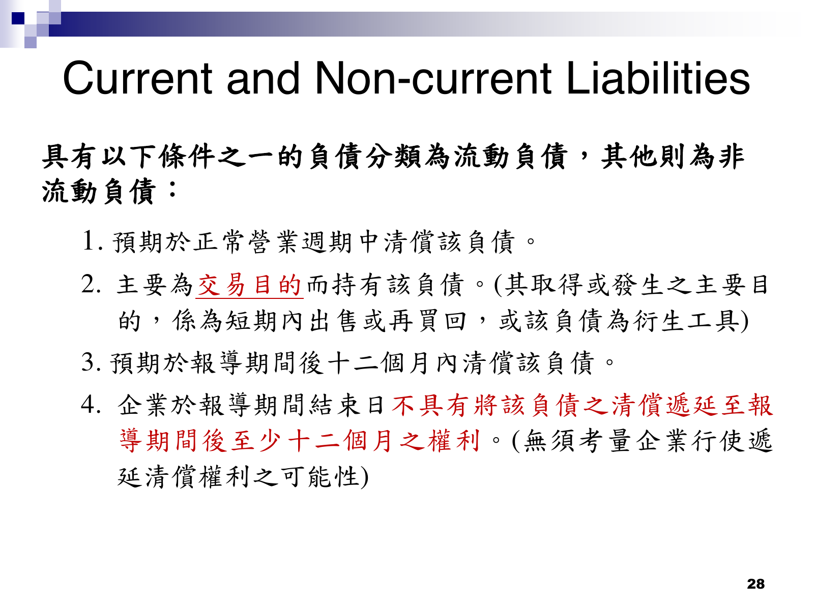

來源：[Ch 03_Balance Sheet.pdf，PDF 第 28 頁](附件/Ch%2003_Balance%20Sheet.pdf#page=28)。先讀上面的白話步驟，再對照原圖；點圖可放大。


## 股利、預收款與權益分類

### 應付股利

$$
應付股利＝每股股利×流通在外股數
$$

已發行 1,000,000 股，其中庫藏股 50,000 股，每股股利 2 元：

$$
(1,000,000－50,000)×2＝1,900,000
$$

**庫藏股不參與分配。**

### 預收收入／合約負債

$$
期末預收款＝期初預收款＋本期新收－本期已履約
$$

收到錢卻還欠客人服務，就是負債，不是權益。

### 權益中的幾個常客

股本、資本公積、保留盈餘、AOCI，以及作為減項的庫藏股。合併報表中的非控制權益也屬權益。

## 真題小練習｜113-1 選擇第 3 題：流動資產加哪些

> [!tip] 先懂這題的道理
> **逐項問「會不會在一年（或營業週期）內變成現金或被用掉」，會就是流動資產。**
> - 員工借款四年後才收回，超過一年，不是流動。
> - 預付廣告會在短期內耗用，交易目的證券隨時準備出售，兩者都是流動。


[113-1 原卷，PDF 第 1 頁](附件/歷屆試題/113-1%20Midterm%20I%20with%20ans_posted.pdf#page=1)。112-1 第 3 題也考同一概念。英文原題如下，已移除答案顏色提示。

> 3. The following information is taken from Kohler Company’s trial balance:   
> Receivables due from employees (due in 4 years) £ 60,000   
> Prepaid advertising 45,000   
> Trading securities (at fair value) 57,000   
> Kohler will report current assets of   
> (A) £45,000.   
> (B) £57,000.   
> (C) £102,000.   
> (D) £162,000.  

> [!success]- 展開詳解｜先寫完，再看推理與答案
> **答案 C：£102,000。**
>
> - 員工應收款（Receivables due from employees）60,000，要四年才到期（due in 4 years），本題不列流動。
> - 預付廣告（Prepaid advertising）45,000，本題視為短期預付資產，列流動。
> - 交易目的證券（Trading securities）57,000，列流動。
>
> Current assets＝45,000＋57,000＝**102,000**。A 漏證券，B 漏預付費用，D 把四年應收款也加進去了。
>
> **核對原卷（紅字是原解答）：**
>
> 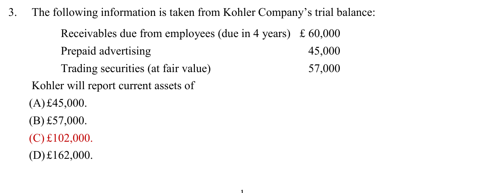


## 真題小練習｜113-1 選擇第 8 題：哪個不是流動負債

> [!tip] 先懂這題的道理
> **負債是公司欠別人、將來要付出資源的義務；庫藏股是公司買回自己的股票，不欠任何人，所以根本不是負債。**
> - 預收收入欠客戶商品或服務，一年內到期的長期債和應付帳款欠錢，都是短期內要清償的流動負債。


[113-1 原卷，PDF 第 2 頁](附件/歷屆試題/113-1%20Midterm%20I%20with%20ans_posted.pdf#page=2)。112-1 第 8 題也考同一概念。英文原題如下，已移除答案顏色提示。

> 8. Which of the following is not a current liability?   
> (A) Treasury shares.   
> (B) Unearned revenue resulting from operating activities.   
> (C) The currently maturing portion of long-term debt.   
> (D) Trade accounts payable.  

> [!success]- 展開詳解｜先寫完，再看推理與答案
> **答案 A：Treasury shares（庫藏股）。**
>
> 先圈 not：題目要找「不是」。庫藏股是公司買回自己股票，列股東權益減項，不是欠別人的債。
>
> B 營業活動的預收收入＝還欠客戶商品或服務；C 長期債務即將到期部分＝近期得清償；D 應付貨款＝正常營業週期內負債。三者在本題都是流動負債。
>
> **核對原卷（紅字是原解答）：**
>
> 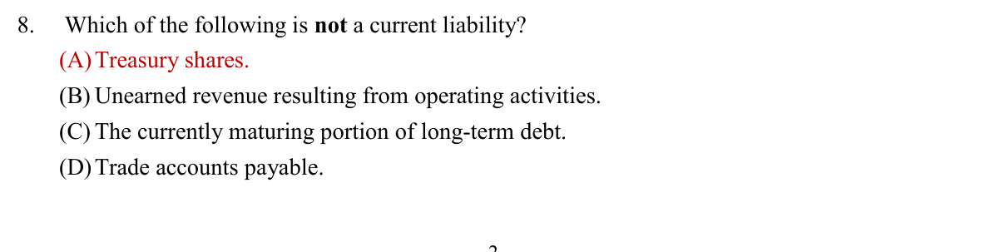


# 選擇三｜第 5 章現金與約當現金

## 教學｜什麼才算「現金及約當現金」？

### 判斷標準是什麼？
**現金是現在就能拿來付款、沒有使用限制的錢；約當現金是幾乎等於現金的短期投資，條件是容易換成已知金額的現金、價值變動風險很小，通常是取得時距到期日三個月以內。**
- 標準是「能不能立刻付款」，所以零用金、活期存款、可立即兌現的支票都算現金。
- 遠期支票要等到票上的日期才能兌現，現在不能用，是應收款。
- 員工借條、客戶存款不足的退票，是別人欠公司的錢，是應收款。
- 被限制用途的存款（例如專門用來償還長期債務的資金）不能自由使用，要另列適當的資產。

### 三個月為什麼從取得日算？
**約當現金的意思是公司「買的時候」就把它當成現金的替代品；一年期債券放到只剩兩個月，當初買它的目的並不是短期變現，所以不會自動變成約當現金。**


## 先懂中文，再認英文

| 中文概念 | 英文題目會怎麼寫 | 看到它要做什麼 |
|---|---|---|
| 銀行存款／零用金 | Cash in bank / petty cash | 加進現金 |
| 商業本票 | Commercial paper | 看取得時到期期間及其他條件 |
| 遠期支票 | Postdated checks | 不是當下可兌現的現金 |
| 到期日／期間 | Maturity / term to maturity | 別只看到短期就加 |
| 約當現金 | Cash equivalents | 短期、高流動、已知金額、風險小 |


## 現金與約當現金：名稱像錢，不代表就是現金

### 先問三件事

1. 現在能不能作為支付工具？
2. 有沒有用途或提領限制？
3. 如果是投資，是否符合約當現金的條件？

| 項目 | 基本判斷 |
|---|---|
| 紙鈔、硬幣、活期存款、零用金 | 現金 |
| 可即時兌現的正常支票、保付支票 | 通常屬現金 |
| 符合條件的極短期、高流動性投資 | 約當現金 |
| 員工借條、預借員工款 | 應收款等，非現金 |
| 客戶存款不足退票 NSF check | 應收款，非現金 |
| 遠期支票 Postdated check | 應收款，非當下可用現金 |
| 郵票 | 用品或預付項目 |
| 長期償債、擴廠用途受限制資金 | 另列適當資產 |
| 銀行透支 | 一般是流動負債，互抵須符合條件 |

### 「三個月」從哪一天算？

一般約當現金判斷，重點是**取得時距到期日**，通常三個月以內，且還要容易換成已知金額、價值變動風險很小。

原本買進一年期債券，放到年底只剩兩個月到期，**不會只因為剩兩個月就自動變成約當現金**。（參照第 5 章現金與約當現金教材）

老師另有臺灣定存的課堂說明；考題若指定情境，要依題目的提前解約、本金保障、持有目的等條件判斷，不要只看「定存」兩字。

### 講義中要特別小心的兩個地方

**補償性餘額**

- 有提領限制：依限制另行分類。
- 只是維持餘額安排、未造成同樣限制：可能仍留在現金，另作揭露。


> [!tip] 先懂這題的道理
> **十二個項目都用同一個問題判斷：現在能不能自由拿來付款？能就是現金，符合短期高流動條件就是約當現金，其他依性質歸到應收款、投資或負債。**
> - 受限制、要很久才能動用、或其實是別人欠公司的，都不是現金。
> - 補償性餘額是銀行要求維持的最低存款；本題沒有造成提領限制，所以不從現金扣，只揭露。
> - 銀行透支是公司欠銀行的錢，列流動負債；本題同一銀行沒有其他存款可以互抵。

> [!example]- 展開助教 E5.1 完整原題（含所有條件與要求）
> **助教 E5.1 完整原題**｜來源：[助教講義 PDF 第 3 頁](附件/TA%20Handout%20-%20Ch%205.pdf#page=3)。下圖保留完整英文題幹、表格與全部小題，未包含解答。
>
> 完整保留 12 個項目及 (a) 現金總額、(b) 其他項目的報表分類要求。不要只看到補償性餘額那一項。
>
> 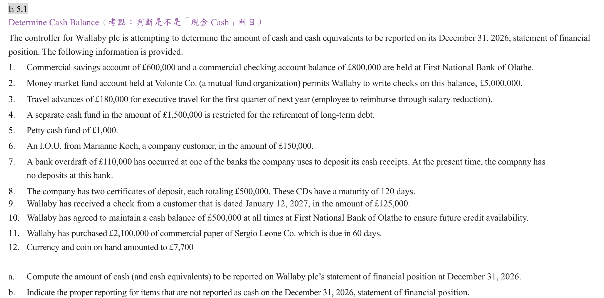
> [!success]- 展開詳解｜先自己做，再核對
> (a) 現金及約當現金＝600,000＋800,000＋5,000,000＋1,000＋2,100,000＋7,700＝**8,508,700**。
>
> (b) 第 3 項列員工應收款 180,000；第 4 項長期償債受限款 1,500,000 列非流動資產；第 6 項借條 150,000 列應收款；第 7 項無同銀行存款的透支 110,000 列流動負債；第 8 項兩筆 120 天定存合計 1,000,000 列短期投資；第 9 項遠期支票 125,000 列應收帳款。
>
> 第 10 項依本題解答不另扣現金，揭露補償性餘額安排；也不能再把 500,000 加一次。這是既有存款的維持要求，不是額外收到的錢。


助教 E5.1 的解答就沒有把該題補償性餘額直接扣掉，因此不能只背「compensating balance 一律不是現金」。

**客戶預付款**

如果客戶真的給了現金：

- 現金增加。
- 預收款負債也增加。

**它不是收入，但收到的錢仍然可以是現金。**此外，若已包含在銀行餘額裡，不能再加一次。

## 真題小練習｜113-1 選擇第 11 題：現金加約當現金，排除遠期支票

> [!tip] 先懂這題的道理
> **遠期支票要等到票上的日期才能兌現，年底還不能拿來付款，所以不是現金，是應收款。**
> - 零用金金額小，但可以直接付款，是現金。
> - 兩個月到期的商業本票，原題視為符合約當現金的條件。


[113-1 原卷，PDF 第 3 頁](附件/歷屆試題/113-1%20Midterm%20I%20with%20ans_posted.pdf#page=3)。112-1 第 11 題也考同一概念。英文原題如下，已移除答案顏色提示。

> 11. Kaniper Company has the following items at year-end:   
> Cash in bank €20,000   
> Petty cash 300   
> Commercial paper with maturity of 2 months 5,500   
> Postdated checks 1,400   
> Kaniper should report cash and cash equivalents of   
> (A) €20,000   
> (B) €20,300   
> (C) €25,800   
> (D) €27,200  

> [!success]- 展開詳解｜先寫完，再看推理與答案
> **答案 C：€25,800。**
>
> 1. Cash in bank 20,000 是現金。
> 2. Petty cash 300 也是現金，不因小額就漏掉。
> 3. 兩個月商業本票（Commercial paper）5,500，原題按符合約當現金條件處理。
> 4. Postdated checks 1,400 是遠期支票，目前不能兌現，排除。
>
> 20,000＋300＋5,500＝**25,800**。D 是四項全加的陷阱。
>
> 觀念補完整：一般仍須看取得時距到期日、可轉為已知現金及價值變動風險；原題簡化提供 maturity of 2 months，依原解答納入。
>
> **核對原卷（紅字是原解答）：**
>
> 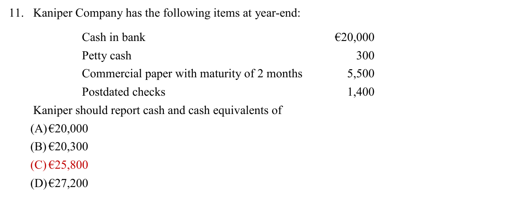


# 選擇四｜第 5 章應收帳款損失備抵

## 教學｜為什麼要先估壞帳，而不是等客戶真的倒了再記？

### 先估計的理由是什麼？
**賒銷產生收入的那一年，公司就已經承擔了收不回來的風險；先估計損失，同一年的收入和相關損失才會放在一起，應收帳款也才會以「預計收得回的金額」列在資產負債表上。**
- 估計的損失記在備抵損失（loss allowance，又稱備抵呆帳）：它是應收帳款的減項，應收帳款總額減備抵＝預計收得回的淨額（cash realizable value）。
- 老師的說法：一般沒有重大融資成分的應收帳款，按整個存續期間的預期信用損失估計，不等客戶正式倒閉。

### 估計、沖銷、收回，各自影不影響淨利？
**只有估計那一步影響淨利；沖銷和收回只是在應收帳款和備抵之間調整，淨額不變。**
- 估計時：借壞帳費用、貸備抵，費用在這時進入損益。
- 確定收不回（沖銷）時：借備抵、貸應收帳款，兩個一起減少，淨額不變。
- 沖銷後又收回時：先借應收帳款、貸備抵把沖銷倒回來，再照一般收款記。

### 期末要補多少，怎麼決定？
**先決定期末備抵「應該有多少」，再看帳上「已經有多少」，差額才是本期壞帳費用。**
- 期末應有＝應收帳款×估計損失率，或用帳齡分析逐段加總。
- 備抵出現借方餘額，代表本期沖銷的比原先估的多，也就是原先估少了，所以本期要多補。


## 先懂中文，再認英文

| 中文概念 | 英文題目會怎麼寫 | 看到它要做什麼 |
|---|---|---|
| 壞帳費用 | Bad Debt Expense | 本期補多少 |
| 損失備抵／備抵呆帳 | Loss allowance / Allowance for Uncollectible Accounts | 期末應有多少 |
| 應收款淨變現金額 | Cash realizable value / net realizable value | 應收總額扣備抵 |
| 貸方餘額／借方餘額 | Credit balance / debit balance | 決定調整時扣或加 |
| 沖銷 | Written off / write-off | 備抵減少 |
| 收回已沖銷帳款 | Recovered / recovery | 先恢復備抵與應收款 |
| 帳齡分析 | Aging of accounts receivable | 先估期末備抵目標 |


## 壞帳：期末「要有多少」，不等於本期「要補多少」

這是本章最值得反覆練的考點。

$$
應收帳款淨額＝應收帳款總額－備抵呆帳
$$


> [!tip] 先懂這題的道理
> **百分比法先算期末備抵應該有多少，再看帳上已有多少，本期費用只補差額；帳上是借方餘額時，代表備抵已經變成負數，要先補回零、再補到目標。**
> - 目標＝應收帳款×估計比例。
> - 已有貸方餘額就扣掉，借方餘額就加上。
> - 銷貨收入在應收帳款百分比法用不到。

**助教 E5.9 完整原題**｜來源：[助教講義 PDF 第 15 頁](附件/TA%20Handout%20-%20Ch%205.pdf#page=15)。下圖保留完整英文題幹、表格與全部小題，未包含解答。

完整試算表與 (a)、(b) 在下圖。(a) 是 **4%＋備抵借餘 1,750**；(b) 改成 **5%＋備抵貸餘 1,700**，兩題的比率不同。

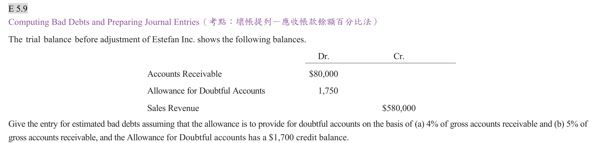

> [!success]- 展開詳解｜先自己做，再核對
> (a) 期末目標＝80,000 × 4%＝3,200；調整前借餘 1,750，要補 **4,950**：借 Bad Debt Expense 4,950，貸 Allowance for Doubtful Accounts 4,950。
>
> (b) 期末目標＝80,000 × 5%＝4,000；已有貸餘 1,700，只補 **2,300**：借 Bad Debt Expense 2,300，貸 Allowance for Doubtful Accounts 2,300。
>
> 下方為了單獨比較借餘、貸餘而固定 4% 的例子，是概念示範，不是 (b) 原題。Sales Revenue 580,000 不用在應收款餘額百分比法的本題計算。


### 第一步：算期末應有的備抵

應收帳款 80,000，預期收不回比例 4%：

$$
期末應有備抵＝80,000×4\%＝3,200
$$

### 第二步：看目前備抵是借方還是貸方

**目前貸餘 1,700：**

已經有 1,700，只需再補：

$$
3,200－1,700＝1,500
$$

**目前借餘 1,750：**

表示現有備抵已被沖過頭，要先補掉借餘，再建立貸餘：

$$
3,200＋1,750＝4,950
$$

這就是助教 E5.9 第一小題的陷阱。**1,750 在借方，不是貸方。**

### 三種分錄一定要分清

**估計損失時：**

```text
借：壞帳費用
    貸：備抵呆帳
```

**確定沖銷時：**

```text
借：備抵呆帳
    貸：應收帳款
```

**沖銷後又收到時，本課採兩步：**

```text
借：應收帳款
    貸：備抵呆帳

借：現金
    貸：應收帳款
```

### 為什麼沖銷不再影響淨利？

假設沖銷前：

- 應收帳款 80,000。
- 備抵 3,200。
- 淨額 76,800。

沖銷 1,000 後：

- 應收帳款 79,000。
- 備抵 2,200。
- 淨額仍然 76,800。

**認列預期損失時已經影響淨利，沖銷當下不能再認一次。**

### 帳齡法與銷貨百分比法

- **帳齡法／應收款百分比法**：先算期末備抵目標，再扣掉調整前餘額。
- **傳統銷貨百分比法**：先估本期壞帳費用。


> [!tip] 先懂這題的道理
> **四小題各自獨立：前兩題複習轉讓應收帳款（出售還是借款），後兩題複習備抵的「目標減現有」。**
> - 第 2 小題手續費按借款金額，不是應收帳款金額，要看題目寫的基準。
> - 第 3、4 小題調整前餘額一借一貸，所以一個加、一個減。

> [!example]- 展開助教 E5.16 完整原題（含所有條件與要求）
> **助教 E5.16 完整原題**｜來源：[助教講義 PDF 第 30 頁](附件/TA%20Handout%20-%20Ch%205.pdf#page=30)。下圖保留完整英文題幹、表格與全部小題，未包含解答。
>
> 四小題是獨立情境（Each situation is independent），金額單位是千元；不要把第 1、2 小題的交易連續帶進第 3、4 小題。
>
> 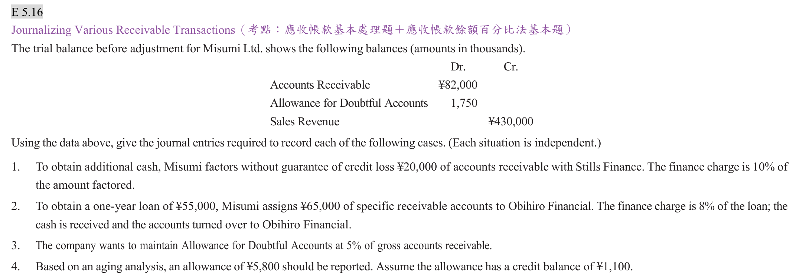
> [!success]- 展開詳解｜先自己做，再核對
> 1. 無追索：手續費＝20,000 × 10%＝2,000。借 Cash 18,000、Loss on Sale of Receivables 2,000，貸 Accounts Receivable 20,000。
> 2. 擔保借款：手續費按 **借款** 55,000 × 8%＝4,400，不是 65,000。借 Cash 50,600、Interest Expense 4,400，貸 Notes Payable 55,000。
> 3. 期末備抵目標 82,000 × 5%＝4,100；調整前借餘 1,750，所以借 Bad Debt Expense **5,850**，貸 Allowance for Doubtful Accounts 5,850。
> 4. 本小題重新指定貸餘 1,100，目標 5,800，所以借 Bad Debt Expense **4,700**，貸 Allowance for Doubtful Accounts 4,700。
>
> 每小題的起點依題目獨立設定；答案沿用原題的千元單位。


助教正文雖說略過帳齡法，但 E5.16 第 4 小題仍提供相關練習；老師公告包含 loss allowance，因此這裡保留計算示範，不代表已確定會考帳齡法。

老師也提到：一般無重大融資成分的交易應收款，採整個存續期間的預期信用損失；不是等客戶正式倒閉才估損失。

### 帳齡法的短例題

未逾期 100,000、損失率 1%；逾期 20,000、損失率 10%。期末備抵目標＝1,000＋2,000＝3,000。若調整前貸餘 800，本期補 2,200；若調整前借餘 800，本期補 3,800。題目問的是「期末備抵」還是「本期費用」，答案完全不同。


### 教材原圖｜對照備抵借餘如何調整為期末貸餘

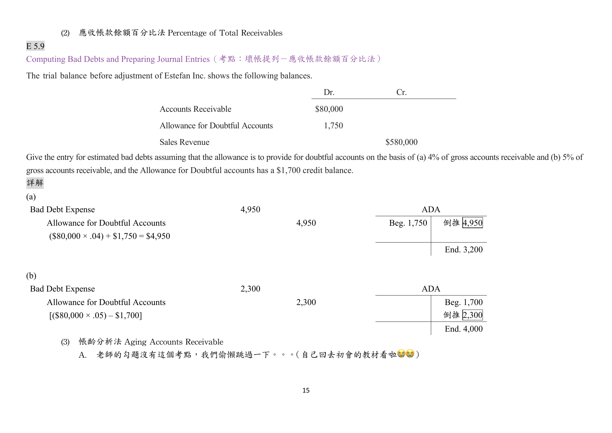

來源：[TA Handout - Ch 5.pdf，PDF 第 15 頁](附件/TA%20Handout%20-%20Ch%205.pdf#page=15)。先讀上面的白話步驟，再對照原圖；點圖可放大。


## 真題小練習｜113-1 選擇第 14 題：期初備抵、沖銷與回收都要追蹤

> [!tip] 先懂這題的道理
> **題目問本期壞帳費用，所以要分別找出「期末備抵目標」和「調整前備抵餘額」，兩者相減。**
> - 期末目標可以從淨額倒推：應收帳款總額－預計收得回的淨額。
> - 調整前餘額要從期初開始追：沖銷使備抵減少，收回已沖銷的帳款會先恢復備抵，所以加回。


[113-1 原卷，PDF 第 4 頁](附件/歷屆試題/113-1%20Midterm%20I%20with%20ans_posted.pdf#page=4)。112-1 第 14 題也考同一概念。英文原題如下，已移除答案顏色提示。

> 14. Ace Co. prepared an aging of its accounts receivable at December 31, 2022 and determined   
> that the cash realizable value of the receivables was £300,000. Additional information is   
> available as follows:   
> Allowance for uncollectible accounts at 1/1/22—credit balance £  34,000   
> Accounts written off as uncollectible during 2022 23,000   
> Accounts receivable at 12/31/22 325,000   
> Uncollectible accounts recovered during 2022 5,000   
>  For the year ended December 31, 2022, Ace’s bad debt expense would be   
> (A) £25,000   
> (B) £23,000   
> (C) £16,000   
> (D) £9,000  

> [!success]- 展開詳解｜先寫完，再看推理與答案
> **答案 D：£9,000。**
>
> ### 第一步：從淨額倒推期末備抵目標
>
> 題目給 cash realizable value 300,000，是應收帳款扣備抵後的淨額，不是備抵本身。
>
> 期末應收總額 325,000−淨額 300,000＝期末應有備抵 **25,000**。
>
> ### 第二步：算調整前備抵餘額
>
> 期初貸餘 34,000−本期沖銷 23,000＋已沖銷帳款回收 5,000＝**貸餘 16,000**。
>
> 沖銷借記備抵使它減少；回收先恢復帳款並貸記備抵，所以加回 5,000。
>
> ### 第三步：只補不足部分
>
> Bad Debt Expense＝25,000−16,000＝**9,000**。
>
> ```text
> Dr. Bad Debt Expense                  9,000
>     Cr. Allowance for Uncollectible Accounts  9,000
> ```
>
> A 25,000 是期末備抵；B 23,000 是沖銷；C 16,000 是調整前餘額。題目問費用，只有 D 正確。
>
> **核對原卷（紅字是原解答）：**
>
> 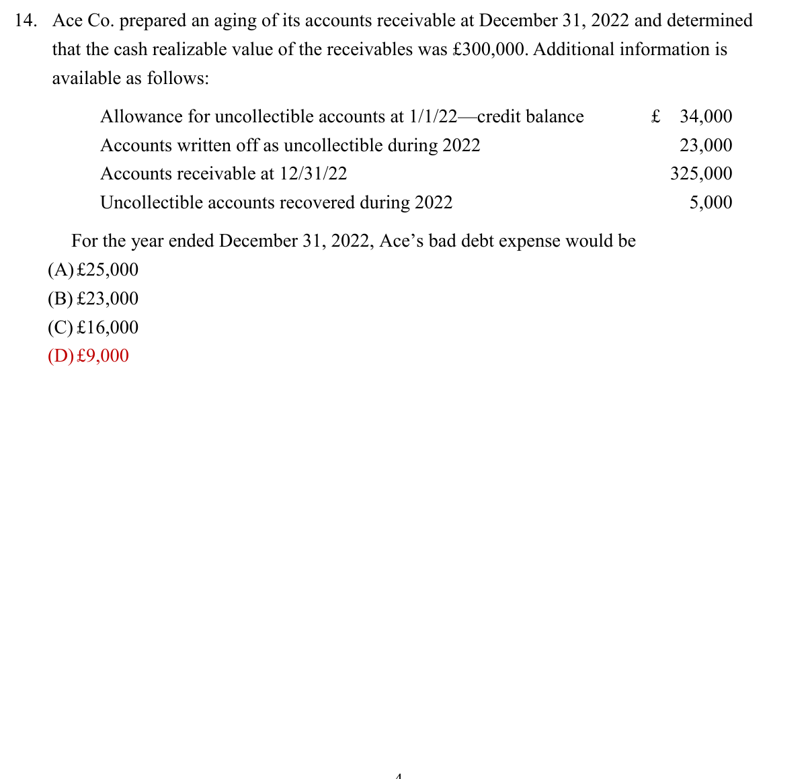


# 選擇五｜第 5 章應收票據：看得懂每一筆分錄

## 教學｜為什麼不付息的票據也會有利息收入？

### 未來的錢為什麼要折現？
**未來才收到的錢，今天的價值比較低；票據到期金額和今天價值之間的差額，就是公司讓客戶延後付款所賺的利息，要在持有期間逐年認列。**
- 公司賣東西收一張兩年後付 121,000 的票據，等於借錢給客戶兩年。
- 今天的價值用市場利率折現得到現值（present value）：121,000÷1.1²＝100,000，這才是今天的銷貨收入。
- 剩下的 21,000 是兩年的利息，每年按「期初帳面金額×市場利率」認列，這叫有效利息法；帳面金額因此逐年長回 121,000。

### 該用哪個利率折現？
**用反映債務人（欠錢的一方）信用風險的市場利率，因為票據收不收得到錢取決於債務人。**
- 公司自己向銀行借錢的利率，反映的是公司的風險，和這張應收票據無關。

### 附息票據的兩個利率各管什麼？
**票面利率決定每年實際收到多少現金利息；市場利率決定票據今天值多少，以及每年認列多少利息收入。兩者的差額就是折價或溢價的攤銷。**
- 票面利率低於市場利率，票據值得比面額少，是折價；高於市場利率則是溢價。


## 先懂中文，再認英文

| 中文概念 | 英文題目會怎麼寫 | 看到它要做什麼 |
|---|---|---|
| 零息票據 | Zero-interest-bearing note | 無票面利息，不是無利息收入 |
| 現值因子 | Present value factor | 用題目給定值 |
| 有效／市場利率 | Effective / prevailing interest rate | 乘期初帳面淨額 |
| 票面利率 | Stated / face rate | 決定現金利息 |
| 票據折價 | Discount on Notes Receivable | 票據資產的減項 |
| 利息收入 | Interest Revenue | 注意問第一年還是第二年 |


## 應收票據：票面利率決定收多少，市場利率決定值多少

票據有重大融資成分時，不能把未來收款全部當成今天的收入。

### 零息票據也可能有利息收入

兩年後收 121,000，市場年利率 10%，中間不付息：

$$
現值＝121,000÷1.1^2＝100,000
$$

原始認列 100,000。

第一年利息收入：

$$
100,000×10\%＝10,000
$$

年底帳面金額＝110,000。

第二年：

$$
110,000×10\%＝11,000
$$

到期帳面金額＝121,000。

**「零息」只是票面不另外付息，不代表沒有融資收益。**

### 附息票據

$$
現值＝每期票面利息的現值＋到期本金的現值
$$

$$
票面現金利息＝面額×票面利率
$$

$$
有效利息收入＝期初帳面金額×有效利率
$$

差額用來攤銷折價或溢價。


> [!tip] 先懂這題的道理
> **用票據交換土地或服務時，成交金額就是票據的現值；折現要用客戶適用的 12%，因為票據的風險來自客戶會不會付錢。**
> - 土地有公允價值 900,000，可以直接用它當票據的現值，和土地帳面 590,000 的差額就是處分利益。
> - 附息票據的現值＝每年票面利息的年金現值＋到期面額的單筆現值。

**助教 E5.13 完整原題**｜來源：[助教講義 PDF 第 13 頁](附件/TA%20Handout%20-%20Ch%205.pdf#page=13)。下圖保留完整英文題幹、表格與全部小題，未包含解答。

原題有兩筆交易：土地換零息票據，以及提供服務換附息票據；同時給公司借款率 8% 和客戶適用利率 12%。要求寫 2026/7/1 兩筆原始交易分錄。

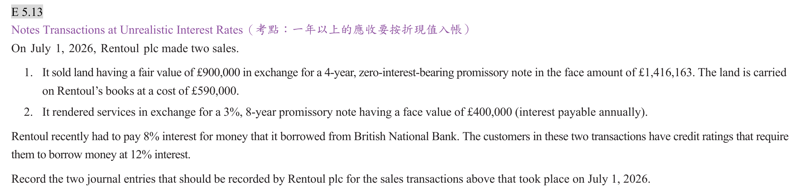

> [!success]- 展開詳解｜先自己做，再核對
> **先選利率：**票據是客戶欠公司的錢，衡量要反映客戶信用，所以用 **12%**，不使用 Rentoul 自己向銀行借款的 8%。
>
> 1. 土地已知公允價值 900,000，票據原始現值 900,000；土地帳面 590,000，處分利益＝**310,000**。按助教的淨額表示：借 Notes Receivable 900,000，貸 Land 590,000、Gain on Sale of Land 310,000。
> 2. 每年票面利息＝400,000 × 3%＝12,000。助教使用的年金因子 4.96764、單筆因子 0.40388：現值＝12,000 × 4.96764＋400,000 × 0.40388＝**221,163.68**。借 Notes Receivable 221,163.68，貸 Service Revenue 221,163.68。
>
> 第一筆的已知土地公允價值能直接支持 900,000；用四捨五入現值因子可能有數元差異，不應把它誤認成另一筆交易損益。助教中文說明誤寫 Notes Payable，但實際題目與分錄是公司的 **Notes Receivable（應收票據）**。


**陷阱：市場利率要反映債務人與票據條件，不能看到題目給了公司的借款利率就直接拿來用。**助教 E5.13 同時給 8% 與客戶 12%，就是在測這件事。

### 信用減損

依本課長期應收票據例題，用重新估計可收取的現金流量，按「**原始有效利率**」折現，再與帳面金額比較。

不要改拿當天新的市場利率代替。

### 零息票據分錄：把現值變成會寫的答案

沿用兩年後收 121,000、現值 100,000 的例子。假設來自本次銷貨，採本課常見的面額加折價呈現：

```text
取得時：
借：應收票據              121,000
    貸：應收票據折價              21,000
    貸：銷貨收入                 100,000
第一年年底：
借：應收票據折價           10,000
    貸：利息收入                  10,000
第二年到期前攤銷：
借：應收票據折價           11,000
    貸：利息收入                  11,000
到期收款：
借：現金                  121,000
    貸：應收票據                 121,000
```

折價是票據的減項。第一年底票據淨額＝121,000－剩餘折價 11,000＝110,000。若採淨額記帳，則原始借應收票據 100,000、之後借應收票據認利息，經濟結果相同；作答依老師題目格式。若交換的是土地，要另用土地帳面金額算處分損益，不能一律貸銷貨收入。

### 附息票據：老師給現值因子，還是要選對乘數

自編題：面額 100,000，票面利率 6%，每年底付息，兩年到期；市場有效利率 10%。給定單筆現值因子 0.826446、年金現值因子 1.735537。

1. 每年實收利息＝100,000 × 6%＝6,000。
2. 原始現值＝100,000 × 0.826446＋6,000 × 1.735537＝**93,057.82**。
3. 第一年的利息收入＝93,057.82 × 10%＝**9,305.78**。
4. 折價攤銷＝9,305.78－6,000＝**3,305.78**。
5. 第一年底帳面淨額＝93,057.82＋3,305.78＝**96,363.60**。

```text
第一年底付息時：
借：現金                    6,000.00
借：應收票據折價            3,305.78
    貸：利息收入                   9,305.78
```

票面利率低於市場利率，所以折價；若票面高於市場則溢價，每期收到的現金會大於有效利息收入，帳面金額逐期下降。部分年度記得乘時間比例；本例每年年底付息，不需另外應計跨期利息。


### 教材原圖｜用零息票據理解折價與利息

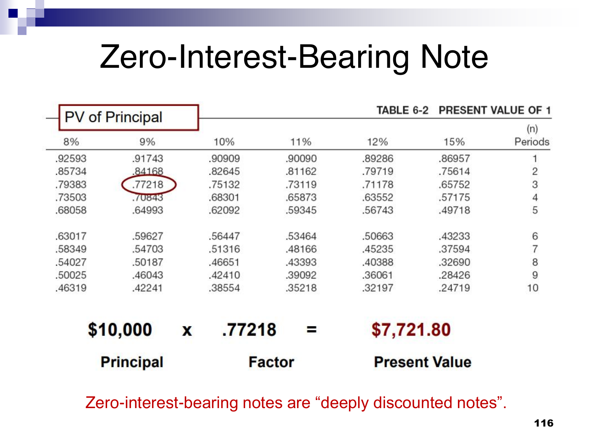

來源：[Ch 05_Cash and Receivables.pdf，PDF 第 116 頁](附件/Ch%2005_Cash%20and%20Receivables.pdf#page=116)。先讀上面的白話步驟，再對照原圖；點圖可放大。


## 真題小練習｜113-1 選擇第 9 題：注意問第二年，不是第一年利息

> [!tip] 先懂這題的道理
> **零息票據的利息收入每年按「期初帳面金額×市場利率」算；帳面金額每年會加上前一年的利息，所以第二年的利息比第一年多。**
> - 題目問 2022 年，也就是持有的第二年，要先算出 2021 年底的帳面金額。


[113-1 原卷，PDF 第 3 頁](附件/歷屆試題/113-1%20Midterm%20I%20with%20ans_posted.pdf#page=3)。英文原題如下，已移除答案顏色提示。

> 9. On January 1, 2021, West Co. exchanged equipment for a £400,000 zero-interest-bearing note   
> due on January 1, 2024. The prevailing rate of interest for a note of this type at January 1, 2021   
> was 10%. The present value of $1 at 10% for three periods is 0.75. What amount of interest   
> revenue should be included in West’s 2022 income statement?   
> (A) £0   
> (B) £30,000   
> (C) £33,000   
> (D) £40,000  

> [!success]- 展開詳解｜先寫完，再看推理與答案
> **答案 C：£33,000。**
>
> 1. 2021/1/1 原始現值＝400,000 × 題目給的 0.75＝**300,000**。
> 2. 2021 年利息＝300,000 × 10%＝30,000。
> 3. 所以 2021 年底、也就是 2022 年初帳面淨額＝330,000。
> 4. 問的是 **2022 income statement**，利息＝330,000 × 10%＝**33,000**。
>
> ```text
> 2022 年底（以面額＋折價表示）：
> Dr. Discount on Notes Receivable     33,000
>     Cr. Interest Revenue                    33,000
> ```
>
> 票據折價減少，帳面淨額上升。A 把零息誤認為沒有利息收入；B 用了第一年數字；D 直接乘票面 400,000。
>
> 原題把三年 10% 現值因子近似為 0.75，**考題指定因子就用 0.75**，不要自己換更精確值而偏離原解答。這裡依它算到題目所問的第二年即可。
>
> **核對原卷（紅字是原解答）：**
>
> 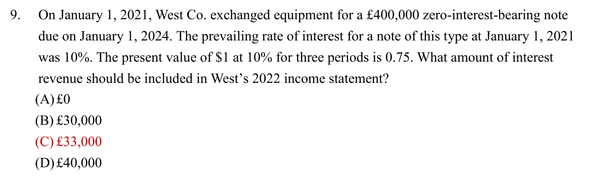


# 選擇六｜第 5 章服務資產與服務負債

## 教學｜賣掉應收帳款後還繼續幫忙收款，為什麼會多出一項資產或負債？

### 服務資產和服務負債從哪裡來？
**代收款這份工作有市場行情（適當服務補償）；公司拿到的服務報酬高於行情，多出來的是一項有價值的權利（服務資產），低於行情就是一項會賠錢的義務（服務負債）。**
- 服務資產的公允價值＝預期服務報酬－適當服務補償。

### 為什麼服務資產要分攤，服務負債卻直接用公允價值？
**服務資產是從原本那筆應收帳款拆出來、公司自己留下的一部分，所以要按相對公允價值分攤原帳面金額；服務負債是新承擔的義務，不是從原資產拆出來的，所以直接按公允價值入帳。**
- 原應收帳款賣掉後拆成兩樣：賣給銀行的部分、自己留下的服務權利。
- 原帳面金額按兩者公允價值的比例分配，賣出部分分到的帳面金額用來算出售損益。
- 服務負債使公司拿到的淨對價變少，所以出售損失變大。


## 先懂中文，再認英文

| 中文概念 | 英文題目會怎麼寫 | 看到它要做什麼 |
|---|---|---|
| 代收款服務 | Servicing of receivables | 賣掉應收款後仍負責收款 |
| 服務資產／服務負債 | Servicing Asset / Servicing Liability | 比較報酬與適當補償 |
| 適當服務補償 | Adequate compensation / fairly compensate | 不是只看有沒有收到服務費 |
| 相對公允價值 | Relative fair values | 服務資產分攤原帳面金額 |
| 帳面金額 | Carrying amount | 不要和 fair value 混為一談 |


## 服務資產與服務負債：不是都直接用公允價值入帳

公司把應收帳款賣掉後，可能仍替銀行收款。

- 報酬高於適當服務補償：可能有服務資產。
- 報酬不足以補償服務：可能有服務負債。


> [!tip] 先懂這題的道理
> **先比較服務報酬和適當補償：報酬高於補償的部分是服務資產，要從原帳面金額分攤；沒有報酬卻要負擔收款工作，就是服務負債，直接按公允價值記並增加損失。**
> - (a) 報酬 15,000 比適當補償 5,000 多 10,000，服務資產公允價值 10,000。
> - (b) 沒有額外報酬、適當補償 8,000，公司等於要免費做價值 8,000 的工作，這是負債。

**助教 E5.22 完整原題**｜來源：[助教講義 PDF 第 24 頁](附件/TA%20Handout%20-%20Ch%205.pdf#page=24)。下圖保留完整英文題幹、表格與全部小題，未包含解答。

(a) 額外服務報酬 15,000、適當補償 5,000；(b) 無額外報酬、適當補償 8,000。兩小題獨立，不是先後發生。先保留完整題目，再看下方分攤與分錄。

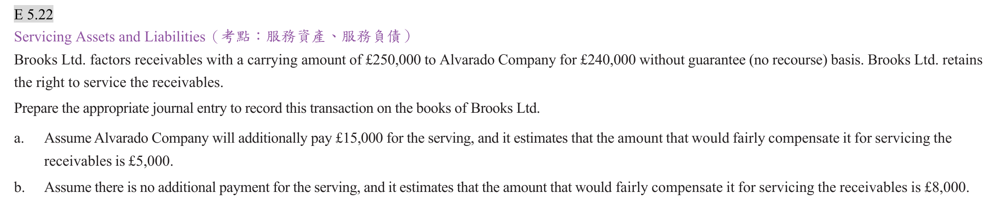

> [!success]- 展開詳解｜先自己做，再核對
> (a) 服務權利公允價值＝15,000−5,000＝10,000。分攤帳面金額＝250,000 × 10,000/(240,000＋10,000)＝**10,000**。借 Cash 240,000、Servicing Asset 10,000，貸 Accounts Receivable 250,000；本例損益為零。
>
> (b) 承擔服務負債公允價值 8,000。損失＝250,000＋8,000−240,000＝**18,000**。借 Cash 240,000、Loss on Sale of Receivables 18,000，貸 Accounts Receivable 250,000、Servicing Liability 8,000。
>
> 服務資產用相對公允價值分攤；服務負債按公允價值認列。下方改變出售部分公允價值的例子是自編變形，不是原題新增條件。


### 服務資產：分攤原帳面金額

假設：

- 原應收款帳面金額 250,000。
- 出售部分公允價值 240,000。
- 服務資產公允價值 10,000。

$$
服務資產入帳金額
＝250,000×\frac{10,000}{240,000＋10,000}
＝10,000
$$

這題剛好等於公允價值。

如果出售部分公允價值改成 250,000：

$$
250,000×\frac{10,000}{250,000＋10,000}
＝9,615.38
$$

**所以不能直接背「服務資產＝報酬－服務成本」。那通常先用來判斷公允價值，再按比例分攤帳面金額。**

### 服務負債：按公允價值認列

應收款帳面 250,000，收現 240,000，另承擔服務負債公允價值 8,000：

```text
借：現金                 240,000
借：出售應收款損失        18,000
    貸：應收帳款                250,000
    貸：服務負債                  8,000
```

部分出售本金、保留利息權利的題目，也是先依相對公允價值分攤原帳面金額，再算出售部分損益。


### 教材原圖｜服務資產要按相對公允價值分攤

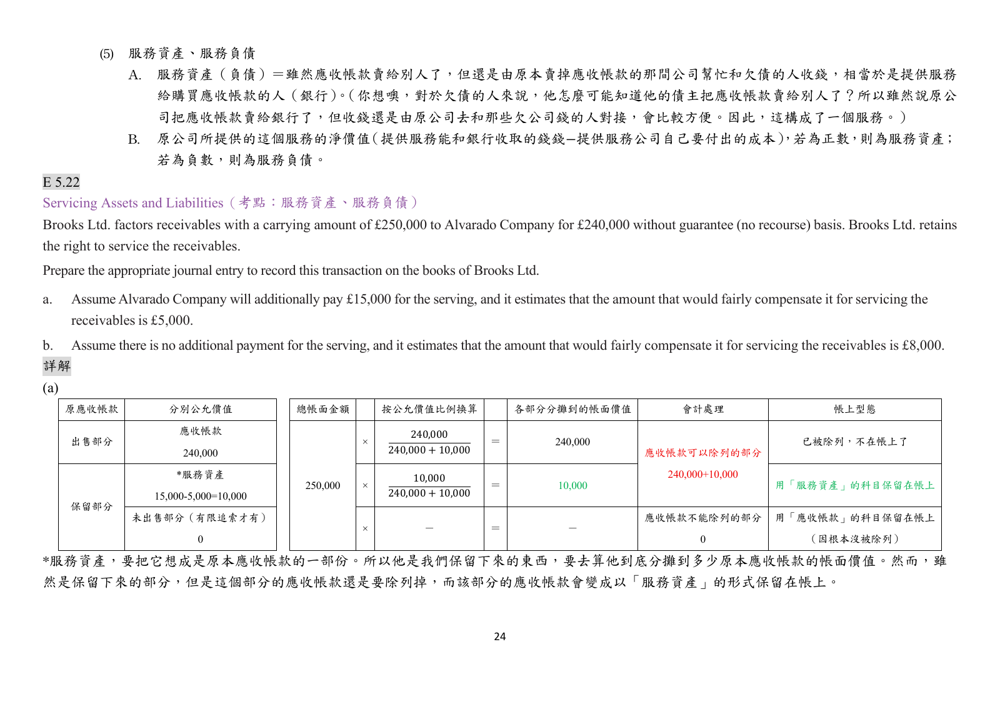

來源：[TA Handout - Ch 5.pdf，PDF 第 24 頁](附件/TA%20Handout%20-%20Ch%205.pdf#page=24)。先讀上面的白話步驟，再對照原圖；點圖可放大。


# 選擇七｜第 6 章存貨範圍、成本與錯誤【基礎解說＋歷屆真題】

## 教學｜存貨的金額要回答哪三個問題？

**老師把存貨估價拆成三步：哪些貨算我的、哪些支出算進存貨成本、賣出時用哪一批的成本（[第 6 章投影片第 8 頁](附件/Ch%2006_Inventory%20(part%201)%206.1-6.4.pdf#page=8)）。這一節處理前兩步，第三步在題型六。**

### 哪些貨算我的存貨？
**看控制權：能不能決定這批貨怎麼用、是否承擔它的風險和報酬；貨放在哪裡、法律上的名義是誰，都不是決定因素。**
- 存貨的定義（IAS 2）：為正常營業出售而持有的商品、正在生產中的在製品、將在生產中耗用的原料和物料。
- 在途存貨看交貨條件：起運點交貨（FOB shipping point）在賣方把貨交給貨運公司時，所有權就轉給買方；目的地交貨（FOB destination）要到買方收貨才轉。
- 寄銷：寄銷人（consignor）把貨放在承銷人（consignee）店裡代賣，賣出前仍是寄銷人的存貨。
- 附買回協議的銷貨：賣方承諾之後買回，本質是拿存貨擔保借錢，存貨仍列賣方，收到的錢記負債。
- 附退貨權的銷貨：預期會被退回的部分不認收入，記退款負債，並記一項「待退回產品權利」；預期不會退的部分照常認收入和銷貨成本。
- 分期付款銷貨：即使賣方保留法定所有權，貨已交給買方、控制已移轉，就照一般銷貨處理，存貨除列；例外是帳款很可能收不回時，不認收入，存貨也不除列。
- 代客戶加工的原料：加工業者只能照客戶指示使用，沒有控制，不是加工業者的存貨。
- 老師的綜合例題（小智公司，[投影片第 19～21 頁](附件/Ch%2006_Inventory%20(part%201)%206.1-6.4.pdf#page=19)）：盤點 75,000＋起運點交貨的在途進貨含運費 10,350－附買回所以仍屬賣方的 20,000－別人寄銷在倉庫的 5,000＋寄銷在外的 15,000＋無法估計呆帳而不認銷貨的分期銷貨 18,000＝**93,350**。

### 哪些支出算進存貨成本？
**把存貨帶到「目前地點和可銷售狀態」所必要的支出才算成本；這些成本跟著存貨走，賣出時才變成銷貨成本，其他支出當期就是費用。**
- 進貨成本：購價、不可退還的進口稅、進貨運費、裝卸，並扣掉商業折扣、回贈、進貨退回與折讓。
- 加工成本：直接人工，加上有系統分攤的製造費用（間接材料、間接人工、廠房折舊、保險、水電）。
- 不算的：異常浪費、一般儲存費（生產過程中必要的儲存除外，例如釀酒）、和存貨無關的管理費用、銷售費用、利息（只有 IAS 23 規定的少數情況可以資本化）。
- 跟著存貨走的叫產品成本（product cost）；銷售和管理費用叫期間成本（period cost），當期就是費用。
- 分錯會扭曲毛利和營業利益：把應列銷管費用的倉儲費 100 算進存貨，若這批存貨賣出 80%，毛利低估 80、營業利益高估 20，因為還有 20 留在存貨沒變成費用（[投影片第 29 頁](附件/Ch%2006_Inventory%20(part%201)%206.1-6.4.pdf#page=29)）。

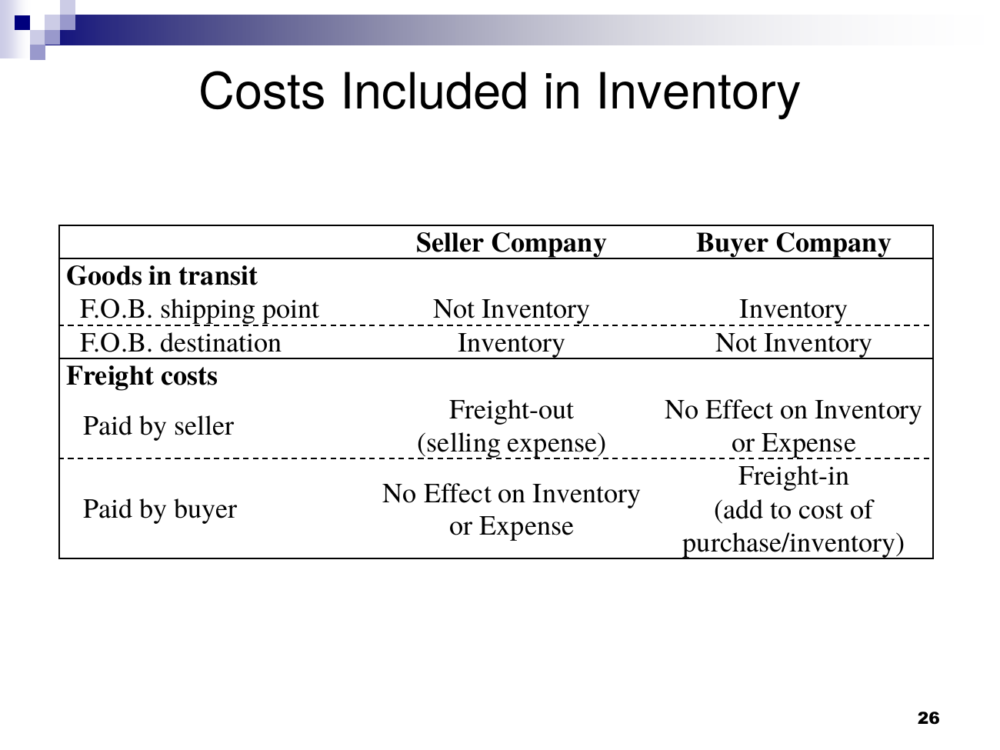

來源：[Ch 06_Inventory (part 1) 6.1-6.4.pdf，PDF 第 26 頁](附件/Ch%2006_Inventory%20(part%201)%206.1-6.4.pdf#page=26)。

### 現金折扣有哪兩種記法？
**總額法先按發票全額記進貨，在折扣期內付款才扣掉折扣；淨額法一開始就假設會拿到折扣，錯過時多付的錢記「進貨折扣損失」。**
- 2/10, n/30 的意思是十天內付款打 2% 折扣，否則三十天內付全額。
- 永續盤存下，進貨退回和進貨折扣都直接貸記存貨；定期盤存才使用「進貨折扣」科目。
- 老師例題（[投影片第 38 頁](附件/Ch%2006_Inventory%20(part%201)%206.1-6.4.pdf#page=38)，定期盤存）：進貨 10,000，其中 4,000 在折扣期內付款、6,000 逾期付款。總額法付 4,000 時貸進貨折扣 80、現金 3,920；淨額法進貨先記 9,800，逾期付 6,000 時借進貨折扣損失 120。

### 帳上存貨和盤點不一致時怎麼辦？
**永續盤存帳上隨時有存貨餘額，但期末仍要實地盤點；帳多於實物是盤虧，借記存貨盤盈虧（Inventory Over and Short）、貸記存貨，這個科目調整銷貨成本。**
- 投影片例子：帳上 4,000、盤點 3,800，借 Inventory Over and Short 200、貸 Inventory 200。
- 臺灣 98 年接軌 IFRS 後，盤盈虧列入銷貨成本，不再列營業外。


## 先懂中文，再認英文

| 中文概念 | 英文題目會怎麼寫 | 看到它要做什麼 |
|---|---|---|
| 實地盤點 | Physical inventory / physical count | 現場數到的貨還要調整歸屬 |
| 在途貨物 | Goods in transit | 按交貨條件判斷 |
| 起運點／目的地交貨 | FOB shipping point / FOB destination | 分清自己是買方還是賣方 |
| 代他人寄銷的存貨 | Inventory held on consignment | 通常不屬自己的存貨 |
| 進貨／銷貨運費 | Freight-in / freight-out | 前者常列存貨、後者列銷售費用 |
| 加工成本／異常損耗 | Conversion costs / abnormal spoilage | 正常製造成本與異常浪費不同 |
| 高估／低估 | Overstated / understated | 從 COGS 公式推方向 |
| 存貨盤盈虧 | Inventory Over and Short | 盤差損失常在借方 |


## 6-3 哪些貨算我的存貨

不要只看貨物擺在哪裡。題目在問報導日這批貨是否屬於公司的存貨；典型入門題會以交貨條件判斷。

| 情況 | 入門題的判斷 |
|---|---|
| FOB shipping point 起運點交貨 | 交運後通常由買方計入在途存貨 |
| FOB destination 目的地交貨 | 到達前通常仍由賣方計入 |
| 寄銷商品送到別人店裡，尚未售出 | 仍是委託人的存貨 |
| 自己代別人寄銷，尚未售出 | 不是自己的存貨 |
| 放在外部倉庫的自有商品 | 地點不影響，仍要考慮計入 |

附買回、附退貨權、分期付款、代客加工等特殊情況，判斷方法見本節開頭的教學。

## 真題小練習｜113-1 選擇第 1 題：在途貨物：先分我是買方還是賣方

> [!tip] 先懂這題的道理
> **在途貨物看交貨條件決定所有權何時移轉；同樣是目的地交貨，自己是買方時貨還沒到不算，自己是賣方時貨還沒到客戶仍然算。**
> - 目的地交貨：貨物抵達買方之前，所有權都在賣方。
> - 題目兩批都沒有被盤點到，只有屬於 Bell 的那批要補加。


[113-1 原卷，PDF 第 1 頁](附件/歷屆試題/113-1%20Midterm%20I%20with%20ans_posted.pdf#page=1)。112-1 第 1 題也考同一概念。英文原題如下，已移除答案顏色提示。

> 1. Bell Inc. took a physical inventory at the end of the year and determined that €475,000 of   
> goods were on hand. In addition, the following items were not included in the physical count:   
>  €60,000 of purchased goods (shipped f.o.b. destination) were in transit (goods were   
> actually received by the company three days after the inventory count).    
>  On the last day of the year, the company sold €25,000 worth of inventory f.o.b.   
> destination, and the goods were in transit.   
> What amount should Bell report as inventory at the end of the year?   
> (A) €475,000   
> (B) €500,000   
> (C) €535,000   
> (D) €560,000  

> [!success]- 展開詳解｜先寫完，再看推理與答案
> **答案 B：€500,000。**
>
> 1. 現場盤到 475,000，題目說下面兩批都「未含在盤點中」（not included in the physical count）。
> 2. 買進的 60,000 是目的地交貨（FOB destination），年底還沒到自己這裡，尚不加入自己的存貨。
> 3. 已賣出的 25,000 也是目的地交貨，年底仍在路上、未到客戶，仍屬 Bell，要補加回。
> 4. 期末存貨＝475,000＋25,000＝**500,000**。
>
> 同樣 FOB destination，自己是買方時不加，是賣方時仍留下，不能一律背「在途加」或「在途減」。A 漏自己的在途貨；C 加錯買進貨；D 兩批都加。原卷把 25,000 當要計入的存貨金額使用，這裡沿用原解答。
>
> **核對原卷（紅字是原解答）：**
>
> 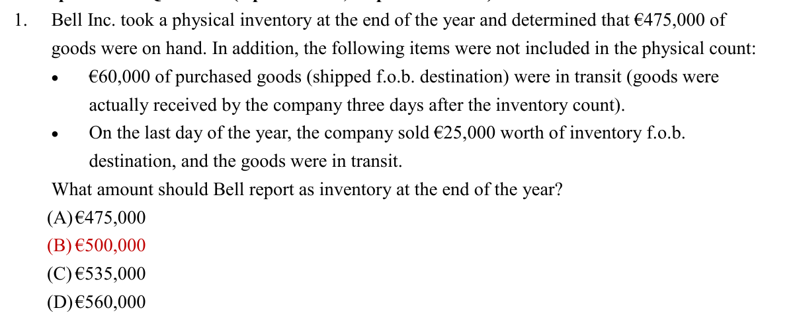


## 6-4 哪些支出進存貨成本

白話原則：為了把存貨弄到**現在的地點與可使用／可銷售狀態**所需的成本，才考慮放進存貨。

| 計入成本的典型項目           | 不計入的典型項目          |
| ------------------- | ----------------- |
| 購價扣除商業折扣、進貨退回折讓     | 銷售費用、送貨給客戶的銷貨運費   |
| 進貨運費、必要搬運           | 異常浪費              |
| 不可退還的進口稅等           | 可收回的稅款            |
| 製造成本中的直接人工與合理分攤製造費用 | 不使存貨達到目前狀態的一般行政費用 |

一般非必要倉儲費通常列費用；生產下一階段前必要的儲存可能例外。現金折扣的總額法與淨額法見本節開頭的教學。

自編例：購價 100,000，商業折扣 10%，進貨運費 3,000，不可退稅 2,000，銷貨運費 4,000。存貨成本＝100,000 × 90%＋3,000＋2,000＝**95,000**；4,000 是銷售費用。

## 真題小練習｜113-1 選擇第 5 題：成本歸屬：異常浪費不塞進存貨

> [!tip] 先懂這題的道理
> **只有把存貨帶到目前地點和可銷售狀態的必要支出才進存貨；異常損耗不是做好產品所必要的，放進存貨會讓資產虛增，所以當期直接列費用。**


[113-1 原卷，PDF 第 2 頁](附件/歷屆試題/113-1%20Midterm%20I%20with%20ans_posted.pdf#page=2)。112-1 第 5 題也考同一概念。英文原題如下，已移除答案顏色提示。

> 5. Which of the following costs should not be included on the statement of financial position as   
> part of the cost of inventory?   
> (A) Purchase import duties   
> (B) Conversion costs   
> (C) Abnormal spoilage   
> (D) Materials freight-in  

> [!success]- 展開詳解｜先寫完，再看推理與答案
> **答案 C：Abnormal spoilage（異常損耗）。**
>
> 1. 題目問 should not be included，找不該資產化的成本。
> 2. 進口稅（Purchase import duties，按不可退稅的一般情境）、加工成本（Conversion costs）、進料運費（Materials freight-in）都與取得或製造存貨有關。
> 3. 異常損耗不是正常把產品做好的必要成本，通常直接列當期損失／費用，不讓存貨因浪費而變貴。
>
> 不要把 abnormal 和正常生產成本混在一起。
>
> **核對原卷（紅字是原解答）：**
>
> 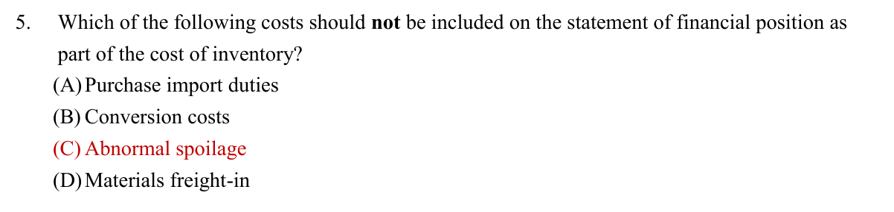


## 真題小練習｜113-1 選擇第 6 題：賣方付的銷貨運費去哪裡

> [!tip] 先懂這題的道理
> **運費看是為了「買進」還是「賣出」：買方付的進貨運費是取得存貨的成本；賣方為出貨付的銷貨運費是銷售費用。**
> - 這題 Margo 是賣方，運費和這筆銷售有關，所以是銷貨運費。


[113-1 原卷，PDF 第 2 頁](附件/歷屆試題/113-1%20Midterm%20I%20with%20ans_posted.pdf#page=2)。112-1 第 6 題也考同一概念。英文原題如下，已移除答案顏色提示。

> 6. Margo Computers is a retailer specializing in selling computers and related equipment. During   
> 2022, Margo Computers sells €200,000 of merchandise to Sandcastles Distributor. Margo   
> Computers incurs €24,000 of freight costs associated with these sales. Which of the following   
> is true regarding how this €24,000 is treated on the financial statements?   
> (A) Margo Computers will report the €24,000 as part of merchandise inventory on the   
> statement of financial position.   
> (B) Margo Computers will report the €24,000 as part of operating expenses on the income   
> statement.    
> (C) Sandcastles Distributor will report the €24,000 as part of merchandise inventory on the   
> statement of financial position.   
> (D) Sandcastles Distributor will report the €24,000 as an accounts receivable on the statement   
> of financial position.  

> [!success]- 展開詳解｜先寫完，再看推理與答案
> **答案 B：Margo 的營業費用（Operating expenses）。**
>
> 先看主詞：Margo sells，而且 Margo incurs freight costs associated with these sales。這是賣方為銷售而發生的運費，屬銷貨運費（Freight-out），在損益表列銷售相關費用。
>
> A 把銷貨運費加回賣方存貨；C、D 把 Margo 發生的費用移到另一家公司。不要只看到 freight 就想到存貨，先認誰付、為進貨還是出貨。
>
> **核對原卷（紅字是原解答）：**
>
> 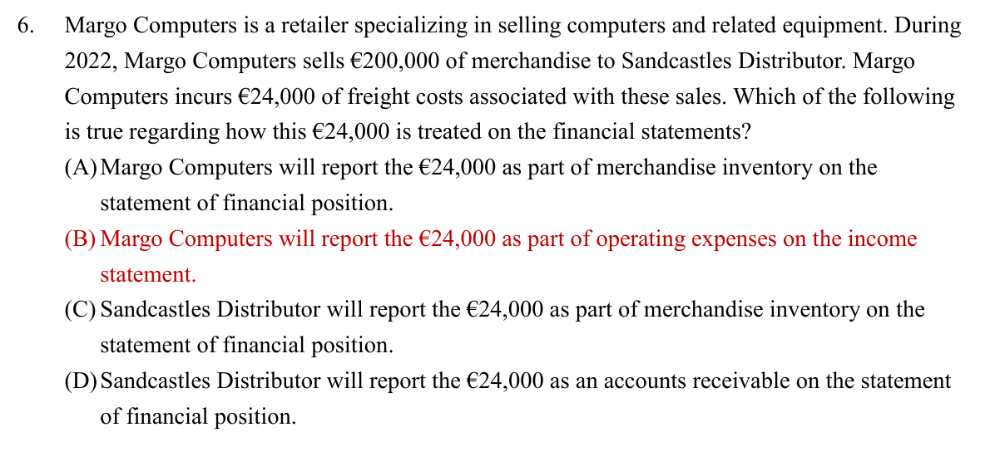


## 真題小練習｜113-1 選擇第 7 題：產品成本何時變費用

> [!tip] 先懂這題的道理
> **產品成本先附在存貨上，等商品賣出、相關收入認列時才轉成銷貨成本，目的是讓收入和它的成本落在同一期。**
> - 付款、收到發票、支出發生的時間點，都不決定成本何時變成費用。


[113-1 原卷，PDF 第 2 頁](附件/歷屆試題/113-1%20Midterm%20I%20with%20ans_posted.pdf#page=2)。112-1 第 7 題也考同一概念。英文原題如下，已移除答案顏色提示。

> 7. What is the general approach as to when product costs are recognized as expenses?   
> (A) In the period when the expenses are paid.    
> (B) In the period when the expenses are incurred.   
> (C) In the period when the vendor invoice is received.   
> (D) In the period when the related revenue is recognized.  

> [!success]- 展開詳解｜先寫完，再看推理與答案
> **答案 D：在相關收入認列期間（In the period when the related revenue is recognized）。**
>
> 買入商品時先是存貨資產；商品賣出、認列收入時，相對應成本才轉成銷貨成本。這是本題問的產品成本（Product costs）一般處理。
>
> A 付款、B 發生支出、C 收到發票，都不必然等於商品賣出的時間。例如一月進貨付錢、二月賣出，成本通常二月才進 COGS。不要把這個原則擴張成異常浪費也得留在存貨；第 5 題就是例外辨識。
>
> **核對原卷（紅字是原解答）：**
>
> 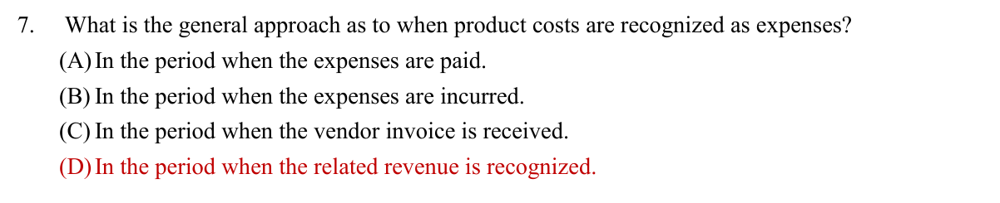


## 真題小練習｜113-1 選擇第 12 題：進貨運費與零售存貨借款利息

> [!tip] 先懂這題的道理
> **進貨運費是把商品運到現在地點的必要成本，所以增加存貨成本；零售商為存貨借錢的利息是籌資成本，原則上列利息費用，不進存貨。**
> - 利息只有在 IAS 23 規定的情況（需要很長時間才能完成的資產）才資本化，一般零售存貨不適用。


[113-1 原卷，PDF 第 3 頁](附件/歷屆試題/113-1%20Midterm%20I%20with%20ans_posted.pdf#page=3)。112-1 第 12 題也考同一概念。英文原題如下，已移除答案顏色提示。

12. How should the following costs affect a retailer's inventory cost?

| Option | Freight-in | Interest on Inventory Loan |
|---|---|---|
| A | Increase | Increase |
| B | Increase | No effect |
| C | No effect | Increase |
| D | No effect | No effect |

> [!success]- 展開詳解｜先寫完，再看推理與答案
> **113-1 答案 B；112-1 同概念答案 A。兩年只是把 A、B 選項對調。**
>
> - Freight-in 是把買進商品運到現在地點的成本，所以 **Increase** inventory cost。
> - 本題是一般零售商（retailer）的存貨借款利息，通常列利息費用，不加進存貨成本，所以 **No effect** on inventory cost。
>
> 因此背「Increase / No effect」，不要背答案字母。若未來題目明確涉及需要長期準備的符合資本化條件資產，要再依其條件判斷；本題沒有那個設定。
>
> **核對原卷（紅字是原解答）：**
>
> 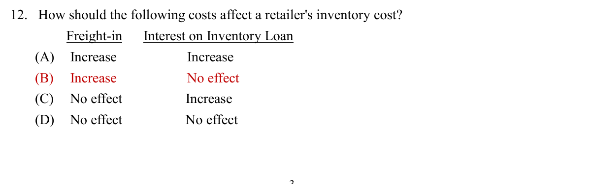


## 真題小練習｜112-1 選擇第 13 題：先扣退貨，再算進貨折扣

> [!tip] 先懂這題的道理
> **現金折扣只能用在「實際還欠的金額」上：先扣退貨，再乘折扣率；永續盤存下進貨折扣直接減少存貨成本，所以貸記 Inventory。**
> - 總額法先按全額記應付帳款，拿到折扣時才把折扣扣掉。


[112-1 原卷，PDF 第 4 頁](附件/歷屆試題/112-1%20Midterm%20I%20with%20sol_posted.pdf#page=4)。英文原題如下，已移除答案顏色提示。

> 13. Elkins Corporation uses a perpetual inventory system and records purchases using the gross   
> method. On March 1, it purchased €10,000 of inventory, terms 2/10, n/30. On March 3, Elkins   
> returned goods that cost €1,000. On March 9, Elkins paid the supplier. On March 9, Elkins   
> should    
> (A) credit purchase discounts for €200   
> (B) credit inventory for €200   
> (C) credit purchase discounts for €180   
> (D) credit inventory for €180  

> [!success]- 展開詳解｜先寫完，再看推理與答案
> **答案 D：credit inventory for €180。**
>
> 本題屬存貨成本的進貨折扣變形，對應第 6 章投影片第 33、38 頁。
>
> 1. perpetual inventory system＝永續盤存，進貨與其調整直接進 Inventory。
> 2. gross method＝總額法，買進時先認 10,000。
> 3. 退貨 1,000，剩餘應付帳款＝9,000。
> 4. 2/10, n/30＝十天內付款享 2% 折扣、一般三十天內付清。
> 5. 3/9 在折扣期內，所以折扣＝9,000 × 2%＝**180**，不是 200。
> 6. 實付現金＝9,000−180＝8,820。
>
> ```text
> Dr. Accounts Payable       9,000
>     Cr. Cash                       8,820
>     Cr. Inventory                    180
> ```
>
> A、B 用原進貨額而未扣退貨；C 雖算對 180，但本題永續盤存採總額法，折扣貸 Inventory，不使用定期盤存的 Purchase Discounts 科目。
>
> **核對原卷（紅字是原解答）：**
>
> 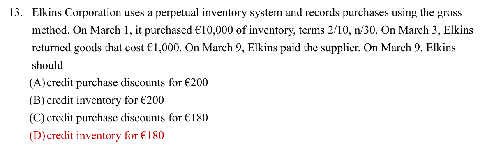


## 教學｜存貨算錯，為什麼會一路錯到淨利和保留盈餘？

### 錯誤是怎麼傳遞的？
**銷貨成本是用期末存貨倒推的：銷貨成本＝期初存貨＋進貨－期末存貨；期末存貨多算多少，銷貨成本就少算多少，淨利就多算多少。**
- 淨利結帳後進保留盈餘，所以期末保留盈餘跟著錯。
- 今年的期末存貨就是明年的期初存貨，錯誤會帶到明年，方向相反，兩年淨利合計會抵銷，但每一年的報表都是錯的。
- 老師的例子（Yei Chen，[投影片第 61 頁](附件/Ch%2006_Inventory%20(part%201)%206.1-6.4.pdf#page=61)）：2022 年期末存貨低估 10,000；錯誤下兩年淨利是 10,000 和 20,000，正確是 20,000 和 10,000，兩年合計都是 30,000。

### 進貨和期末存貨一起漏記，為什麼淨利不受影響？
**同一批貨既沒記進貨、也沒算進期末存貨，在銷貨成本公式裡一加一減剛好抵銷；但資產負債表上存貨和應付帳款都低估。**
- 存貨和應付帳款低估同一個金額，營運資金（流動資產－流動負債）不變。
- 流動比率（流動資產÷流動負債）原本大於 1 時，分子分母減同一個數，比率會變大，所以高估（[投影片第 62 頁](附件/Ch%2006_Inventory%20(part%201)%206.1-6.4.pdf#page=62)）。

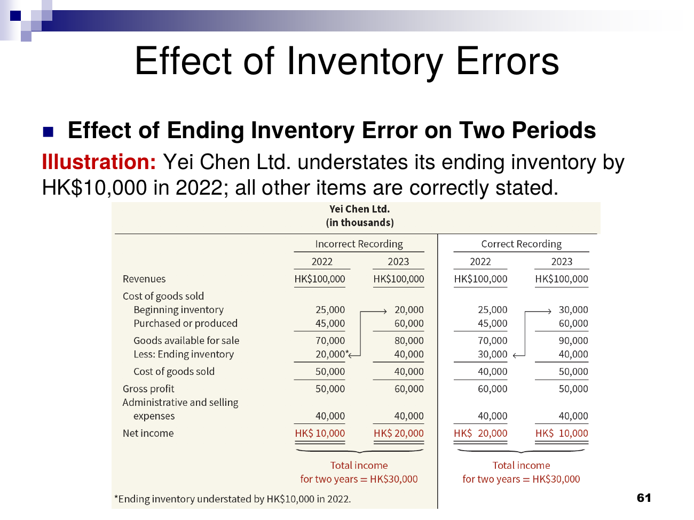

來源：[Ch 06_Inventory (part 1) 6.1-6.4.pdf，PDF 第 61 頁](附件/Ch%2006_Inventory%20(part%201)%206.1-6.4.pdf#page=61)。

## 6-5 存貨錯誤：先推公式，不要硬背箭頭

**銷貨成本＝期初存貨＋淨進貨－期末存貨。**

假設只有盤點金額錯誤，進貨及應付帳款等都正確，先忽略所得稅：

| 錯誤     | 本期銷貨成本 | 本期淨利 | 本期期末資產 | 本期期末保留盈餘 |
| ------ | ------ | ---- | ------ | -------- |
| 期末存貨高估 | 低估     | 高估   | 高估     | 高估       |
| 期末存貨低估 | 高估     | 低估   | 低估     | 低估       |

例：期末存貨少算 10,000。因為少減 10,000，銷貨成本多 10,000；淨利少 10,000，期末存貨資產和保留盈餘也少 10,000。

### 下一年為什麼會反過來

今年期末就是明年期初。今年期末少 10,000，明年期初也少 10,000；若明年期末已正確，明年銷貨成本便少 10,000，明年淨利多 10,000。

在**第二年期末正確、沒有其他錯誤且忽略稅**的前提下，兩年淨利合計的錯誤會互相抵消，第二年底保留盈餘也恢復正確。但第一年、第二年各年的淨利仍各自錯誤，不能因此不更正。

### 進階陷阱：漏記整筆進貨，不能直接套上表

年底買進並已取得的貨 10,000，漏記應付帳款與進貨，同時盤點也漏列。定期盤存下，進貨少 10,000，期末存貨也少 10,000，銷貨成本兩個影響互抵，淨利可能不變；但存貨與應付帳款都低估。一定先看是「只盤點錯」還是「交易與盤點一起漏」。

## 真題小練習｜113-1 選擇第 10 題：把別人的寄銷品當自己的存貨

> [!tip] 先懂這題的道理
> **代別人賣的寄銷品不是自己的存貨；誤算進去會讓期末存貨高估，再經過「銷貨成本＝可供銷售－期末存貨」一路傳到淨利和保留盈餘。**


[113-1 原卷，PDF 第 3 頁](附件/歷屆試題/113-1%20Midterm%20I%20with%20ans_posted.pdf#page=3)。112-1 第 10 題也考同一概念。英文原題如下，已移除答案顏色提示。

> 10. Tang, Inc. sells collectible jewelry on consignment from various manufacturers. Additionally,   
> Tang sells its own line of specialty jewelry manufactured in-house. On December 31, 2022,   
> during Tang, Inc 's annual inventory count, an inexperienced new staff member included in   
> Tang’s ending inventory €350,000 worth of inventory held on consignment from Metcalf   
> Associates. Which of the following is correct regarding the impact of this error on Tang’s   
> income statement and statement of financial position at December 31, 2022?   
> (A) Net income is understated by €350,000.   
> (B) Ending inventory is understated by €350,000.   
> (C) Retained earnings is overstated by €350,000.   
> (D) Cost of goods sold is overstated by €350,000.  

> [!success]- 展開詳解｜先寫完，再看推理與答案
> **答案 C：Retained earnings is overstated by €350,000。**
>
> 1. held on consignment from Metcalf＝Tang 替 Metcalf 保管／銷售的寄銷貨，不是 Tang 自有存貨。
> 2. Tang 誤加 350,000，期末存貨高估（overstated）。
> 3. COGS＝期初＋進貨−期末。期末多減 350,000，使 COGS 低估 350,000。
> 4. 費用少算 → 本期淨利高估 → 結帳後 RE 高估 350,000。
>
> 本題按只錯列期末存貨、無其他錯誤及稅影響處理。A、B、D 的方向都相反。可畫一條箭頭：EI ↑ → COGS ↓ → NI ↑ → RE ↑。
>
> **核對原卷（紅字是原解答）：**
>
> 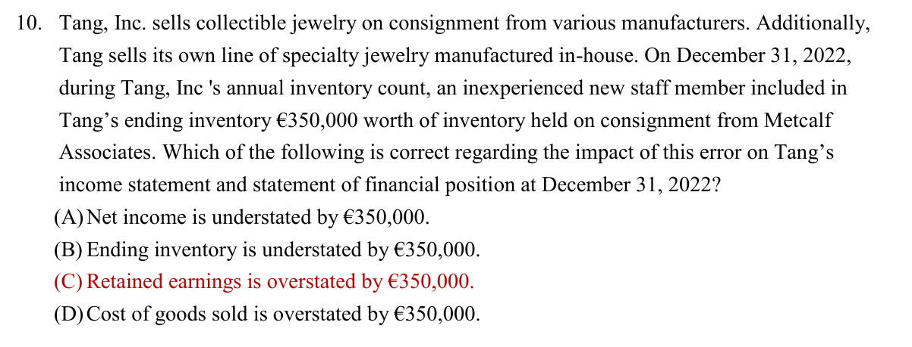


## 真題小練習｜112-1 選擇第 9 題：永續盤存帳比實物多，怎麼調整

> [!tip] 先懂這題的道理
> **永續盤存帳上的餘額要以實地盤點為準；帳多於實物代表貨少了，是盤虧，資產減少，損失記在存貨盤盈虧的借方，並調整銷貨成本。**


[112-1 原卷，PDF 第 3 頁](附件/歷屆試題/112-1%20Midterm%20I%20with%20sol_posted.pdf#page=3)。英文原題如下，已移除答案顏色提示。

> 9. Mineral Makers (MM) Company keeps its inventory records using a perpetual system. At   
> December 31, 2022, the unadjusted balance in the inventory account is €64,000. Through a   
> physical count on December 31, 2022, MM determines that its actual merchandise inventory at   
> year-end is €62,500. Which of the following is true regarding the statement of financial   
> position and the income statement of MM at December 31, 2022?   
> (A) Inventory is increased and Inventory Over and Short is decreased by €1,500.   
> (B) Inventory is decreased and Inventory Over and Short is increased by €1,500.   
> (C) Inventory is increased and Inventory Over and Short is increased by €1,500.   
> (D) Inventory is decreased and Inventory Over and Short is decreased by €1,500.  

> [!success]- 展開詳解｜先寫完，再看推理與答案
> **答案 B：Inventory 減少、Inventory Over and Short 增加 1,500。**
>
> 1. 帳上 64,000，實地盤點 62,500，表示帳比實物多 **1,500**。
> 2. 資產要回到實際數量，所以貸記 Inventory 1,500。
> 3. 少掉的貨是盤虧損失，本題用 Inventory Over and Short，借記 1,500。
>
> ```text
> Dr. Inventory Over and Short       1,500
>     Cr. Inventory                         1,500
> ```
>
> 因此資產下降，盤虧費用上升，淨利下降。選項的 increased 是指這個損失科目增加，不是說存貨增加。
>
> **核對原卷（紅字是原解答）：**
>
> 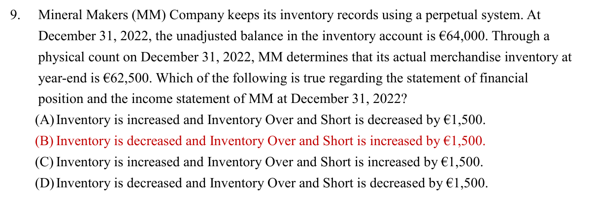


## 老師例題練習｜Christmas Company：六個錯誤各自怎麼影響毛利

來源：[第 6 章投影片第 63～64 頁](附件/Ch%2006_Inventory%20(part%201)%206.1-6.4.pdf#page=63)。公司採定期盤存，2021 年發現六個可能的錯誤：

1. 一筆 51,000 的進貨已正確記入進貨，但應付帳款只貸記 4,000。
2. 年底前收到一批 4,400 的貨，已正確記入進貨，但盤點時沒有算進期末存貨。
3. 一筆 5,600 的進貨被誤記成 6,500。
4. 一筆 1,200 的進貨既沒記進貨，也沒記應付帳款。
5. 年中退回供應商 3,100 的瑕疵品，原進貨已記，退回分錄沒記。
6. 盤點時有成本 800 的存貨被算了兩次。

要求：原先算出 2021 年毛利 25,000，正確毛利是多少？若不更正，2022 年淨利會錯多少？

> [!success]- 展開答案｜先自己做，再核對
> 每一項都先問：它改變的是「進貨」還是「期末存貨」？再代入銷貨成本＝期初＋進貨－期末。
>
> | 錯誤 | 進貨 | 期末存貨 | 銷貨成本 |
> |---|---|---|---|
> | 1 | 不影響（錯的是應付帳款） | 不影響 | 不影響 |
> | 2 | 不影響 | 低估 4,400 | 高估 4,400 |
> | 3 | 高估 900 | 不影響 | 高估 900 |
> | 4 | 低估 1,200 | 不影響 | 低估 1,200 |
> | 5 | 高估 3,100 | 不影響 | 高估 3,100 |
> | 6 | 不影響 | 高估 800 | 低估 800 |
> | 合計 | 高估 2,800 | 低估 3,600 | **高估 6,400** |
>
> 銷貨成本高估 6,400，毛利就低估 6,400，正確毛利＝25,000＋6,400＝**31,400**。
>
> 2021 年期末存貨淨低估 3,600，就是 2022 年期初存貨低估 3,600，使 2022 年銷貨成本低估、淨利**高估 3,600**。

# 第三部分｜第二輪自編加練：13 題選擇＋6 題計算

以下全為自編練習，不是老師考題或出題預測。選擇題依公告每題 3 分，共 39 分；六類計算題用檢核方式練，不猜老師各題配分。

## A. 選擇題：先遮住後面的答案

每一題都對應第二部分某一節的教學；答錯時回去讀那一節的粗體結論，不要只看答案表。


1. 土地成本 100、年底市價 130，採歷史成本且無其他調整，列多少？ A.100 B.130 C.30 D.0
2. 正常營業週期 18 個月，商品預計 15 個月內售出，通常屬？ A.非流動資產 B.流動資產 C.負債 D.權益
3. 哪個不是負債？ A.應付薪資 B.預收貨款 C.備抵呆帳 D.應付股利
4. 取得時 60 天到期、價值變動風險甚小且易轉為確定金額現金的短期投資，通常屬？ A.約當現金 B.存貨 C.費用 D.庫藏股
5. 活存 100、零用金 2、未包含在前兩者的客戶退票 5，現金為？ A.107 B.105 C.102 D.97
6. 期末備抵目標 6,000，調整前借餘 1,000，本期費用？ A.5,000 B.6,000 C.7,000 D.1,000
7. 在備抵法下沖銷已估計的壞帳，應收帳款淨額當下？ A.增加 B.減少 C.不變 D.必為零
8. 一年後收 110,000 的零息票據，單筆現值因子 0.9090909，原始淨額約為？ A.110,000 B.100,000 C.10,000 D.0
9. 票據期初淨額 90,000，有效利率 10%，面額 100,000、票面 6%，全年利息收入？ A.6,000 B.9,000 C.10,000 D.3,000
10. 原帳面 260,000、出售部分公允價值 240,000、服務資產公允價值 20,000，服務資產入帳？ A.0 B.18,000 C.20,000 D.260,000
11. 無額外服務報酬，適當服務補償的公允價值為 8,000，應認？ A.服務資產 8,000 B.服務負債 8,000 C.不認列 D.收入 8,000
12. 年底寄放在經銷商、尚未售出的寄銷貨，誰計入存貨？ A.經銷商 B.委託人 C.雙方 D.都不列
13. 只有期末存貨高估 10,000，其他正確，忽略稅，本期淨利？ A.低估 10,000 B.不變 C.高估 10,000 D.高估 20,000

## B. 六類計算題：答案一定要有過程

### 練習一：銀行調節

**先問自己：每一項是哪一邊還沒記？只有公司端的項目需要寫分錄。**


銀行餘額 50,000、公司餘額 47,800；在途存款 8,000、未兌現支票 5,000、銀行代收票據本金 6,000、手續費 300、客戶退票 500。算正確餘額，寫公司調整分錄。

### 練習二：同資料比較三種追索

**先問自己：倒帳風險留在誰身上？有限追索時，承購商能不能轉賣這批帳款？**


應收帳款帳面 100,000，收現 95,000，無保留款；有限追索最大保證 10,000，保證公允價值 2,000。分別寫：①無追索且符合全額除列；②完全追索、保留幾乎全部風險；③有限追索、既未移轉也未保留幾乎全部風險，且保留控制；④將③改為放棄控制。

### 練習三：指定擔保借款

**先問自己：手續費的計算基準是什麼？利息是按多少本金、借了幾個月？**


拿 200,000 應收帳款擔保借 120,000，手續費按應收帳款 1%，依本課列利息費用。之後收回客戶貨款 150,000；一個月後償還銀行全部本金與利息，借款年利率 12%。寫三個階段的公司分錄。

### 練習四：損益與保留盈餘

**先問自己：哪些數字是稅前、哪些已經稅後？股利放在哪一張表？**


銷貨淨額 500,000、銷貨成本 300,000、銷管費用 80,000、利息費用 20,000，繼續營業所得稅率 20%。另有停業單位**稅後**損失 10,000。期初保留盈餘 200,000、宣告股利 30,000，無其他調整。求毛利、營業利益、繼續營業稅前與稅後淨利、淨利及期末保留盈餘。

### 練習五：權益變動

**先問自己：每一筆變動屬於哪一欄？庫藏股讓權益增加還是減少？**


期初股本 300,000、股份溢價 50,000、保留盈餘 100,000、AOCI 20,000、庫藏股 0。本期發行股票收現 60,000，其中股本 40,000、溢價 20,000；淨利 80,000、宣告股利 25,000、稅後 OCI 損失 5,000、買回庫藏股成本 10,000。算各欄期末及總權益。

### 練習六：存貨

**先問自己：每次賣出時倉庫裡有哪幾批？期末存貨錯了，會怎麼經過銷貨成本傳到淨利？**


期初 100 件、每件 10；先進 100 件、每件 14，售 120 件；再進 100 件、每件 20，售 60 件。分別算 FIFO、定期加權平均、永續移動平均的期末存貨與銷貨成本。再說明：如果只把期末存貨低估 5,000，本期淨利與次年淨利會如何，假設次年期末正確、其他正確、不考慮稅。

## C. 作答後再看：答案與錯誤原因

### 選擇題答案

| 題號 | 答案 | 理由 |
|---|---|---|
| 1 | A | 歷史成本不因市價上漲自動調升 |
| 2 | B | 正常營業週期可以超過一年 |
| 3 | C | 備抵是資產減項 |
| 4 | A | 從取得日起判斷短期，且滿足轉換與風險條件 |
| 5 | C | 100＋2，退票不是現金 |
| 6 | C | 6,000＋1,000，先補平借餘 |
| 7 | C | 應收與備抵同步減少 |
| 8 | B | 110,000 × 現值因子 |
| 9 | B | 90,000 × 10%，不是票面現金利息 |
| 10 | C | 260,000 × 20,000/260,000 |
| 11 | B | 服務報酬不足，認公允價值負債 |
| 12 | B | 寄銷未售出仍屬委託人 |
| 13 | C | 期末存貨高估 → 銷貨成本低估 → 淨利高估 |

### 練習一答案

銀行端：50,000＋8,000－5,000＝**53,000**。公司端：47,800＋6,000－300－500＝**53,000**。

```text
借：現金              6,000
    貸：應收票據             6,000
借：銀行手續費          300
    貸：現金                   300
借：應收帳款            500
    貸：現金                   500
```

檢核：兩端一致；沒有對在途存款或未兌現支票重複入帳。

### 練習二答案

```text
① 無追索、符合出售：
借：現金                  95,000
借：出售應收帳款損失       5,000
    貸：應收帳款                100,000
② 完全追索、借款處理：
借：現金                  95,000
借：利息費用               5,000
    貸：應收帳款移轉負債        100,000
③ 有限追索、保留控制：
借：現金                  95,000
借：出售應收帳款損失       7,000
    貸：應收帳款                 90,000
    貸：持續參與相關負債         10,000
    貸：財務保證負債              2,000
④ 有限追索、放棄控制：
借：現金                  95,000
借：出售應收帳款損失       7,000
    貸：應收帳款                100,000
    貸：財務保證負債              2,000
```

檢核：②應收款留帳，③僅保留 10,000，④全額除列。所有分錄借貸平衡。

### 練習三答案

手續費＝200,000 × 1%＝2,000；一個月利息＝120,000 × 12% × 1/12＝1,200。

```text
借：現金                 118,000
借：利息費用               2,000
    貸：應付票據                120,000
借：現金                 150,000
    貸：應收帳款                150,000
借：應付票據             120,000
借：利息費用               1,200
    貸：現金                    121,200
```

檢核：借款當下沒有除列應收款；手續費與每月利息的計算基礎不同。

### 練習四答案

毛利 200,000 → 營業利益 120,000 → 稅前淨利 100,000 → 所得稅 20,000 → 繼續營業稅後淨利 80,000 → 扣停業稅後損失後淨利 **70,000**。期末保留盈餘＝200,000＋70,000－30,000＝**240,000**。

檢核：停業損失沒有再算一次稅；股利沒有當費用。

### 練習五答案

| 期末欄位 | 算法 | 金額 |
|---|---|---:|
| 股本 | 300,000＋40,000 | 340,000 |
| 股份溢價 | 50,000＋20,000 | 70,000 |
| 保留盈餘 | 100,000＋80,000－25,000 | 155,000 |
| AOCI | 20,000－5,000 | 15,000 |
| 庫藏股減項 | 買回成本 | −10,000 |
| 合計 | 上述加總 | **570,000** |

再驗：期初 470,000＋發行 60,000＋淨利 80,000－股利 25,000－OCI 5,000－庫藏股 10,000＝570,000。

### 練習六答案

FIFO：存貨 **2,280**、銷貨成本 **2,120**。定期加權平均：**1,760／2,640**。永續移動平均：**1,973.33／2,426.67**。計算過程回看題型六。

期末存貨只低估 5,000：本期淨利低估 5,000；次年期末正確時，次年淨利高估 5,000。兩年合計抵消，不代表個別年度報表正確。

# 最後一頁｜複習節奏與待補教材

## 10/6 至 10/14 的建議安排

| 日期 | 當天完成的事 |
|---|---|
| 10/6 | 看考試地圖；學銀行調節，獨立完成 113-1 計算 1 |
| 10/7 | 追索權四種分錄對照；完成 113-1 計算 2，再做 112-1 加分 7 |
| 10/8 | 擔保借款＋備抵；完成 113-1 計算 3、選擇 14 |
| 10/9 | 損益、保留盈餘與股東權益；完成 113-1 計算 4、5 |
| 10/10 | FIFO、兩種平均法；完成 113-1 計算 6、選擇 2 |
| 10/11 | 票據分錄、服務資產／負債；先做 113-1 選擇 9，再練 E5.22 |
| 10/12 | 衡量、流動分類、現金、存貨範圍與錯誤；做完穿插的範圍內歷屆選擇題 |
| 10/13 | 蓋住答案重做六類題，只重讀錯誤原因 |
| 10/14 考前 | 快看公式、分錄對照、自己常錯的符號與科目 |

計算題先寫架構和已知金額，再解最難部分；不確定也保留算式。是否給步驟分以老師評分為準。考前檢查：借貸平衡、銀行兩端相等、存貨成本加總相等、權益各欄加總相等。

## 需要你補到資料夾的教材

| 優先順序 | 缺少什麼 | 為什麼需要 |
|---|---|---|
| 已補齊 | 第 6 章老師投影片 part 1（6.1～6.4）與名詞表 | 已整合進題型六與選擇七的教學 |
| **第一優先** | **第 6 章助教講義、指定習題與解答** | 歷屆採定期加權平均；需確認本次盤存制度、四捨五入及其他存貨細節 |
| 第二優先 | 第 1 章老師正式投影片，尤其 measurement principle | 目前只有 Glossary 和助教講義，衡量原則的授課深度尚未完整確認 |
| 有就補 | 老師勾選題號、答案更正、課堂板書或考前補充公告 | 讓解題格式和老師最後要求一致 |
| 已補齊 | 112-1、113-1 期中考及解答 | 已穿插為主要練習，無須重複提供 |

不用補全部補充教材。老師已說公告未提到的 supplemental materials 不考，優先補上面直接對應考點的資料即可。

## 原始教材索引

- [第 1 章名詞表](附件/Chapter%201%20Glossary.pdf)
- [第 1 章助教講義](附件/TA%20Handout%20-%20Ch%201.pdf)
- [第 2 章老師投影片](附件/Ch%2002_Income%20Statement.pdf)
- [第 2 章助教講義](附件/TA%20Handout%20-%20Ch%202%20(1).pdf)
- [第 3 章老師投影片](附件/Ch%2003_Balance%20Sheet.pdf)
- [第 3 章助教講義](附件/TA%20Handout%20-%20Ch%203.pdf)
- [第 5 章老師投影片](附件/Ch%2005_Cash%20and%20Receivables.pdf)
- [第 5 章助教講義](附件/TA%20Handout%20-%20Ch%205.pdf)
- [第 6 章老師投影片 part 1](附件/Ch%2006_Inventory%20(part%201)%206.1-6.4.pdf)
- [第 6 章名詞表 part 1](附件/Chapter%206%20Glossary%20(part%201).pdf)

舊版已保留在「備份」資料夾；本檔取代舊的自訂章節配分與範圍。


# 附錄｜歷屆出過，但本次未明列的題目

先完成前面的真題。以下保留是為了讓兩份卷子的差異完整可查，**不把舊考題自動升格成本次範圍**。老師目前只列第 1 章 measurement principle；存貨部分也未明列 LCNRV。若後續公告納入，再提高優先。

## 真題小練習｜112-1 選擇第 4 題：繼續經營假設【本次未明列】

> [!tip] 先懂這題的道理
> **繼續經營假設是假設公司會一直營運下去，所以資產按成本列帳，而不是按立即變賣的清算價值；公司破產時，這個前提可能不成立。**
> - 企業個體、會計期間、貨幣計量三個假設，不會因為破產而失效。


[112-1 原卷，PDF 第 2 頁](附件/歷屆試題/112-1%20Midterm%20I%20with%20sol_posted.pdf#page=2)。英文原題如下，已移除答案顏色提示。

> 4. Which basic assumption may not be followed when a firm in bankruptcy reports financial   
> results?   
> (A) Economic entity assumption   
> (B) Going concern assumption   
> (C) Periodicity assumption   
> (D) Monetary unit assumption  

> [!success]- 展開詳解｜先寫完，再看推理與答案
> **答案 B：Going concern assumption（繼續經營假設）。**
>
> 題目說公司破產（in bankruptcy），問哪個基本假設可能不再適用（may not be followed）。一般報表以公司會持續營運為前提；若不再能以持續經營編製，就可能改用其他基礎。
>
> 不是每個進入破產程序的公司都立即停止經營，題目使用 may，重點是繼續經營前提可能不成立。Economic entity 是公司與個人分開；Periodicity 是分期間；Monetary unit 是用貨幣衡量。
>
> **核對原卷（紅字是原解答）：**
>
> 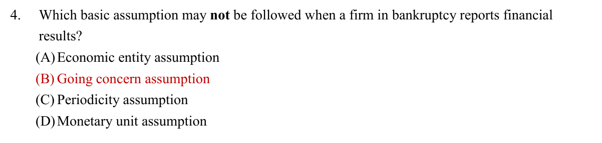
## 真題小練習｜113-1 選擇第 13 題：LCNRV 備抵回轉【本次未明列】

> [!tip] 先懂這題的道理
> **存貨不能以高於「預計賣得到的淨額」列帳，所以成本高於淨變現價值時要用備抵把存貨降下來；和壞帳一樣，每年先算備抵應有多少，再調整差額。**
> - 淨變現價值（net realizable value）＝預計售價－完工和銷售還要花的成本。
> - 今年應有的備抵比去年少，代表價值回升，減少備抵並認列回升利益。
> - 老師目前發的第 6 章只到 part 1（6.1～6.4），不含這個主題。


[113-1 原卷，PDF 第 4 頁](附件/歷屆試題/113-1%20Midterm%20I%20with%20ans_posted.pdf#page=4)。英文原題如下，已移除答案顏色提示。

> 13. Dover Company began operations in 2021 and valued its ending inventory at LCNRV using an   
> allowance account. Related inventory information is presented below:   
>           Cost        Net Realizable Value   
>   12/31/21    £520,000       £485,000   
>   12/31/22     615,000        585,000   
>    
> Assuming the loss method is used. Which of the following will Dover Company record at   
> December 31, 2022?   
> (A) A debit to Inventory Loss of £30,000   
> (B) A credit to Recovery of Inventory Loss of £100,000   
> (C) A debit to Recovery of Inventory Loss of £5,000   
> (D) A debit to Allowance to Reduce Inventory to NRV of £5,000  

> [!success]- 展開詳解｜先寫完，再看推理與答案
> **答案 D：借記 Allowance to Reduce Inventory to NRV 5,000。**
>
> LCNRV＝Lower of Cost and Net Realizable Value，成本與淨變現價值孰低。先懂白話：原成本高於可回收金額時，建立一個減項，讓存貨淨額降下來。
>
> 1. 2021 年需要備抵＝520,000−485,000＝**35,000**。
> 2. 2022 年需要備抵＝615,000−585,000＝**30,000**。
> 3. 已有貸方備抵 35,000，現在只需 30,000，所以要減少 5,000。
> 4. 減少貸方備抵，應借記它：
>
> ```text
> Dr. Allowance to Reduce Inventory to NRV   5,000
>     Cr. Recovery of Inventory Loss               5,000
> ```
>
> A 把期末目標 30,000 當本期損失；B 把兩年 NRV 增加 100,000 當回轉；C 把回轉科目的借貸方向寫反。和壞帳備抵一樣，**餘額目標不等於本期調整額**。
>
> **核對原卷（紅字是原解答）：**
>
> 


# 附錄｜保留你原先的作答紀錄

以下保留私人筆記中的原題與你的原始作答，供回顧，不重新列入本次必讀範圍。完整舊版另已備份。

## 第 1 章練習｜15 分

### 題 1：交易判斷，5 分

各判斷一次，每題 1 分：

1. 向銀行借款，是否產生收益？ 否
2. 股東投入現金，是否產生收益？否
3. 宣告現金股利，是否產生費用？否
4. 本月服務已完成但尚未收款，是否可能認列收入？可以
5. 買回庫藏股，應列資產還是權益減項？權益減項

### 題 2：倒推淨利，5 分

期初資產 900、負債 400；期末資產 1,200、負債 450。本期股東投入 100、股利 30，沒有其他權益變動。求淨利。

750-500-100+30=180

### 題 3：觀念配對，5 分

1. 老闆私人旅遊費不列公司費用。 企業個體
2. 每季編一次報表。會計期間
3. 設備沒有按立即清算價格列帳，因公司將繼續營業。繼續經營
4. 重大訴訟資訊在附註揭露。充分揭露
5. 資訊能幫助預測未來獲利。預測價值（攸關性）


## 第 2 章練習｜30 分

### 題 1：綜合計算，16 分

下列金額單位為元，依本課助教的損益表格式：

- 銷貨淨額 1,000,000。
- 銷貨成本 600,000。
- 銷售費用 100,000。
- 管理費用 80,000。
- 出售設備利益 20,000。
- 利息費用 10,000。
- 所得稅率 20%。
- 停業單位損失 40,000，**已是稅後**。
- OCI 利益 15,000，**已是稅後**。
- 特別股股利 4,000。
- 普通股全年流通在外 100,000 股。

求毛利、營業利益、稅前淨利、繼續營業稅後淨利、本期淨利、綜合損益、EPS。

1000000-600000-100000-80000+20000=240000(op income )
240000-10000=230000(income bf tax)
230000 *0.8=184000
184000-40000=144000
144000+15000=159000(綜合損益)
144000-4000/100000

### 題 2：保留盈餘，8 分

期初保留盈餘 200,000；發現去年漏記折舊 20,000，相關稅率 20%；本年淨利 80,000；本年宣告股利 30,000，其中 10,000 明年才支付。求期末保留盈餘。

200000
多扣16000
+80000-30000(明年才支付也要扣)
234000

### 題 3：判斷題，6 分

1. 股東投入資金會增加綜合損益。no
2. FVTPL 投資的未實現評價利益一定列 OCI。進入今年損益
3. 更改設備剩餘耐用年限，通常要重算以前年度折舊。不用


> 訂正提醒：你原本 EPS 算式 `144000-4000/100000` 應加括號為 `(144000-4000)/100000＝1.40`。這是保存舊作答時補的註記，不另增加本次 EPS 必練題。


## 歷屆原卷完整附件

- [112-1 原卷，PDF 第 1 頁](附件/歷屆試題/112-1%20Midterm%20I%20with%20sol_posted.pdf#page=1)
- [113-1 原卷，PDF 第 1 頁](附件/歷屆試題/113-1%20Midterm%20I%20with%20ans_posted.pdf#page=1)

原卷紅字為原解答；筆記練習區已改成不顯示答案顏色的文字。計算題詳細解法已與原卷答案逐項核對，自編延伸另行標示。
