# 統計學｜原題分章練習與詳解

[[統計學｜期中考練習入口|回到入口]] · [[統計學｜公式速查與錯題本|公式與錯題本]] · [[統計學｜模擬期中原卷圖|查看原卷]]

> [!info] 手寫證明版
> III-23、III-24 已依你的手寫方法重寫；未在原卷單獨考出的推導收在 [[#最後補充｜依你的手寫方法整理的延伸證明]]。III-22 的才比雪夫證明在這份手寫原稿中未出現，維持原來的指示變數證法。

> [!tip] 每題的固定動作
> 每題依「老師原題 → 題目與選項解讀 → 概念原理 → 詳細解題步驟 → 答案 → 陷阱與考試小技巧」閱讀，詳解直接展開。先讀題並辨認要求，再由定義理解方法，最後核對答案。2026-10-27 已對照老師上傳的官方解答 [[附件/統計學模擬期中老師解答.pdf|老師解答 PDF]]：選擇 15 題、計算 9 題的最終答案全部一致；與老師不同的寫法、老師的筆誤及可補充的步驟，已直接改寫進各題的步驟、答案與陷阱。I、II、III 分別表示選擇、計算、證明，以區分原卷重複的題號。

# 第一章與第二章｜資料、圖形與統計思考

### 章節重點：先看資料在回答什麼問題

9/23 第 8 頁用「中心、分散」整理統計量：中位數衡量中心位置；變異數衡量相對平均的平方離差。中心也可由平均數描述，分散也可用標準差或四分位距描述，依題目指定選用。

**類別資料 categorical** 是分組標籤，例如性別；用 1、2 編碼時，數字仍只用來辨認組別。**數值資料 quantitative** 是數量或測量值，例如人數、收入、年齡。

中位數 median 看排序中央位置；眾數 mode 看最常出現的值，分組圖則先找最高的組；偏態 skewness 看尾巴拖向哪一邊。右偏表示右側尾巴較長。

機率描述不確定性。大量、適當條件下的重複試驗能出現穩定比例，但少數幾次不保證接近機率；連續五次反面，也不會使下一次公平硬幣的正面機率自動變大。

### I-1｜哪一種是類別變數？

#### 1. 老師原題

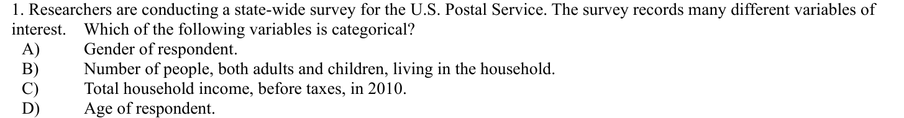

*圖片直接擷取老師原卷；跨頁題保留前後兩段。原卷 2%。*

#### 2. 題目與選項解讀

**來源：p.1。** 郵政服務調查記錄下列變數，哪項是 categorical？

A. 受訪者性別　B. 家庭總人數　C. 2010 年稅前家庭總收入　D. 年齡。

**選項在比較什麼：** A 要辨認分類身分；B 是計數；C 是金額測量；D 是時間長度測量。題目要求找出用群組標籤記錄的那一項。

#### 3. 概念原理：從定義推到方法

**從定義出發：變數是對每個觀察對象記錄的一項特徵。分類方式取決於這項特徵允許哪些有意義的運算。**

類別變數的值用來辨認所屬群組，因此基本運算是判斷「同類或不同類」、計算各類的次數與比例。即使用數字編碼，代碼間的差距也只由編碼方式決定。

數值變數的值表示數量或測量結果；在適當的測量尺度下，加減能表達實際差距，平均能描述集中位置。再依可能值是否可逐一列舉，區分離散計數與連續測量。

因此判斷流程是：先確認記錄的特徵，再確認數值運算的意義，最後才細分類型。

#### 4. 詳細解題步驟

**步驟 1：確認目標。** 題目要找 categorical，也就是以所屬群組記錄的變數。

**步驟 2：逐項分類。** A 的性別記錄群組身分；B 的家庭總人數可計數；C 的家庭收入以金額測量；D 的年齡以時間長度測量。

**步驟 3：對照定義。** A 符合群組標籤的用途，B、C、D 都記錄具有數量意義的大小。

#### 5. 答案

A，與老師解答一致。性別屬類別變數；家庭人數、收入與年齡屬數值變數。

#### 6. 陷阱與考試小技巧

先寫出判斷依據「分類標籤／數量或測量」，再選選項；數字編碼仍按資料意義判讀。

### I-2｜直方圖的中位數與眾數

#### 1. 老師原題

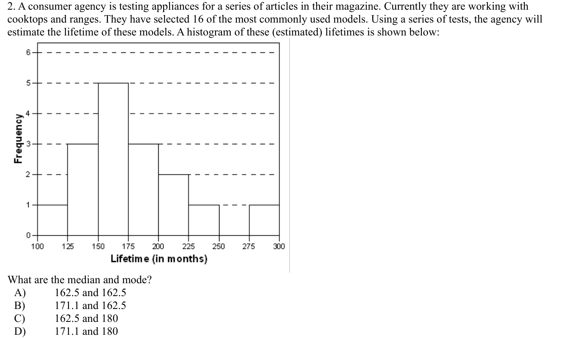

*圖片直接擷取老師原卷；跨頁題保留前後兩段。原卷 2%。*

#### 2. 題目與選項解讀

**來源：p.1，見原卷圖。** 16 種家電估計壽命直方圖：

| 壽命組（月） | 100–125 | 125–150 | 150–175 | 175–200 | 200–225 | 225–250 | 250–275 | 275–300 |
|---|---:|---:|---:|---:|---:|---:|---:|---:|
| 次數 | 1 | 3 | 5 | 3 | 2 | 1 | 0 | 1 |

問 median、mode 依序為何？A. 162.5、162.5　B. 171.1、162.5　C. 162.5、180　D. 171.1、180。

**選項在比較什麼：** 每個選項依序給「中位數、眾數」。先分別求兩項，再對照數值配對；圖中提供的是分組次數，讀題時要留意代表值的估計方式。

#### 3. 概念原理：從定義推到方法

**中位數由排序位置定義，眾數由出現次數定義。** 設排序資料為 $x_{(1)}\le\cdots\le x_{(n)}$。當 $n$ 為偶數，中間左右各有相同筆數，中央落在第 $n/2$ 與第 $n/2+1$ 筆之間，因此中位數定義為兩者的平均。

直方圖將多筆原始值合併為區間次數。設第 $j$ 組次數為 $n_j$，累積次數 $C_j=\sum_{i\le j}n_i$，則該組包含排序位置 $C_{j-1}+1$ 到 $C_j$。這就是用累積次數定位中位數的理由。

眾數組是次數最多的組；本圖各組等寬，可直接比較柱高。組中點 $(L+U)/2$ 用來代表區間時，得到分組估計。精確的中位數與眾數仍依賴組內原始值。

##### 把中央位置公式拆開

令偶數筆數 $n=2m$。排序後前半部有 $m$ 筆，後半部也有 $m$ 筆，兩個交界位置便是第 $m$ 與第 $m+1$ 筆。依偶數筆中位數的定義：

$$\operatorname{median}=\frac{x_{(m)}+x_{(m+1)}}2=\frac{x_{(n/2)}+x_{(n/2+1)}}2.$$

例如排序資料為 2、4、8、10，中央為 4 與 8，中位數為 $(4+8)/2=6$。這個例子使用完整原始值；老師題目提供分組圖，因此要先定位所在組，再依題意估計代表值。

#### 4. 詳細解題步驟

**步驟 1：找中央位置。** $n=16$，所以要找排序後第 8、9 筆，再用累積次數找出這兩筆所在的區間。

**步驟 2：用累積次數定位。**

| 組別 | 次數 | 累積次數 | 這組包含的排序位置 |
|---|---:|---:|---|
| 100～125 | 1 | 1 | 第 1 筆 |
| 125～150 | 3 | 4 | 第 2～4 筆 |
| 150～175 | 5 | 9 | 第 5～9 筆 |

第 8、9 筆都落在第三組，所以中位數所在組是 150～175。

**步驟 3：找眾數組。** 最高柱的次數是 5，也在 150～175，因此眾數組與中位數所在組相同。

**步驟 4：取組中點。**

老師解答以組中點代表中位數與眾數，兩者都是 $(150+175)/2=162.5$。

**直方圖提供的是分組資訊。** 本題可確認中位數所在組及眾數組，並依選項用組中點 162.5 估計；精確數值還需要原始資料。

#### 5. 答案

A：162.5、162.5，與老師解答一致。

#### 6. 陷阱與考試小技巧

直方圖可確定兩個所在組；精確原始中位數及眾數需原始值。計算時先標第 8、9 筆，再用累積次數定位。

### I-3｜判斷偏態

#### 1. 老師原題

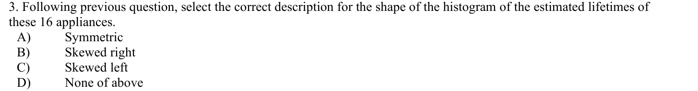

*圖片直接擷取老師原卷；跨頁題保留前後兩段。原卷 2%。*

#### 2. 題目與選項解讀

**來源：p.1，接 I-2。** A. 對稱　B. 右偏　C. 左偏　D. 皆非。

**選項在比較什麼：** A 表示左右大致對稱；B 表示右尾較長；C 表示左尾較長；D 表示前三種都不合。這題沿用 I-2 的直方圖。

#### 3. 概念原理：從定義推到方法

**偏態描述分布在左右方向上的不對稱。** 先辨認主要機率或資料集中的區域，再觀察低次數部分向兩側延伸的程度。

右尾延伸較長稱為右偏；左尾延伸較長稱為左偏。左右形狀相互對應時稱為對稱。這個名稱直接依尾端方向定義，因此判讀時應比較橫軸左右的延伸範圍。

柱高提供各區間的次數，尾端則由一連串低次數區間構成。把這兩項資訊分開讀，就能從圖形判定偏態。

#### 4. 詳細解題步驟

**步驟 1：找集中區。** 最高的一組是 150～175 月，附近 150～200 月聚集較多資料。

**步驟 2：比較延伸方向。** 左側延伸到約 100 月；右側仍有低次數區間延伸到 300 月，右側延伸較長。

**步驟 3：套用偏態名稱。** 依較長尾端所在方向判定，圖形呈右偏。

#### 5. 答案

B，右偏，與老師解答一致。

#### 6. 陷阱與考試小技巧

尾巴方向決定偏態名稱。先找集中區，再沿橫軸比較左右尾端長度。

### I-5｜莖葉圖與四分位數

#### 1. 老師原題

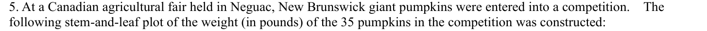

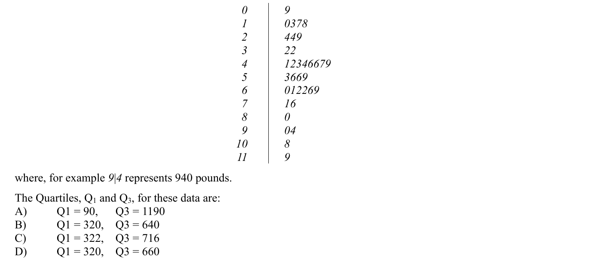

*圖片直接擷取老師原卷；跨頁題保留前後兩段。原卷 2%。*

#### 2. 題目與選項解讀

**來源：p.1–2。** 35 顆南瓜，$9|4=940$ 磅。完整莖葉資料：

```text
 0 | 9
 1 | 0378
 2 | 449
 3 | 22
 4 | 12346679
 5 | 3669
 6 | 012269
 7 | 16
 8 | 0
 9 | 04
10 | 8
11 | 9
```

求 $Q_1,Q_3$：A. 90、1190　B. 320、640　C. 322、716　D. 320、660。

**選項在比較什麼：** 四個選項都依序列出下四分位數與上四分位數。要同時核對排序位置和磅的單位。

#### 3. 概念原理：從定義推到方法

**四分位數的根本工作，是在排序資料中定位下半部與上半部的中央。** 莖葉圖用「莖」保存較高位數、「葉」保存較低位數；鍵決定兩者的實際單位。每片葉對應一筆觀察，所以累計葉片數即可得到排序位置。

本題沿用排除整體中位數的慣例：奇數筆資料先取中央一筆，再將剩餘資料分成等長的上下兩半。下半部的中位數為 $Q_1$，上半部的中位數為 $Q_3$。

若某半部有 $m$ 筆且 $m$ 為奇數，其中央位置為 $(m+1)/2$。求上半部位置時，再加上前面已經跨過的筆數，便可回到整份資料的排序位置。

##### 中央位置的 $+1$ 從哪裡來？

奇數筆數可寫成 $m=2r+1$。拿掉中央一筆後，左右各剩 $r$ 筆，所以中央是第 $r+1$ 筆。由 $r=(m-1)/2$：

$$r+1=\frac{m-1}{2}+1=\frac{m+1}{2}.$$

例如共有 7 筆，中央是第 4 筆；排除後，下半部為第 1～3 筆、上半部為第 5～7 筆。因此按本題慣例，$Q_1$ 在全體第 2 筆，$Q_3$ 在第 6 筆。

#### 4. 詳細解題步驟

**步驟 1：讀單位。** 依鍵讀成 90、100、130、170、180……，每個葉代表 10 磅。

**步驟 2：定位置。** $n=35$，整體中位數是第 $(35+1)/2=18$ 筆。本題採排除第 18 筆後，上下各 17 筆的中位數，因此 $Q_1$ 為全體第 9 筆，$Q_3$ 為第 27 筆。

**步驟 3：回到原圖數葉片。** 前 8 筆為 90、100、130、170、180、240、240、290，第 9 筆為 **320**。

第 23～28 筆為 600、610、620、620、660、690，第 27 筆為 **660**。

四分位數有不同計算慣例，使用試題／課程指定的方式；全程維持同一種計算慣例。

#### 5. 答案

D：$Q_1=320$ 磅、$Q_3=660$ 磅，與老師解答一致。

#### 6. 陷阱與考試小技巧

先讀鍵，再標第 9、27 筆。四分位數有不同慣例，本題全程採排除整體中位數的方式；重複葉片各算一筆。

### I-10｜隨機現象的長期規律

#### 1. 老師原題

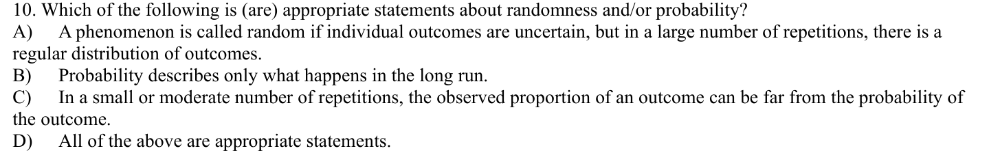

*圖片直接擷取老師原卷；跨頁題保留前後兩段。原卷 2%。*

#### 2. 題目與選項解讀

**來源：p.2。** 哪些說法適當？A. 單次結果不確定，但大量重複有規律分布。B. 機率只描述長期發生情形。C. 少量或中等次數的觀察比例可能離機率很遠。D. 以上皆是。

**選項在比較什麼：** A 談單次結果與長期規律；B 談機率的解釋範圍；C 談有限次樣本的波動；D 要求前三句在題目語境中都成立。

#### 3. 概念原理：從定義推到方法

**機率模型先指定每個事件的機率；長期頻率則描述重複觀察時的比例。** 令 $I_i$ 在第 $i$ 次事件發生時為 1，其餘為 0，則 $n$ 次觀察的發生比例為 $\hat p_n=(I_1+\cdots+I_n)/n$。

若各次獨立且發生機率都為 $p$，則 $E(I_i)=p$、$\operatorname{Var}(I_i)=p(1-p)$，所以

$$E(\hat p_n)=p,\qquad \operatorname{Var}(\hat p_n)=\frac{p(1-p)}n.$$

隨著次數增加，比例的波動程度縮小，這提供長期規律的數學理由。有限次觀察仍可偏離 $p$。獨立性另表示：知道過去結果後，下一次事件的條件機率仍為 $p$。

##### 補上比例變異數的中間步驟

指示變數只取 0 或 1，先直接按定義計算：

$$E(I_i)=1p+0(1-p)=p,\qquad E(I_i^2)=1^2p+0^2(1-p)=p.$$

因此 $\operatorname{Var}(I_i)=E(I_i^2)-[E(I_i)]^2=p-p^2=p(1-p)$。

令 $J_i=I_i-p$，則 $E(J_i)=0$。獨立時，對 $i\ne j$ 有 $E(J_iJ_j)=E(J_i)E(J_j)=0$。把比例偏離平均的平方展開：

$$\begin{aligned}
\operatorname{Var}(\hat p_n)
&=E\!\left[\left(\frac1n\sum_{i=1}^nJ_i\right)^2\right]\\
&=\frac1{n^2}\left[\sum_iE(J_i^2)+2\sum_{i<j}E(J_iJ_j)\right]\\
&=\frac1{n^2}\left[np(1-p)+0\right]=\frac{p(1-p)}n.
\end{aligned}$$

平方展開會產生單項平方與交叉乘積；獨立且中心化讓交叉乘積的期望歸零，留下 $n$ 個相同的平方離差平均。

例如 $p=0.5$，$n=100$ 時比例的標準差為 $\sqrt{0.25/100}=0.05$；$n=400$ 時為 $0.025$。次數增加為四倍，典型波動尺度縮為一半。

#### 4. 詳細解題步驟

**步驟 1：檢查 A。** 單次結果具有不確定性；在穩定且適當的重複條件下，比例可呈現長期規律，符合本題主旨。

**步驟 2：檢查 B。** 老師解答把 B 算作適當敘述：課堂採長期相對頻率觀點，機率就是描述長期重複下的比例。

**步驟 3：檢查 C。** 有限次比例仍有波動，少量或中等次數時可能離理論機率很遠，符合機率模型。

**步驟 4：整合。** A、B、C 都是適當描述，所以選「以上皆是」。

#### 5. 答案

D，與老師解答一致。

#### 6. 陷阱與考試小技巧

嚴格來說 B 的 only 限定過強，但老師解答把它算對；考試照課堂的頻率觀點作答。機率也能描述單次不確定性。看見「以上皆是」時，逐句核對適用條件。

# 第三章｜補事件、樣本空間與貝氏法則

### 章節重點：先翻譯事件，再決定加減乘除

「至少一個」的反面是「一個都沒有」。有順序的兩次抽樣，AD 與 DA 是不同結果；除非題目明確只記錄瑕疵總數。

$$P(A^c)=1-P(A),\qquad P(A\mid B)=\frac{P(A\cap B)}{P(B)}.$$

貝氏題的分母要加總**所有能產生目前觀察的原因及其機率**，再求目標原因所占的比例。

### I-6｜至少一個男孩的補事件

#### 1. 老師原題

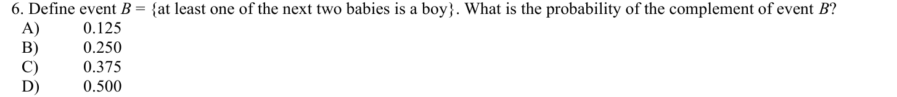

*圖片直接擷取老師原卷；跨頁題保留前後兩段。原卷 2%。*

#### 2. 題目與選項解讀

**來源：p.2。** $B=$ 接下來兩個寶寶至少一個男孩。求 $P(B^c)$。A. 0.125　B. 0.250　C. 0.375　D. 0.500。

**選項在比較什麼：** 四個選項都是補事件的機率。題目要求的是 $B^c$，先將文字條件完整翻譯，再與數值選項比較。

#### 3. 概念原理：從定義推到方法

**事件是樣本空間中的一部分；補事件收集其餘全部結果。** 原事件 $B$ 與補事件 $B^c$ 互斥，且聯集為整個樣本空間，因此

$$P(B)+P(B^c)=1.$$

「至少一個符合」表示符合個數大於或等於 1；其補事件就是符合個數等於 0。這是整數計數條件的直接否定。

兩次結果都符合指定條件的機率，一般由 $P(A_1\cap A_2)=P(A_1)P(A_2\mid A_1)$ 計算。加入獨立假設後，才可改寫成 $P(A_1)P(A_2)$。因此作答應先翻譯事件，再寫清模型假設，最後代入機率。

##### 補事件與獨立乘法各推一次

因 $B\cup B^c=\Omega$ 且兩者互斥，$P(\Omega)=1$ 可寫成 $P(B)+P(B^c)=1$；移項便得到 $P(B^c)=1-P(B)$。

另一方面，條件機率定義為 $P(A_2\mid A_1)=P(A_1\cap A_2)/P(A_1)$。兩邊同乘 $P(A_1)$：

$$P(A_1\cap A_2)=P(A_1)P(A_2\mid A_1).$$

獨立表示 $P(A_2\mid A_1)=P(A_2)$，代入後才得到兩個單次機率相乘的形式。

例如兩次獨立試驗的成功率各為 $0.2$，兩次都失敗的機率為 $0.8\times0.8=0.64$，所以至少成功一次的機率為 $1-0.64=0.36$。

#### 4. 詳細解題步驟

**步驟 1：翻譯補事件。** $B$ 表示兩次出生中男孩個數至少為 1，所以 $B^c$ 表示男孩個數為 0，即兩個都是女孩。

**步驟 2：列出假設。** 使用每次女孩機率為 $1/2$、兩次出生結果獨立的課堂模型。

**步驟 3：算同時發生的機率。**

$$P(B^c)=P(\text{第一個女孩})P(\text{第二個女孩})=\frac12\cdot\frac12=\frac14=0.250.$$

#### 5. 答案

B，$P(B^c)=1/4=0.250$，與老師解答一致。

#### 6. 陷阱與考試小技巧

先寫「兩個都女孩」，再列獨立與男女各半的假設。數值答案依這些假設成立。

**9/23 筆記連結：** 你第 2 頁的「兩個補事件是否獨立」證明已整理在 [[#補充 15｜沿用德摩根律，證明補事件仍然獨立]]。互斥事件若各有正機率，兩者相依；判斷獨立時仍以 $P(A\cap B)=P(A)P(B)$ 為準。

### I-7｜兩件產品的樣本空間

#### 1. 老師原題

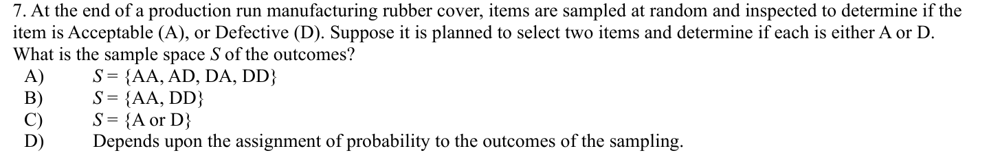

*圖片直接擷取老師原卷；跨頁題保留前後兩段。原卷 2%。*

#### 2. 題目與選項解讀

**來源：p.2。** 各件標記 A（合格）或 D（瑕疵），依序抽兩件。哪個樣本空間正確？A. {AA, AD, DA, DD}　B. {AA, DD}　C. {A or D}　D. 取決於機率如何分配。

**選項在比較什麼：** A 列出四種兩位置序列；B 只列兩次狀態相同的序列；C 只描述單一位置的狀態；D 把答案連結到機率權重。要核對的是完整試驗會記錄哪些結果。

#### 3. 概念原理：從定義推到方法

**樣本空間是一次完整試驗所有可能結果的集合。** 題目若記錄兩件產品各自的狀態，一個完整結果就要寫成有序對 $(s_1,s_2)$。

每個位置的可能狀態集合為 $\{A,D\}$，因此完整空間是笛卡兒積 $\{A,D\}\times\{A,D\}$。展開時，將第一個位置的每個狀態各自配上第二個位置的所有狀態。

機率是在完整結果上分配權重，總和為 1。列出空間與指定權重是兩個步驟；題目給定的抽樣限制決定哪些結果可發生，瑕疵率及相依關係則決定各結果的機率。

#### 4. 詳細解題步驟

**步驟 1：固定第一件為 A。** 第二件可為 A 或 D，產生 AA、AD。

**步驟 2：固定第一件為 D。** 第二件可為 A 或 D，產生 DA、DD。

**步驟 3：合併檢查。** 共有 $2\times2=4$ 個完整序列。每個序列都保留兩件產品的狀態，且四種配對都已列齊，再對照選項。

#### 5. 答案

A，$\{AA,AD,DA,DD\}$，與老師解答一致。

#### 6. 陷阱與考試小技巧

每個結果寫滿兩個位置；檢查 AD、DA 都有列入。分配各序列機率時，再使用瑕疵率及抽樣條件。

### II-19｜兩個人都說牛奶糖，真的就是嗎？

#### 1. 老師原題

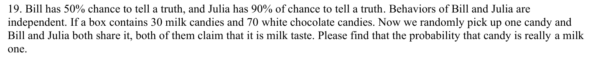

*圖片直接擷取老師原卷；跨頁題保留前後兩段。原卷 5%。*

#### 2. 題目與選項解讀

**來源：p.4。** 盒內 30 顆牛奶糖、70 顆白巧克力糖。隨機抽一顆，Bill 與 Julia 共享。Bill 說真話機率 50%，Julia 90%，行為獨立；兩人都說是牛奶味，求真的是牛奶糖的機率。

**作答任務：** 已知糖種比例及兩人的說真話率，觀察是「兩人都說牛奶」，所求為給定這個觀察後的牛奶糖機率。

#### 3. 概念原理：從定義推到方法

**這一段要從「重新計算比例」一路推到貝氏公式。先釐清符號，再逐步列式。**

| 符號 | 白話意思 |
|---|---|
| $M$ | 糖真正是牛奶口味 |
| $M^c$ | 糖真正是另一種口味，即巧克力 |
| $R$ | 兩個人都回答牛奶口味 |
| $M\cap R$ | 真的是牛奶，而且兩人都回答牛奶，兩件事同時成立 |
| $P(M\mid R)$ | 已知兩人都回答牛奶後，真正牛奶的比例 |

這裡 $\cap$ 表示「同時」，條件符號 $\mid$ 右側則是「已經知道的資訊」。

##### 推導 1：為什麼條件機率要除以 $P(R)$？

先用有限且等可能的結果來看比例。假設全部有 $N$ 個結果，其中 $N_R$ 個滿足報告事件 $R$，而 $N_{M\cap R}$ 個同時滿足真實牛奶與報告牛奶。

收到報告 $R$ 後，考慮範圍縮到這 $N_R$ 個結果。目標是其中真正牛奶的比例，所以

$$\begin{aligned}
P(M\mid R)
&=\frac{N_{M\cap R}}{N_R}\\
&=\frac{N_{M\cap R}/N}{N_R/N}\\
&=\frac{P(M\cap R)}{P(R)}.
\end{aligned}$$

第一行是「符合目標的個數 ÷ 已知範圍的個數」。第二行把分子、分母同除以總數 $N$，比例保持相同。第三行將相對於全部結果的比例寫成機率。

一般機率模型也用這個比值定義條件機率。要求 $P(R)>0$，才能用它作分母。除以 $P(R)$ 的作用，是將已知事件 $R$ 的總機率重新縮放成 1。

##### 推導 2：乘法公式如何得到？

把條件交換，先寫「已知真的是牛奶時，兩人都回答牛奶」：

$$P(R\mid M)=\frac{P(R\cap M)}{P(M)}.$$

兩邊同乘 $P(M)$，再用 $R\cap M=M\cap R$，得到

$$P(M\cap R)=P(M)P(R\mid M).$$

第一個因子選出真正牛奶的比例；第二個因子在這部分裡選出兩人都回答牛奶的比例。兩次篩選後，就得到同時成立的聯合機率。這條乘法公式保留條件機率，所以適用於一般相依事件。

##### 推導 3：全機率公式的兩項從哪裡來？

所有「兩人都回答牛奶」的結果，依實際糖種可分為兩組：

1. 真正牛奶而出現報告：$M\cap R$。
2. 真正巧克力而出現報告：$M^c\cap R$。

糖種只有這兩類，每個結果恰屬一類，因此兩組互斥，而且合起來剛好是整個 $R$：

$$R=(M\cap R)\cup(M^c\cap R).$$

互斥事件的機率可直接相加，所以

$$\begin{aligned}
P(R)
&=P(M\cap R)+P(M^c\cap R)\\
&=P(M)P(R\mid M)+P(M^c)P(R\mid M^c).
\end{aligned}$$

第一個等號來自把事件分成互斥的兩組；第二個等號將兩組各自套用剛推出的乘法公式。這就是本題的全機率公式。

##### 推導 4：把分子、分母代回條件機率

現在已經有 $P(M\cap R)$ 與 $P(R)$ 的展開式，代回最初的定義：

$$\boxed{P(M\mid R)=\frac{P(M)P(R\mid M)}{P(M)P(R\mid M)+P(M^c)P(R\mid M^c)}}.$$

分子保留「真正牛奶且出現報告」這一組；分母涵蓋「所有會出現報告」的結果。整條公式就是在報告出現的範圍內，重新計算真正牛奶的比例。

##### 用一個簡單數字例子理解

**以下是教學用的 100 個等可能結果，數字與老師原題分開。** 假設 40 個結果是真正牛奶、60 個是真正巧克力。在這兩組中，兩人都回答牛奶的比例分別為 $0.75$ 與 $0.10$。

| 真實糖種 | 全部結果數 | 其中兩人都回答牛奶 | 其餘報告 |
|---|---:|---:|---:|
| 牛奶 $M$ | 40 | $40\times0.75=30$ | 10 |
| 巧克力 $M^c$ | 60 | $60\times0.10=6$ | 54 |
| 合計 | 100 | 36 | 64 |

已知兩人都回答牛奶，就聚焦在表中間那一欄的 36 個結果。其中真正牛奶有 30 個，所以比例為 $30/36=5/6$。

同一件事寫成公式：

$$P(M\mid R)=\frac{0.40\times0.75}{0.40\times0.75+0.60\times0.10}=\frac{0.30}{0.36}=\frac56.$$

表格中的 30 對應分子，36 對應分母；除以總數 100 後，就成為式中的 0.30 與 0.36。下一節再使用老師原題的 30／70 顆與兩人的說真話率計算。

##### 對照你 9/23 的樹狀圖

你 [[統計9_23原稿.pdf#page=3|9/23 第 3～5 頁]] 使用的路徑法，與上面推導相同：沿一條路先乘來源機率與條件機率，再把所有產生相同觀察的互斥路徑加起來，最後取目標路徑所占比例。本題固定使用 $M$ 表示牛奶、$R$ 表示報告；原稿的 $A_i,B$ 三分支與三袋抽球例題放在 [[#補充 16｜用你的三分支樹狀圖練全機率與貝氏公式]]，各例內維持原記號。

#### 4. 詳細解題步驟

**第 1 步：定義事件。** $M=$ 牛奶糖，$R=$ 兩人皆說牛奶。採題目預期模型：只有兩種口味，說謊就回答另一種，說真話率不隨糖種改變，給定糖種後兩人的說真話行為獨立。

**第 2 步：依糖種算觀察的機率。**
$$P(R\mid M)=0.5\times0.9=0.45,$$
$$P(R\mid M^c)=0.5\times0.1=0.05.$$

**第 3 步：貝氏更新。**
$$P(M\mid R)=\frac{0.3(0.45)}{0.3(0.45)+0.7(0.05)}=\frac{0.135}{0.170}=\frac{27}{34}\approx0.794.$$

老師解答用分數寫：$P(R\mid M)=\tfrac12\cdot\tfrac{9}{10}=\tfrac{9}{20}$、$P(R\mid M^c)=\tfrac12\cdot\tfrac1{10}=\tfrac1{20}$，和上面的 0.45、0.05 相同。**老師 PDF 的分母第二項印成 $(1/20)\times0.3$，這是筆誤，應為 $\times0.7$**；用 0.3 會算出 $1/2$，只有用 0.7 才得到 $27/34$。

#### 5. 答案

$P(M\mid R)=27/34\approx0.794$，與老師解答一致。

#### 6. 陷阱與考試小技巧

分母收齊兩種糖的報告來源。給定糖種後兩人行為獨立、說謊改報另一種口味、準確率對兩種糖相同，是此數值解答使用的模型。

# 第四章 A｜離散隨機變數、期望與變異數

### 章節重點：先建機率表，再算兩個加權平均

$$E(X)=\sum_x xp(x),\qquad E(X^2)=\sum_x x^2p(x),$$
$$\operatorname{Var}(X)=E(X^2)-[E(X)]^2.$$

**$E(X^2)$ 是先平方再平均；$[E(X)]^2$ 是先平均再平方。** 這裡使用完整機率分配，直接依各結果的機率加權計算變異數。

$$E(a+bX)=a+bE(X),\qquad \operatorname{Var}(a+bX)=b^2\operatorname{Var}(X).$$

加常數把所有點平移，不改變分散；乘倍數則把距離乘 $|b|$，距離平方就乘 $b^2$。**標準差乘 $|b|$，變異數乘 $b^2$。**

### I-8、I-9｜讀分配表與計算期望

#### 1. 老師原題

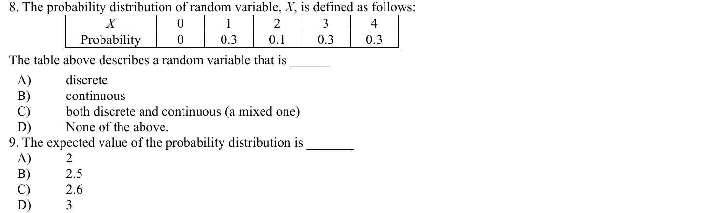

*圖片直接擷取老師原卷；跨頁題保留前後兩段。原卷每題 2%，本節合計 4%。*

#### 2. 題目與選項解讀

**來源：p.2。**

| $x$ | 0 | 1 | 2 | 3 | 4 |
|---|---:|---:|---:|---:|---:|
| $p(x)$ | 0 | 0.3 | 0.1 | 0.3 | 0.3 |

I-8：這是 A. 離散　B. 連續　C. 混合　D. 皆非？

I-9：期望值是 A. 2　B. 2.5　C. 2.6　D. 3？

**選項在比較什麼：** I-8 的 A、B、C 分別指離散、連續與兩者混合的機率配置，D 為以上皆非。I-9 四項是平均值候選數字，需由表中權重計算後對照。

#### 3. 概念原理：從定義推到方法

**離散機率分配把總機率 1 分配到可列舉的結果值上。** 因此每個 $p(x)$ 都非負，且 $\sum_xp(x)=1$；某點權重為 0，表示該點對任何加權和的貢獻為 0。

期望的定義是依機率加權的平均：

$$E(X)=\sum_x xp(x).$$

理由可從平均的結構理解：若各值出現比例為 $p(x)$，其對總平均的貢獻就是值乘上比例。所有比例合計為 1，將各貢獻相加便得到分配的平均位置。

由於權重非負且總和為 1，有限取值的期望必落在最小值與最大值之間。這也提供計算後的基本檢查。

##### 從普通平均走到加權平均

若 $n$ 筆資料中，值 $x_j$ 出現 $n_j$ 次，則將重複值合併後：

$$\bar x=\frac{n_1x_1+\cdots+n_kx_k}{n}=\sum_{j=1}^k x_j\frac{n_j}{n}.$$

每個 $n_j/n$ 是該值所占比例。機率模型將這些比例換成分配權重 $p(x_j)$，就得到期望的定義 $E(X)=\sum_jx_jp(x_j)$。

例如 $X$ 以 $3/4$ 的機率取 2、以 $1/4$ 的機率取 6，則 $E(X)=2(3/4)+6(1/4)=3$。用 4 個等可能結果 2、2、2、6 核對，普通平均也是 $12/4=3$。

**9/23 記號對照：** [[統計9_23原稿.pdf#page=6|原稿第 6 頁]] 對離散分配使用 $p$ 或 $f$ 表示機率函數。本講義統一以 $p(x)=P(X=x)$ 表示單點機率，以 $f(x)$ 表示連續密度；讀函數名稱時先確認模型類型。你寫的 $1/8,3/8,3/8,1/8$ 表格已併入補充 8 的二項公式核對。

#### 4. 詳細解題步驟

機率配置在一個個可列舉的點上，$p(0)=0$ 不會讓它變成連續。

$$E(X)=0(0)+1(0.3)+2(0.1)+3(0.3)+4(0.3)=2.6.$$
將 0、1、2、3、4 各自乘上對應機率後相加，就得到加權平均。

#### 5. 答案

I-8 選 A（離散）；I-9 選 C，$E(X)=2.6$。與老師解答一致。

#### 6. 陷阱與考試小技巧

逐欄寫 $xp(x)$，最後核對機率總和為 1。零權重仍可留在表中，方便逐欄對齊。

### II-13｜兩顆骰子的最小值恰為 3

#### 1. 老師原題

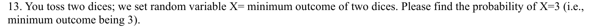

*圖片直接擷取老師原卷；跨頁題保留前後兩段。原卷 5%。*

#### 2. 題目與選項解讀

**來源：p.3。** 丟兩顆骰子，令 $X=$ 兩顆點數中的最小值，求 $P(X=3)$。採公平且互相獨立的骰子。

**作答任務：** 隨機變數取兩顆點數中的最小值，目標為最小值恰好等於 3 的機率。

#### 3. 概念原理：從定義推到方法

**最小值的定義是兩個值中較小的一個。** 因此 $X=\min(D_1,D_2)$ 滿足

$$\{X\ge k\}=\{D_1\ge k\}\cap\{D_2\ge k\}.$$

對整數值 $X$，事件 $\{X\ge k+1\}$ 包含在 $\{X\ge k\}$ 裡，兩者差集恰為 $\{X=k\}$。由機率的可加性：

$$P(X=k)=P(X\ge k)-P(X\ge k+1).$$

公平骰子的每個點數機率相等，符合門檻的點數個數除以 6 即得單顆機率；獨立性讓兩顆同時符合的機率相乘。整個方法依序來自最小值定義、集合差集與獨立乘法。

##### 把集合相減寫成完整等式

由整數性，$\{X\ge k\}$ 可分成互斥的 $\{X=k\}$ 與 $\{X\ge k+1\}$，所以

$$P(X\ge k)=P(X=k)+P(X\ge k+1).$$

移項即得所需公式。兩顆公平獨立骰子各有 $7-k$ 個點數至少為 $k$，因此

$$P(X=k)=\frac{(7-k)^2-(6-k)^2}{36}=\frac{[(7-k)-(6-k)][(7-k)+(6-k)]}{36}=\frac{13-2k}{36}.$$

中間一步使用平方差公式。以 $k=6$ 核對：只有兩顆都為 6 才成立，機率為 $1/36$；公式也給出 $(13-12)/36=1/36$。

#### 4. 詳細解題步驟

**步驟 1：算最小值至少 3。** 每顆骰子符合的點數是 3、4、5、6，共 4 個；兩顆獨立，所以機率是 $(4/6)^2=16/36$。

**步驟 2：扣掉最小值至少 4。** 每顆只剩 4、5、6，共 3 個；機率是 $(3/6)^2=9/36$。

**步驟 3：相減，留下剛好 3。**

$$P(X=3)=P(X\ge3)-P(X\ge4)=\frac{16}{36}-\frac9{36}=\frac7{36}\approx0.194.$$

**步驟 4：用老師解答的列舉法驗算。** 最小值恰為 3 的結果只有 $(3,3),(3,4),(3,5),(3,6),(4,3),(5,3),(6,3)$ 共 7 個，所以 $P=7/36$。點數範圍小時，直接列舉比公式快。

#### 5. 答案

$P(X=3)=7/36\approx0.194$，與老師解答一致。

#### 6. 陷阱與考試小技巧

「最小值恰為 3」要求兩顆都至少 3，且有一顆為 3。寫成兩個門檻機率相減，能一次處理兩個條件。

### II-14｜接上題，求期望與變異數

#### 1. 老師原題

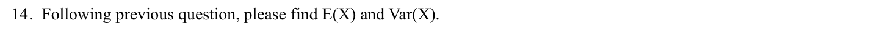

*圖片直接擷取老師原卷；跨頁題保留前後兩段。原卷 5%。*

#### 2. 題目與選項解讀

**來源：p.3。** 求 $E(X)$、$\operatorname{Var}(X)$。

**作答任務：** 沿用 II-13 的最小值隨機變數，求整份分配的平均與變異數；需涵蓋 1 到 6 的全部可能值。

#### 3. 概念原理：從定義推到方法

**期望衡量平均位置，變異數衡量與平均的平方距離。** 設 $\mu=E(X)$，變異數從定義出發為

$$\operatorname{Var}(X)=E[(X-\mu)^2].$$

展開平方，利用期望對加法與常數倍的線性性：

$$E(X^2-2\mu X+\mu^2)=E(X^2)-2\mu E(X)+\mu^2=E(X^2)-\mu^2.$$

因此只要建立完整分配，就能分別算 $\sum_xxp(x)$ 與 $\sum_xx^2p(x)$，再相減取得變異數。這裡的權重由整份機率分配提供。

本題分配由上一題的差集公式推廣到每個 $k$：$P(X=k)=P(X\ge k)-P(X\ge k+1)$。先完成所有可能值，兩個加權和才涵蓋完整分配。

##### 展開平方後，每個期望如何處理？

$\mu$ 是固定數值，因此 $E(\mu X)=\mu E(X)$，且 $E(\mu^2)=\mu^2\sum_xp(x)=\mu^2$。逐行寫出：

$$\begin{aligned}
E[(X-\mu)^2]
&=E[X^2-2\mu X+\mu^2] &&\text{展開平方}\\
&=E(X^2)-2\mu E(X)+\mu^2 &&\text{拆開加總，提出常數}\\
&=E(X^2)-2\mu^2+\mu^2 &&\text{代入 }E(X)=\mu\\
&=E(X^2)-\mu^2. &&\text{合併同類項}
\end{aligned}$$

用一個數字例子核對：$X$ 以各 $1/2$ 的機率取 1、3，平均為 2。按原始定義算，變異數為 $(1-2)^2/2+(3-2)^2/2=1$；按簡化公式算，$E(X^2)=(1^2+3^2)/2=5$，所以 $5-2^2=1$。兩種算法計算的是同一個平方離差平均。

#### 4. 詳細解題步驟

對 $k=1,\ldots,6$：
$$P(X=k)=\left(\frac{7-k}{6}\right)^2-\left(\frac{6-k}{6}\right)^2=\frac{13-2k}{36}.$$

| $k$ | 1 | 2 | 3 | 4 | 5 | 6 |
|---|---:|---:|---:|---:|---:|---:|
| $36p(k)$ | 11 | 9 | 7 | 5 | 3 | 1 |
| $36kp(k)$ | 11 | 18 | 21 | 20 | 15 | 6 |
| $36k^2p(k)$ | 11 | 36 | 63 | 80 | 75 | 36 |

$$E(X)=\frac{91}{36}\approx2.528,\qquad E(X^2)=\frac{301}{36}\approx8.361.$$
$$\operatorname{Var}(X)=\frac{301}{36}-\left(\frac{91}{36}\right)^2=\frac{2555}{1296}\approx1.971.$$

#### 5. 答案

$E(X)=91/36\approx2.528$；$\operatorname{Var}(X)=2555/1296\approx1.971$。

**老師解答寫 $\operatorname{Var}(X)=1.96$，差異來自四捨五入，不是算錯。** 老師先把 $E(X)$ 取成 2.53、$E(X^2)$ 取成 8.36，再算 $8.36-2.53^2\approx1.959$；保留分數到最後才是 1.971。

#### 6. 陷阱與考試小技巧

檢查機率分子合計為 36；分開寫 $xp(x)$ 與 $x^2p(x)$。保留分數到最後，變異數需非負。考試寫成「$2555/1296\approx1.971$」：先寫分數再寫小數，和老師的 1.96 對照時，改考者能看出差異只是四捨五入。

### II-15｜線性轉換不需要重建分配表

#### 1. 老師原題

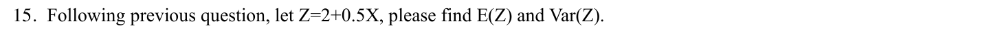

*圖片直接擷取老師原卷；跨頁題保留前後兩段。原卷 5%。*

#### 2. 題目與選項解讀

**來源：p.3。** 接 II-14，$Z=2+0.5X$，求期望與變異數。

**作答任務：** 將上一題的最小值轉為 $Z=2+0.5X$，分別求新平均與新變異數。

#### 3. 概念原理：從定義推到方法

**線性轉換的公式可以直接由期望與變異數的定義推出。** 令 $Z=a+bX$。因為各機率加總為 1，

$$E(Z)=\sum_x(a+bx)p(x)=a\sum_xp(x)+b\sum_xxp(x)=a+bE(X).$$

再計算每個結果與新平均的差距：

$$Z-E(Z)=a+bX-[a+bE(X)]=b[X-E(X)].$$

平方取期望便得到 $\operatorname{Var}(Z)=b^2\operatorname{Var}(X)$。常數平移在相減時消去，倍數則在平方時變成 $b^2$。標準差是變異數的平方根，因此對應倍數為 $|b|$。

##### 把「平方取期望」完整寫出來

令 $\mu=E(X)$，已推出 $Z-E(Z)=b(X-\mu)$。因此

$$\begin{aligned}
\operatorname{Var}(Z)
&=E\{[Z-E(Z)]^2\}\\
&=E[b^2(X-\mu)^2]\\
&=b^2E[(X-\mu)^2]\\
&=b^2\operatorname{Var}(X).
\end{aligned}$$

第二行代入離差關係，第三行將固定的 $b^2$ 提出平均。再開平方：$\sigma_Z=\sqrt{b^2\sigma_X^2}=|b|\sigma_X$，絕對值來自平方根取非負值。

例如 $X$ 等可能取 1、3，平均 2、變異數 1。令 $Z=2+0.5X$，則 $Z$ 等可能取 2.5、3.5，平均 3，變異數為 $[(-0.5)^2+(0.5)^2]/2=0.25$，與 $0.5^2\times1$ 一致。

#### 4. 詳細解題步驟

$$E(Z)=2+0.5\frac{91}{36}=\frac{235}{72}\approx3.264.$$
$$\operatorname{Var}(Z)=0.5^2\frac{2555}{1296}=\frac{2555}{5184}\approx0.493.$$
常數 2 不進入變異數；係數 0.5 必須平方。若問標準差，才是原標準差乘 0.5。

#### 5. 答案

$E(Z)=235/72\approx3.264$；$\operatorname{Var}(Z)=2555/5184\approx0.493$。

**老師解答寫 $E(Z)=3.265$、$\operatorname{Var}(Z)=0.25\times1.96=0.49$**，是沿用上一題四捨五入後的值；方法完全相同。

#### 6. 陷阱與考試小技巧

變異數使用 $0.5^2$；標準差才使用 $|0.5|$。接續題沿用精確分數。

### II-21｜直接求函數的期望與變異數

#### 1. 老師原題

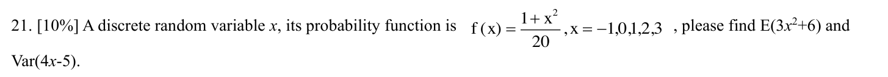

*圖片直接擷取老師原卷；跨頁題保留前後兩段。原卷題旁標 10%，但 Part II 總標題寫每題 5%，此處保留原卷差異。*

#### 2. 題目與選項解讀

**來源：p.5。** $p(x)=(1+x^2)/20$，$x=-1,0,1,2,3$。求 $E(3X^2+6)$ 與 $\operatorname{Var}(4X-5)$。

**作答任務：** 第一小題是平方函數的期望；第二小題是線性函數的變異數。兩題共用原分配提供的權重。

#### 3. 概念原理：從定義推到方法

**函數期望的基本規則，是先對結果值做指定運算，再按原機率加權。** 對離散 $X$：

$$E[h(X)]=\sum_x h(x)p(x).$$

代入 $h(x)=3x^2+6$，將加總拆開：

$$\sum_x(3x^2+6)p(x)=3\sum_xx^2p(x)+6\sum_xp(x)=3E(X^2)+6.$$

另一小題先從 $\operatorname{Var}(X)=E(X^2)-[E(X)]^2$ 得到原本變異數。由 $4X-5-E(4X-5)=4[X-E(X)]$，平方取期望後，變異數乘上 $4^2$。

所以共同準備量為 $E(X)$ 與 $E(X^2)$。逐一列出 $p(x)$、$xp(x)$、$x^2p(x)$，即可把兩小題接到定義上。

##### 函數期望為什麼沿用原本的機率？

令 $Z=h(X)$。對每個新值 $z$，把所有滿足 $h(x)=z$ 的原值機率加起來，就得到 $P(Z=z)$。所以

$$\begin{aligned}
E(Z)&=\sum_z zP(Z=z)\\
&=\sum_z\sum_{x:h(x)=z}h(x)p(x)\\
&=\sum_xh(x)p(x).
\end{aligned}$$

最後一步把依新值分組的加總合併回全部原值，每個原值的機率都保留。

例如 $X$ 等可能取 $-1$、2，$E(X^2)=(1+4)/2=2.5$。$3X^2+6$ 對應兩個新值 9、18，直接平均得 13.5；用拆開後的式子也得 $3(2.5)+6=13.5$。

#### 4. 詳細解題步驟

| $x$ | −1 | 0 | 1 | 2 | 3 |
|---|---:|---:|---:|---:|---:|
| $20p(x)$ | 2 | 1 | 2 | 5 | 10 |
| $20xp(x)$ | −2 | 0 | 2 | 10 | 30 |
| $20x^2p(x)$ | 2 | 0 | 2 | 20 | 90 |

機率分子共 20，分配合法。$E(X)=40/20=2$，$E(X^2)=114/20=5.7$。

$$E(3X^2+6)=3E(X^2)+6=23.100.$$
$$\operatorname{Var}(X)=5.7-2^2=1.7,$$
$$\operatorname{Var}(4X-5)=4^2(1.7)=27.200.$$

#### 5. 答案

$E(3X^2+6)=23.100$；$\operatorname{Var}(4X-5)=27.200$。與老師解答一致。

#### 6. 陷阱與考試小技巧

負值在一次動差保留負號，平方後為正。老師解答最後一行寫成 $\operatorname{Var}(4x+5)$，是筆誤；常數不影響變異數，答案仍是 27.2。原卷本題旁標 10%，Part II 標題寫每題 5%，實際配分需以老師說明為準。

# 第四章 B｜連續密度、面積與變數轉換

### 章節重點：密度是高度，機率是面積

合法密度必須非負，且總面積為 1：

$$f(x)\ge0,\quad\int_{-\infty}^{\infty}f(x)\,dx=1,\quad P(a\le X\le b)=\int_a^b f(x)\,dx.$$

有密度的連續變數在單一點機率為零，即使該點密度不為零。密度高度可以超過 1，只要面積正確。

### I-4｜均勻密度的「眾數」陷阱

#### 1. 老師原題

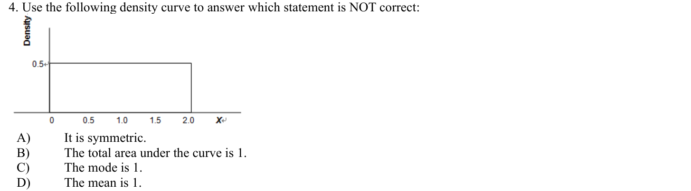

*圖片直接擷取老師原卷；跨頁題保留前後兩段。原卷 2%。*

#### 2. 題目與選項解讀

**來源：p.1。** 圖形在 $0<x<2$ 的高度固定為 $0.5$，其他地方為 0。哪句不正確？A. 對稱　B. 曲線下面積為 1　C. 眾數是 1　D. 平均是 1。

**選項在比較什麼：** A 檢查左右對稱；B 檢查總機率；C 檢查密度最高的位置；D 檢查平均位置。題幹要求選出不正確敘述。

#### 3. 概念原理：從定義推到方法

**連續密度把區間機率定義為曲線下的面積。** 若 $a<x<b$ 上密度固定為 $c$，總機率為 1 要求 $c(b-a)=1$，所以 $c=1/(b-a)$。

平均由加權積分定義：

$$E(X)=\int_a^b\frac{x}{b-a}\,dx=\frac{b^2-a^2}{2(b-a)}=\frac{a+b}{2}.$$

曲線以端點中點對稱，因此平均也位於這個中心。眾數則依密度最大的位置判定：均勻密度的整段高度相同，所有區間內位置都達到相同最大高度。課程若以唯一峰值描述眾數，便會說均勻分配沒有唯一眾數。作答需留意題目對這個詞的用法。

##### 均勻分配的平均積分逐行算

$$\begin{aligned}
E(X)&=\frac1{b-a}\int_a^b x\,dx\\
&=\frac1{b-a}\left[\frac{x^2}{2}\right]_a^b\\
&=\frac{b^2-a^2}{2(b-a)}\\
&=\frac{(b-a)(b+a)}{2(b-a)}=\frac{a+b}{2}.
\end{aligned}$$

依序是提出固定密度、對 $x$ 積分、代入上下限、利用平方差分解後約去 $b-a>0$。

例如均勻分布在 2 到 6，密度為 $1/(6-2)=1/4$，平均為 $(2+6)/2=4$。區間 3 到 5 的機率為 $(5-3)/4=1/2$，可同時核對密度與面積的關係。

#### 4. 詳細解題步驟

**步驟 1：檢查對稱。** 區間為 0 到 2，中心為 $(0+2)/2=1$；中心左右等距位置的密度相同，因此 A 的對稱敘述成立。

**步驟 2：檢查面積。** 長方形的底為 2、高為 0.5，總面積為 $2\times0.5=1$，B 成立。

**步驟 3：檢查眾數。** 區間內每個位置的密度都為 0.5，整段都達最高密度。均勻密度沒有唯一的峰，老師解答因此判定「眾數是 1」為錯誤敘述。

**步驟 4：計算平均。**

$$E(X)=\int_0^2x\cdot0.5\,dx=\left[\frac{x^2}{4}\right]_0^2=1.$$

因此 D 的平均敘述成立，完成四個選項的核對。

#### 5. 答案

C，與老師解答一致。

#### 6. 陷阱與考試小技巧

均勻密度全段同高。若以所有達最大密度的位置定義眾數，1 也包含其中；但老師解答採「沒有唯一眾數」的讀法，考試照老師的讀法。先圈出 NOT correct，再檢查四句話。

### I-11～I-13｜三角形密度一次練三種問題

#### 1. 老師原題


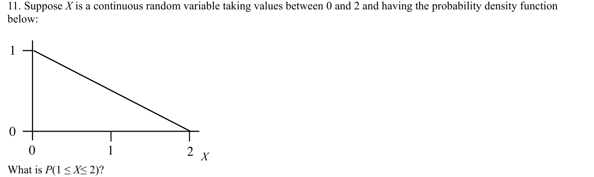

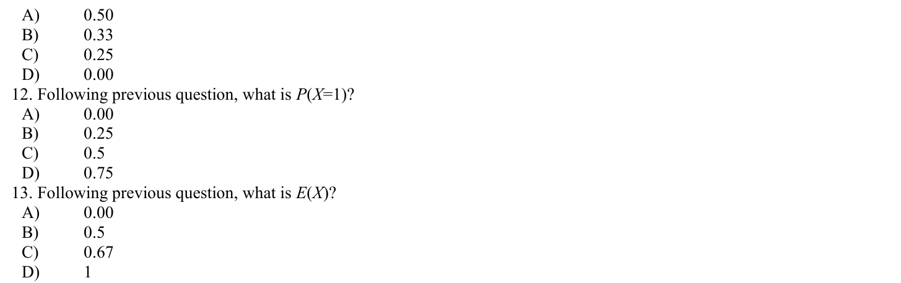

*圖片直接擷取老師原卷；跨頁題保留前後兩段。原卷每題 2%，本節合計 6%。*

#### 2. 題目與選項解讀

**來源：p.2–3。** 原圖從 $(0,1)$ 直線下降到 $(2,0)$，區間外的密度為 0。

- **I-11：** $P(1\le X\le2)$？A. 0.50　B. 0.33　C. 0.25　D. 0。
- **I-12：** $P(X=1)$？A. 0　B. 0.25　C. 0.5　D. 0.75。
- **I-13：** $E(X)$？A. 0　B. 0.5　C. 0.67　D. 1。

**選項在比較什麼：** I-11 四項是區間機率；I-12 四項是恰好取單一數值的機率；I-13 四項是平均位置。三題共用同一張圖，各自對應不同運算。

#### 3. 概念原理：從定義推到方法

**密度 $f(x)$ 描述每單位長度附近的機率集中程度。** 在很短的區間內，機率約為 $f(x)\Delta x$；把小區間累加並取極限，就得到

$$P(a\le X\le b)=\int_a^b f(x)\,dx.$$

單點的區間長度為 0，因此有密度的連續分配滿足 $P(X=c)=\int_c^c f(x)dx=0$。

平均需將每個位置乘上其機率權重。短區間對平均的貢獻約為 $x f(x)\Delta x$，取極限後得到 $E(X)=\int xf(x)dx$。這說明區間機率與平均所用積分的差別。

本圖是直線，先依兩端點求斜率與截距，再把所得密度代入各自的定義。

##### 從圖上兩點推到密度函數

直線斜率等於「高度變化 ÷ 水平距離」。圖中兩點為 $(0,1)$、$(2,0)$，所以斜率

$$m=\frac{0-1}{2-0}=-\frac12.$$

直線寫成 $f(x)=mx+b$；代入 $x=0,f(0)=1$ 得截距 $b=1$。因此 $0<x<2$ 時，$f(x)=1-x/2$，其餘範圍密度為 0。先核對總面積：

$$\int_0^2\left(1-\frac x2\right)dx=\left[x-\frac{x^2}{4}\right]_0^2=2-1=1.$$

這裡對常數 1 積分得到 $x$，對 $x/2$ 積分得到 $x^2/4$，最後代入上限減下限。

例如要計算 $0<X<1$ 的機率，同樣代入該區間：$[x-x^2/4]_0^1=3/4$。這表示總機率的四分之三集中在左半段，可用來理解這張圖左高右低的形狀。

#### 4. 詳細解題步驟

右半部是底 1、高 0.5 的三角形：
$$P(1\le X\le2)=\frac12(1)(0.5)=0.25.$$
也可積分 $\int_1^2(1-x/2)dx=1/4$。

單點沒有寬度，所以 $P(X=1)=0$。$f(1)=0.5$ 表示該點的密度高度；區間機率由密度曲線下的面積決定。

$$E(X)=\int_0^2x\left(1-\frac x2\right)dx=\left[\frac{x^2}{2}-\frac{x^3}{6}\right]_0^2=\frac23\approx0.667.$$
左邊密度較高，平均小於區間中點 1，符合直覺。

#### 5. 答案

I-11 選 C（0.25）；I-12 選 A（0）；I-13 選 C（$2/3\approx0.667$）。與老師解答一致。

#### 6. 陷阱與考試小技巧

先在題號旁標「面積／單點／平均」。平均積分中保留前面的 $x$；密度高度的單位與區間機率不同。

### I-14｜常態分配是哪一類？

#### 1. 老師原題

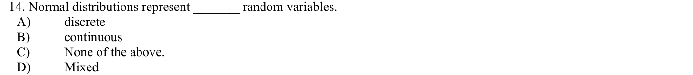

*圖片直接擷取老師原卷；跨頁題保留前後兩段。原卷 2%。*

#### 2. 題目與選項解讀

**來源：p.3；對應第 6 章分配辨認。** A. 離散　B. 連續　C. 皆非　D. 混合。

**選項在比較什麼：** A 指機率集中在可列舉的點；B 指本課以密度描述的連續模型；C 為以上皆非；D 指同時含離散質量與連續部分。

#### 3. 概念原理：從定義推到方法

**有密度的連續分配，透過積分把機率分配到實數區間。** 常態模型的密度為

$$f(x)=\frac1{\sigma\sqrt{2\pi}}\exp\!\left(-\frac{(x-\mu)^2}{2\sigma^2}\right),\qquad \sigma>0.$$

它在實數軸上非負、總積分為 1，任一區間的機率由該區間積分取得。單點積分的上下限相同，所以單點機率為 0。

分配類型由這個機率配置方式決定。記錄時採用的四捨五入精度，屬於觀測資料的表示方式。本題只需辨認模型類型；這個式子用來說明分類理由，無須進行區間積分。

##### 補齊 9/23 常態密度高度的界限

原稿第 7 頁寫了密度的最大高度。因 $\sigma>0$ 且 $(x-\mu)^2\ge0$，指數 $-(x-\mu)^2/(2\sigma^2)\le0$，所以

$$0<e^{-(x-\mu)^2/(2\sigma^2)}\le1.$$

乘上正係數得到

$$0<f_X(x)\le\frac1{\sigma\sqrt{2\pi}}.$$

在 $x=\mu$ 時，指數為 0，$e^0=1$，確實達到右邊高度，因此上界包含等號。若 $\sigma$ 很小，最高密度可大於 1；總積分仍保持為 1。

#### 4. 詳細解題步驟

**步驟 1：辨認模型。** 題目指定 Normal distribution，即常態分配。

**步驟 2：確認機率配置。** 常態使用實數軸上的密度，區間機率由積分計算。

**步驟 3：對照選項類型。** 這符合連續分配的定義，據此選出對應類別。

#### 5. 答案

B，連續分配，與老師解答一致。

#### 6. 陷阱與考試小技巧

本題雖對應第 6 章，老師模擬卷有列入，因此保留基本辨認。看見分配類型題，先辨識機率配置方式即可。

### II-20｜三個函數，哪些是合法密度？

#### 1. 老師原題

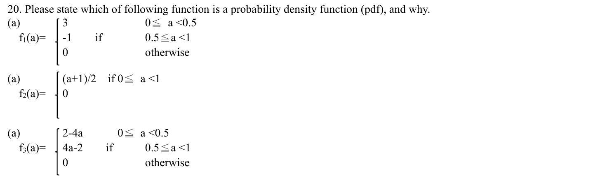

*圖片直接擷取老師原卷；跨頁題保留前後兩段。原卷 5%。*

#### 2. 題目與選項解讀

**來源：p.4。** 以下區間外均為 0；原卷三個子題標記重複，這裡依函數名稱區分。

$$f_1(a)=\begin{cases}3,&0\le a<0.5,\\-1,&0.5\le a<1,\\0,&\text{其他},\end{cases}$$
$$f_2(a)=\begin{cases}(a+1)/2,&0\le a<1,\\0,&\text{其他},\end{cases}$$
$$f_3(a)=\begin{cases}2-4a,&0\le a<0.5,\\4a-2,&0.5\le a<1,\\0,&\text{其他}.\end{cases}$$

請逐項檢查非負性與總面積，並據此說明是否為 pdf。

**作答任務：** 依序判定三個分段函數能否作為完整密度，每個都要檢查符號與總積分。

#### 3. 概念原理：從定義推到方法

**機率必須非負，而且所有可能結果的總機率為 1。** 密度用積分產生機率，因此這兩項機率要求對應到

$$f(x)\ge0\quad\text{（幾乎處處）},\qquad \int_{-\infty}^{\infty}f(x)dx=1.$$

若某一整段密度為負，積分便會產生負的區間機率。若總積分偏離 1，全部結果的機率就無法正規化。兩項條件需同時成立。

分段函數的積分由各段積分相加。一次函數可由端點確認符號，並以三角形或長方形面積計算積分。密度本身以「每單位長度」衡量，數值可大於 1；機率大小由積分後的面積決定。

##### 對照 9/23 圖上的面積條件

你 [[統計9_23原稿.pdf#page=7|原稿第 7 頁]] 畫的長方形寬 0.5、高 2，完整面積為 $0.5\times2=1$。這是合法密度高度可超過 1 的直接例子。

原稿的面積註記可精確分成兩句：**完整密度的總面積必須等於 1；只取其中一段的區間機率，面積介於 0 與 1。** 若函數的全部面積小於 1，需補上其餘分布或重新正規化後，才能當作完整密度。

#### 4. 詳細解題步驟

**步驟 1：檢查 $f_1$。** 面積雖為 $3(0.5)-1(0.5)=1$，但後半段是負值，違反非負性。

**步驟 2：檢查 $f_2$。** 雖然非負，總面積只有
$$\int_0^1\frac{a+1}{2}da=\left[\frac{a^2}{4}+\frac a2\right]_0^1=\frac34\ne1.$$

**步驟 3：檢查 $f_3$。** 第一段由 2 線性降到 0；第二段由 0 線性升到 2，所以兩段均非負。兩個三角形各底 0.5、高 2，總面積 $2\times\frac12(0.5)(2)=1$。若用積分書寫，就是

$$\int_0^{0.5}(2-4a)\,da+\int_{0.5}^1(4a-2)\,da=\frac12+\frac12=1.$$

高度 2 可以是合法密度；本題的總面積為 1，且各處非負，符合兩項條件。

#### 5. 答案

$f_1$ 不合法；$f_2$ 不合法；$f_3$ 合法。與老師解答一致（老師只寫「Only f3 is a pdf」）。

#### 6. 陷阱與考試小技巧

老師解答只寫結論「Only f3 is a pdf」，但考試要寫理由才拿得到分：每個函數各寫「非負性」與「總面積」兩項檢查。密度高度可大於 1；機率須透過積分計算。

### II-17｜平方轉換：為什麼要看正負兩邊？

#### 1. 老師原題

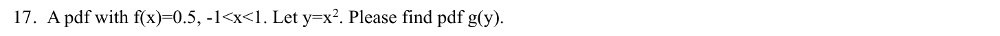

*圖片直接擷取老師原卷；跨頁題保留前後兩段。原卷 5%。*

#### 2. 題目與選項解讀

**來源：p.4。** $f_X(x)=0.5$，$-1<x<1$，區間外為 0。令 $Y=X^2$，求 $g_Y(y)$。

**作答任務：** 已知 $X$ 的均勻密度，求平方後 $Y$ 的密度；答案需包含新變數的取值範圍。

#### 3. 概念原理：從定義推到方法

##### 先分清楚 $X$、$Y$、$x$、$y$ 與事件

| 記號 | 意義 |
|---|---|
| $X$ | 原來的隨機變數，試驗結果決定它的值 |
| $Y=X^2$ | 新的隨機變數，由原來的值平方得到 |
| $x$ | 原變數的一個具體數值，也可作為積分中的變動符號 |
| $y$ | 新變數的一個具體數值；在 $F_Y(y)$ 中用作累積到哪裡的門檻 |
| $\{Y\le y\}$ | 所有使 $Y$ 小於或等於門檻 $y$ 的試驗結果，這是一個事件 |

例如固定 $y=1/4$，$F_Y(1/4)=P(Y\le1/4)$ 就是在問事件 $\{Y\le1/4\}$ 發生的機率。大寫表示隨機變數，小寫用來指定評估函數的位置或門檻；老師原題的小寫 $y=x^2$ 表達的是數值轉換關係，講義以 $Y=X^2$ 標示隨機變數之間的關係。

**變數轉換保留原來每個事件的機率，只改變結果的表示方式。** 若 $Y=h(X)$，要找 $Y$ 落在某範圍的機率，就先找所有會被 $h$ 映到該範圍的 $X$。

由累積分配的定義，$F_Y(y)=P(Y\le y)=P(h(X)\le y)$。平方函數滿足

$$X^2\le y\iff -\sqrt y\le X\le\sqrt y\qquad(y\ge0).$$

所以正負兩側都要納入同一個原始事件。求出這個區間的機率後，使用密度與累積分配的關係 $g_Y(y)=F_Y'(y)$，便得到新密度。

計算需依新變數範圍分段：下界以下的 CDF 為 0，上界以上為 1，中間才使用原分配積分。這樣可同時處理轉換範圍與多個反解。

##### 為什麼 CDF 微分會回到密度？

有密度的 $Y$ 滿足 $F_Y(y)=\int_{-\infty}^y g_Y(t)dt$。當 $y$ 增加小量 $\Delta y$，新增的累積機率為

$$F_Y(y+\Delta y)-F_Y(y)=\int_y^{y+\Delta y}g_Y(t)dt.$$

兩邊除以 $\Delta y$，右邊是這小段的平均密度；在密度連續處，令 $\Delta y\to0$，得到 $F_Y'(y)=g_Y(y)$。更一般地，這個關係幾乎處處成立。

以本題的 $y=1/4$ 理解事件：$Y\le1/4$ 等價於 $-1/2\le X\le1/2$。這段寬度為 1，密度為 $1/2$，所以機率為 $1/2$。一般化後得到的 $F_Y(y)=\sqrt y$ 代入 $1/4$ 也得到 $1/2$。

#### 4. 詳細解題步驟

**1. 先找平方後的範圍：包含 0。**

對題目區間內的原值 $-1<x<1$，先改寫成絕對值，再平方：

$$-1<x<1\ \Longrightarrow\ 0\le |x|<1\ \Longrightarrow\ 0\le x^2<1.$$

下界可以取到：$x=0$ 在原區間內，平方後 $y=0$。上界 1 需要 $x=1$ 或 $x=-1$，兩個端點都在題目開區間之外。因此這個區間經平方轉換得到的範圍為 $[0,1)$，可寫成 $0\le Y<1$。以機率描述，$P(0\le Y<1)=1$。

**2. 求累積分配，先把 $y=0$ 單獨算清楚。**

- 當 $y<0$，平方值全都非負，所以 $F_Y(y)=0$。
- 當 $y=0$，事件 $\{Y\le0\}$ 等於 $\{X=0\}$。原分配有連續密度，單點機率為 0，因此

$$F_Y(0)=P(Y=0)=P(X=0)=\int_0^0\frac12dx=0.$$

0 是平方後可得到的數值，而「恰好取到 0」這個單點的機率為 0。連續模型的區間機率來自面積，單點寬度為 0；兩項描述可以同時成立。

- 當 $0<y<1$，把累積事件換回 $X$ 的範圍：

$$\begin{aligned}
F_Y(y)&=P(Y\le y)\\
&=P(X^2\le y) &&\text{代入 }Y=X^2\\
&=P(-\sqrt y\le X\le\sqrt y) &&\text{平方不等式的正負兩側}\\
&=\int_{-\sqrt y}^{\sqrt y}\frac12dx &&\text{計算區間機率}\\
&=\frac12[\sqrt y-(-\sqrt y)]=\sqrt y. &&\text{高度乘區間寬度}
\end{aligned}$$

- 當 $y\ge1$，已涵蓋全部機率，所以 $F_Y(y)=1$。

為了清楚保留 0，完整 CDF 可寫成：

$$F_Y(y)=\begin{cases}0,&y<0,\\\sqrt y,&0\le y<1,\\1,&y\ge1.\end{cases}$$

這裡 $\sqrt0=0$。也可以把 $y=0$ 歸到第一段，寫成「$y\le0$ 時為 0，$0<y<1$ 時為 $\sqrt y$」；兩種分段寫法得到完全相同的函數。

**3. 密度公式為什麼寫在 $0<y<1$？**

在這個開區間內，$\sqrt y$ 可以微分：

$$g_Y(y)=F_Y'(y)=\frac{d}{dy}y^{1/2}=\frac12y^{-1/2}=\frac1{2\sqrt y},\qquad 0<y<1.$$

微分時，次方 $1/2$ 移到前面，指數減 1 成為 $-1/2$。到 $y=0$ 時，這個式子的分母為 0，因此另外指定端點密度的值。

密度用積分決定機率，改動單一點的非負密度值不影響任何區間積分。本題可選 $g_Y(0)=0$，得到一個合法的密度表示：

$$g_Y(y)=\begin{cases}\dfrac1{2\sqrt y},&0<y<1,\\0,&\text{其他}.\end{cases}$$

**所以要分開讀：平方後的範圍包含 0；$1/(2\sqrt y)$ 這個密度公式在 $0<y<1$ 使用，端點另外定義。** $P(Y=0)=0$ 則是由 CDF 在 0 沒有跳躍，或由 $P(X=0)=0$ 得到。

**4. 驗算。** $\int_0^1(2\sqrt y)^{-1}dy=[\sqrt y]_0^1=1$。

#### 5. 答案

$g_Y(y)=1/(2\sqrt y)$，$0<y<1$；其他地方取 0。與老師解答一致，老師同樣用 CDF 法。

#### 6. 陷阱與考試小技巧

先寫平方後的範圍 $0\le Y<1$，再依門檻 $y$ 分段計算。$Y$ 是隨機變數，$\{Y\le y\}$ 是事件；CDF 可在 0 代值，密度式 $1/(2\sqrt y)$ 則在正的 $y$ 使用。最後驗算總積分為 1。

# 第四章 C｜才比雪夫不等式：不知道分配也能給界限

### 章節重點：用平均與變異數求機率的保證下界

只要平均 $\mu$、有限變異數 $\sigma^2$ 存在，對 $a>0$：

$$P(|X-\mu|\ge a)\le\frac{\sigma^2}{a^2},\qquad P(|X-\mu|<a)\ge1-\frac{\sigma^2}{a^2}.$$

右式若為負，可改用機率至少為 0。**不需要假設常態分配。** $a$ 是端點與平均的距離；若改用標準差倍數表示，則令 $k=a/\sigma$。

### II-16｜由兩個動差找到區間機率下界

#### 1. 老師原題

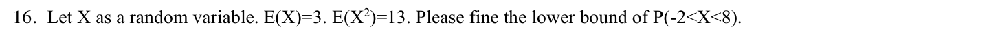

*圖片直接擷取老師原卷；跨頁題保留前後兩段。原卷 5%。*

#### 2. 題目與選項解讀

**來源：p.3–4。** $E(X)=3$、$E(X^2)=13$，求 $P(-2<X<8)$ 的下界。

**作答任務：** 已知一階與二階動差，求指定區間機率的保證下界；答案需表達「至少有多少」。

#### 3. 概念原理：從定義推到方法

**變異數是平方離差的平均，因此能限制遠離平均的機率比例。** 設 $A=\{|X-\mu|\ge a\}$，在事件 $A$ 上，每個平方離差至少為 $a^2$；其餘結果的平方離差仍非負。取平均便有

$$\sigma^2=E[(X-\mu)^2]\ge a^2P(A).$$

除以 $a^2>0$，得到外側機率上界 $P(A)\le\sigma^2/a^2$。內側為補事件，所以

$$P(|X-\mu|<a)=1-P(A)\ge1-\frac{\sigma^2}{a^2}.$$

應用時先由二階動差求變異數，再把題目區間寫成「距離平均小於 $a$」。這條推導只用到有限的平均平方離差，因此適用於各種具有有限變異數的分配。

##### 用一組數字理解保證下界

假設平均為 10、變異數為 4，想知道距離平均小於 4 的機率。距離至少 4 的結果，每一個至少貢獻 $4^2=16$ 的平方離差，所以

$$4=E[(X-10)^2]\ge16P(|X-10|\ge4).$$

兩邊除以 16，外側機率至多為 $1/4$；內側的補事件機率因此至少為 $3/4$：

$$P(6<X<14)\ge1-\frac14=\frac34.$$

這個推論將所有遠處結果的平方離差用同一個最低值估計，因此得到保證界限。接下來換回老師給的一階、二階動差及區間端點。

#### 4. 詳細解題步驟

**1. 算變異數。** $\sigma^2=13-3^2=4$，所以 $\sigma=2$。

**2. 改寫區間。** 中心是 3，左右各距離 5：
$$-2<X<8\iff |X-3|<5.$$

**3. 套補事件形式。**
$$P(-2<X<8)\ge1-\frac4{25}=\frac{21}{25}=0.840.$$

答案寫成「至少 0.840」，表達這是機率下界。補事件是 $|X-3|\ge5$，因此原題的嚴格不等號仍與公式吻合。

#### 5. 答案

$P(-2<X<8)\ge21/25=0.840$，與老師解答一致。

#### 6. 陷阱與考試小技巧

先以 $13-3^2$ 求變異數，再取距離 $a=5$。答案保留「至少」或 $\ge$；補事件的邊界為 $|X-3|\ge5$。

### III-22｜證明才比雪夫不等式

#### 1. 老師原題

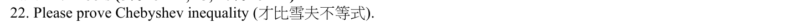

*圖片直接擷取老師原卷；跨頁題保留前後兩段。原卷 5%。*

#### 2. 題目與選項解讀

**來源：p.5。** 請證明 Chebyshev inequality。

**作答任務：** 從有限變異數的假設出發，證明偏離平均至少一段距離的機率上界。

#### 3. 概念原理：從定義推到方法

**要證明機率界限，先找每個結果都成立的數值不等式。** 令指示變數 $\mathbf1_A$ 在事件 $A$ 發生時等於 1，其餘時等於 0。由期望的定義：

$$E(\mathbf1_A)=1\cdot P(A)+0\cdot P(A^c)=P(A).$$

對 $A=\{|X-\mu|\ge a\}$，分兩種情形檢查：在 $A$ 內，$(X-\mu)^2\ge a^2$；在 $A$ 外，$(X-\mu)^2\ge0$。兩種情形合寫為 $(X-\mu)^2\ge a^2\mathbf1_A$。

期望是非負機率權重的加總或積分，因此會保留逐點成立的不等號方向。將兩邊取期望後，左邊成為變異數，右邊成為常數乘機率，最後即可解出機率上界。

#### 4. 詳細解題步驟

假設 $E(X)=\mu$、$\operatorname{Var}(X)=\sigma^2<\infty$，令 $a>0$，$A=\{|X-\mu|\ge a\}$。逐點有
$$(X-\mu)^2\ge a^2\mathbf1_A.$$
其中 $\mathbf1_A$ 是事件成立取 1、否則取 0 的指示變數。

兩邊取期望：
$$\sigma^2=E[(X-\mu)^2]\ge a^2E(\mathbf1_A)=a^2P(A).$$
因 $a^2>0$，得到
$$P(|X-\mu|\ge a)\le\frac{\sigma^2}{a^2}.$$
若 $\sigma>0$，令 $a=k\sigma$，即得 $P(|X-\mu|\ge k\sigma)\le1/k^2$。若 $\sigma=0$，則 $X=\mu$ 幾乎必然，原本 $a>0$ 形式仍成立。

#### 5. 答案

對任意 $a>0$，$P(|X-\mu|\ge a)\le\sigma^2/a^2$，證畢。

老師解答沒有附證明，只寫「See Guan's textbook」（推測是管中閔的統計學課本）；考前可對照課本的符號。

#### 6. 陷阱與考試小技巧

完整呈現「逐點比較 → 取期望 → 除以正數」。若寫標準差倍數形式，另說明 $\sigma>0$。
# 第五章｜聯合分配、條件期望與最佳預測

### 章節重點：先看範圍，再看公式

聯合密度 $f_{X,Y}(x,y)$ 描述兩個變數同時出現的位置。邊際密度是把另一個變數積掉：

$$f_X(x)=\int f_{X,Y}(x,y)dy,\qquad f_{X\mid Y}(x\mid y)=\frac{f_{X,Y}(x,y)}{f_Y(y)}\quad(f_Y(y)>0).$$

獨立須在整個平面（幾乎處處）滿足 $f_{X,Y}=f_Xf_Y$。**判斷獨立時，要同時檢查密度的數值及支持範圍。**

$E(X\mid Y=y)$ 是固定 $y$ 後的平均數；$E(X\mid Y)$ 是一個隨 $Y$ 改變的隨機變數。再對所有 $Y$ 的可能性平均，得到 $E[E(X\mid Y)]=E(X)$。

### I-15｜條件期望一定是常數嗎？

#### 1. 老師原題

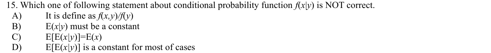

*圖片直接擷取老師原卷；跨頁題保留前後兩段。原卷 2%。*

#### 2. 題目與選項解讀

**來源：p.3。** 關於 $f(x\mid y)$ 哪句不正確？A. 等於 $f(x,y)/f(y)$　B. $E(x\mid y)$ 一定為常數　C. $E[E(x\mid y)]=E(x)$　D. $E[E(x\mid y)]$ 在大多數情況是常數。

**選項在比較什麼：** A 是條件密度的比值定義；B 問條件平均是否必定固定；C 是兩層期望與整體期望的關係；D 問外層期望後是否為常數。題目要求找不正確敘述，需特別辨認條件符號的大小寫。

#### 3. 概念原理：從定義推到方法

**條件分配將已知條件下的機率重新正規化，條件期望再對這份分配求平均。** 對 $f_Y(y)>0$：

$$f_{X\mid Y}(x\mid y)=\frac{f_{X,Y}(x,y)}{f_Y(y)},\qquad E(X\mid Y=y)=\int x f_{X\mid Y}(x\mid y)dx.$$

固定 $y$ 時，積分後得到一個數值 $E(X\mid Y=y)$。讓條件隨隨機變數 $Y$ 改變，便得到 $E(X\mid Y)$；它是 $Y$ 的函數，可能隨 $Y$ 取不同值。

再對 $Y$ 的分配取期望，就是把所有條件的平均依權重合併。由聯合分配的加總規則，$E[E(X\mid Y)]=E(X)$。在期望有限的條件下，這個整體平均是一個固定數值。解讀選項時須依次確認「固定 y」「隨機 Y」與「外層期望」。

##### 條件密度的分母如何得到？

先固定 $y$，把聯合密度視為沿 $x$ 方向的一段權重。這些權重加總後是 $\int f_{X,Y}(x,y)dx=f_Y(y)$。要讓條件分配的總積分為 1，就將整段除以這個總權重：

$$\int\frac{f_{X,Y}(x,y)}{f_Y(y)}dx=\frac1{f_Y(y)}\int f_{X,Y}(x,y)dx=1.$$

因此條件密度為 $f_{X,Y}/f_Y$，再用它作權重計算 $\int x f_{X\mid Y}(x\mid y)dx$，便得到條件平均。這個寫法在 $f_Y(y)>0$ 處使用。

用離散小表理解相同的正規化過程：假設 $Y=0$ 時的兩個聯合機率是 $P(X=1,Y=0)=0.1$、$P(X=3,Y=0)=0.3$。先相加得到 $P(Y=0)=0.4$，再各除以 0.4，得到條件機率 0.25、0.75。所以

$$E(X\mid Y=0)=1(0.25)+3(0.75)=2.5.$$

固定 $Y=0$ 後，條件平均便由該組內重新加權得到。

#### 4. 詳細解題步驟

**步驟 1：檢查 A。** 聯合密度除以條件變數的邊際密度，可將固定條件下的密度正規化；需有 $f_Y(y)>0$。

**步驟 2：檢查 B。** 按原卷意圖，將條件期望讀成 $E(X\mid Y)$。其值由條件分配決定，可能隨 $Y$ 改變，因此「一定為常數」的主張過強。

**步驟 3：檢查 C。** 對 $E(X\mid Y)$ 再按 $Y$ 的分配平均，由疊代期望得到 $E[E(X\mid Y)]=E(X)$。

**步驟 4：檢查 D。** 期望存在且有限時，外層平均後的 $E(X)$ 為固定數值。依此核對題目要找的錯誤敘述。

#### 5. 答案

B，與老師解答一致。

#### 6. 陷阱與考試小技巧

原題大小寫有歧義：固定 $y$ 的 $E(X\mid Y=y)$ 為數值；$E(X\mid Y)$ 為隨機變數的函數。A 需 $f_Y(y)>0$，C、D 需相應期望存在且有限。

### II-18｜由三角形支持範圍判斷獨立性

#### 1. 老師原題

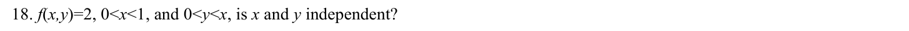

*圖片直接擷取老師原卷；跨頁題保留前後兩段。原卷 5%。*

#### 2. 題目與選項解讀

**來源：p.4。** $f_{X,Y}(x,y)=2$，$0<x<1$、$0<y<x$，其他地方為 0。問 $X,Y$ 是否獨立？

**作答任務：** 依三角形區域內的聯合密度判斷獨立性，需要寫出能支持結論的密度比較。

#### 3. 概念原理：從定義推到方法

**獨立的定義是任意兩個事件的聯合機率可分解為各自機率的乘積。** 對有聯合密度的變數，等價條件為 $f_{X,Y}(x,y)=f_X(x)f_Y(y)$ 幾乎處處成立。

邊際密度來自加總另一個變數的所有可能性：$f_X(x)=\int f_{X,Y}(x,y)dy$。本題固定 $x$ 後，允許的 $y$ 為 $0<y<x$；固定 $y$ 後，允許的 $x$ 為 $y<x<1$。積分上下限直接由這些不等式決定。

支持範圍是密度可能為正的區域，也是聯合分配的一部分。比較密度時，需把範圍外的零值一起納入。若兩式在一片有正面積的區域上不同，就能判定獨立條件未成立。

##### 邊際積分與獨立乘積的由來

對任意區間 $A$，$X$ 落在 $A$ 的事件涵蓋所有可能的 $y$，所以

$$P(X\in A)=\int_A\left[\int_{-\infty}^{\infty} f_{X,Y}(x,y)dy\right]dx.$$

與 $P(X\in A)=\int_A f_X(x)dx$ 比較，括號內就是邊際密度 $f_X(x)$。積掉另一變數，意思是將該變數所有可能性加總。

若聯合密度可分解為 $f_X(x)f_Y(y)$，則對任意區間 $A,B$：

$$\begin{aligned}
P(X\in A,Y\in B)
&=\int_A\int_B f_X(x)f_Y(y)dy\,dx\\
&=\left[\int_A f_X(x)dx\right]\left[\int_B f_Y(y)dy\right]\\
&=P(X\in A)P(Y\in B).
\end{aligned}$$

積分可分開是因為兩個因子各自只依賴一個變數。這正好滿足獨立的事件定義；反方向在有聯合密度時也成立，密度相等以幾乎處處解讀。

例如單位正方形 $0<x<1,0<y<1$ 上密度為 1，兩個邊際都為 1，聯合也等於其乘積。老師題目的支持範圍為三角形，接下來要按該範圍重新檢查。

#### 4. 詳細解題步驟

**步驟 1：先算兩個邊際密度。**
$$f_X(x)=\int_0^x2dy=2x,\quad0<x<1,$$
$$f_Y(y)=\int_y^12dx=2(1-y),\quad0<y<1.$$
**步驟 2：比較聯合密度與邊際乘積。** 邊際乘積是 $4x(1-y)$，不會在整個支持範圍等於常數 2；三角形外如 $0<x<y<1$，聯合密度為 0，但邊際乘積為正。因此 **不獨立**。

**步驟 3：把結論寫完整。** 取整片小長方形 $0.1<x<0.2$、$0.7<y<0.8$，聯合密度全部為 0，但邊際乘積全部大於 0，獨立所需的相等條件失敗。兩者在一整片有面積的區域上都不相等，足以判定相依。

#### 5. 答案

$X,Y$ 不獨立，與老師解答一致；老師也是先算 $f(x)=2x$、$f(y)=2-2y$ 再比較乘積。

#### 6. 陷阱與考試小技巧

先畫 $0<y<x<1$ 的三角形，再寫積分上下限。證明相依時指出一片正面積區域上的差異。

### III-23｜沿用手寫的雙重加總法證明疊代期望

#### 1. 老師原題

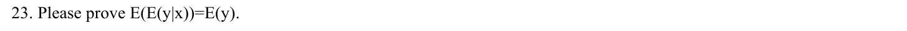

*原卷 5%；你的證明來源：[[統計學手寫證明原稿.pdf#page=7|手寫第 7 頁]]。*

#### 2. 題目與選項解讀

原題要求證明 $E[E(Y\mid X)]=E(Y)$。你的筆記先證明 $E[E(X\mid Y)]=E(X)$，兩式是同一條定理的兩種變數命名。

為了沿用你的閱讀習慣，下面主推導固定 **$X$ 取值 $a_i$、$Y$ 取值 $b_j$，先給定 $Y$ 求 $X$ 的平均**。最後另寫出原題方向的完整式子。每段推導都維持相同變數角色。

#### 3. 概念原理：從定義推到方法

你第 7 頁的核心是：**先在每個 $Y=b_j$ 的條件下算平均，再依 $P(Y=b_j)$ 把這些平均加回去。**

先固定 $Y=b_j$，條件平均是

$$E(X\mid Y=b_j)=\sum_i a_iP(X=a_i\mid Y=b_j).$$

這是一個數值。讓條件隨 $Y$ 改變，就得到隨機變數 $E(X\mid Y)$。因此外層期望需要對 $j$ 加總：

$$E[E(X\mid Y)]=\sum_j E(X\mid Y=b_j)P(Y=b_j).$$

**你的原稿第一行需要補上的細節：** 求和中的條件寫成 $Y=b_j$，讓每一項明確對應到該組的數值。

接著使用條件機率的定義：

$$P(X=a_i\mid Y=b_j)=\frac{P(X=a_i,Y=b_j)}{P(Y=b_j)}.$$

外層正好乘回 $P(Y=b_j)$，分母就約掉，權重回到聯合機率。最後固定 $i$，將所有 $b_j$ 的聯合機率相加，得到 $P(X=a_i)$。

**這裡加總後得到的是 $P(X=a_i)$。** 因為加總時 $X=a_i$ 仍固定，只有 $Y$ 的條件被全部涵蓋。這句可對照你原稿最後一行的旁註。

#### 4. 詳細解題步驟

假設 $E|X|<\infty$。下列條件比值用在 $P(Y=b_j)>0$ 的項；零機率項對外層期望的貢獻為 0。

**步驟 1：先展開外層，再展開內層。**

$$\begin{aligned}
E[E(X\mid Y)]
&=\sum_j E(X\mid Y=b_j)P(Y=b_j)\\
&=\sum_j\left[\sum_i a_iP(X=a_i\mid Y=b_j)\right]P(Y=b_j).
\end{aligned}$$

外層 $j$ 遍歷條件組別；內層 $i$ 遍歷該組內 $X$ 的取值。兩個索引各自有固定工作。

**步驟 2：代入條件機率，約掉分母。**

$$\begin{aligned}
&\sum_j\sum_i a_i
\frac{P(X=a_i,Y=b_j)}{P(Y=b_j)}P(Y=b_j)\\
&\qquad=\sum_j\sum_i a_iP(X=a_i,Y=b_j).
\end{aligned}$$

**步驟 3：固定 $a_i$，把所有 $b_j$ 加起來。**

$$\begin{aligned}
\sum_j\sum_i a_iP(X=a_i,Y=b_j)
&=\sum_i a_i\left[\sum_jP(X=a_i,Y=b_j)\right]\\
&=\sum_i a_iP(X=a_i)\\
&=E(X).
\end{aligned}$$

第一行交換加總順序，由 $E|X|<\infty$ 保證絕對可加總；第二行把互斥的 $Y$ 組別合併成 $X$ 的邊際機率；第三行使用期望定義。

**步驟 4：考卷上依原題方向書寫。** 保留 $X=a_i$、$Y=b_j$ 的對應，這次內層求 $Y$、外層對 $X$ 加權：

$$\begin{aligned}
E[E(Y\mid X)]
&=\sum_i\left[\sum_j b_jP(Y=b_j\mid X=a_i)\right]P(X=a_i)\\
&=\sum_i\sum_j b_jP(X=a_i,Y=b_j)\\
&=\sum_j b_j\left[\sum_iP(X=a_i,Y=b_j)\right]\\
&=\sum_j b_jP(Y=b_j)=E(Y).
\end{aligned}$$

這個方向的條件為 $E|Y|<\infty$。若題目指定有聯合密度的連續型，沿用同一條路把加總換成積分即可：

$$\begin{aligned}
E[E(Y\mid X)]
&=\int\left[\int y\frac{f_{X,Y}(x,y)}{f_X(x)}dy\right]f_X(x)dx\\
&=\int y\left[\int f_{X,Y}(x,y)dx\right]dy\\
&=\int yf_Y(y)dy=E(Y).
\end{aligned}$$

比值在 $f_X(x)>0$ 處使用；仍由 $E|Y|<\infty$ 保證交換積分合法。

#### 5. 答案

$$\boxed{E[E(Y\mid X)]=E(Y)}.$$

你的筆記方向同樣成立：$E[E(X\mid Y)]=E(X)$。

老師解答沒有附證明，只寫「See Guan's textbook」。

#### 6. 陷阱與考試小技巧

記住三個動作：**展開兩層平均 → 條件機率的分母約掉 → 聯合機率加總成邊際。** 考卷要求哪個方向，最後就寫回哪個方向；$a_i$ 全程配 $X$，$b_j$ 全程配 $Y$。此證明適用於相依或獨立的變數。

### III-24｜沿用手寫的兩個交叉項，證明條件平均使平方誤差最小

#### 1. 老師原題

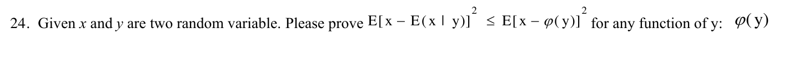

*原卷 10%；你的證明來源：[[統計學手寫證明原稿.pdf#page=10|手寫第 10～12 頁]]。*

#### 2. 題目與選項解讀

對任何只依賴 $Y$ 的預測規則 $\varphi(Y)$，證明

$$E\{[X-E(X\mid Y)]^2\}\le E\{[X-\varphi(Y)]^2\}.$$

沿用你原稿的 $X$、$Y$、$\varphi(Y)$，每一行都保留完整的 $E(X\mid Y)$。你的 A、B 括號標記用來辨認平方展開的兩部分。

#### 3. 概念原理：從定義推到方法

**你的方法：加減 $E(X\mid Y)$，展開平方，把交叉項拆成 ①、② 分別證明為 0。**

先準備你第 8～9 頁使用的工具：給定 $Y$ 後，$Y$ 的函數就成為已知量，因此

$$E[X\varphi(Y)\mid Y]=\varphi(Y)E(X\mid Y).$$

用你熟悉的加總方式看一次。固定 $Y=b_j$，$\varphi(b_j)$ 是常數，所以

$$\begin{aligned}
E[X\varphi(Y)\mid Y=b_j]
&=\sum_i a_i\varphi(b_j)P(X=a_i\mid Y=b_j)\\
&=\varphi(b_j)\sum_i a_iP(X=a_i\mid Y=b_j)\\
&=\varphi(b_j)E(X\mid Y=b_j).
\end{aligned}$$

同理，$E(X\mid Y)$ 本身只依賴 $Y$，所以再給定 $Y$ 時，其值保持相同：

$$E[E(X\mid Y)\mid Y]=E(X\mid Y).$$

於是偏差的條件平均為

$$\begin{aligned}
E[X-E(X\mid Y)\mid Y]
&=E(X\mid Y)-E[E(X\mid Y)\mid Y]\\
&=E(X\mid Y)-E(X\mid Y)=0.
\end{aligned}$$

後面兩個交叉項都靠這一個等式歸零。外面再取期望，則使用上一題的疊代期望。

#### 4. 詳細解題步驟

假設 $E(X^2)<\infty$。先考慮 $E[(X-\varphi(Y))^2]<\infty$ 的預測；如果右側為無限大，所求不等式直接成立。

**步驟 1：在誤差中加減同一項。**

$$X-\varphi(Y)=\underbrace{X-E(X\mid Y)}_{A}+\underbrace{E(X\mid Y)-\varphi(Y)}_{B}.$$

A 是真實結果相對條件平均的偏差；B 是條件平均與另一個預測值的差距。

**步驟 2：照 $(A+B)^2=A^2+B^2+2AB$ 展開，再取期望。**

$$\begin{aligned}
E[(X-\varphi(Y))^2]
&=E[(X-E(X\mid Y))^2]\\
&\quad+E[(E(X\mid Y)-\varphi(Y))^2]\\
&\quad+2E[(X-E(X\mid Y))(E(X\mid Y)-\varphi(Y))].
\end{aligned}$$

**步驟 3：在乘積內分色，再用分配律拆成 ①、②。**

配色直接對應算式中的部分：${\color{#70B7FF}X-E(X\mid Y)}$ 是共同偏差；${\color{#FFB366}E(X\mid Y)}$ 與 ${\color{#C9A0FF}\varphi(Y)}$ 是要從內層提出的因子。①、② 保留白色編號。

$$\begin{gathered}
E\!\left[{\color{#70B7FF}(X-E(X\mid Y))}\left({\color{#FFB366}E(X\mid Y)}-{\color{#C9A0FF}\varphi(Y)}\right)\right]\\[4pt]
\Big\downarrow\quad\text{分配律：藍色部分分別乘上橘色、紫色部分}\\[4pt]
\underbrace{E\!\left[{\color{#70B7FF}(X-E(X\mid Y))} {\color{#FFB366}E(X\mid Y)}\right]}_{\text{①}}
-\underbrace{E\!\left[{\color{#70B7FF}(X-E(X\mid Y))} {\color{#C9A0FF}\varphi(Y)}\right]}_{\text{②}}
\end{gathered}$$

**步驟 4：追蹤橘色因子，證明 ① 為 0。**

$$\begin{gathered}
\text{①}=E\!\left[{\color{#70B7FF}(X-E(X\mid Y))}{\color{#FFB366}E(X\mid Y)}\right]\\[4pt]
\Big\downarrow\quad\text{用疊代期望，加上內層「給定 }Y\text{」}\\[4pt]
E\!\left[E\!\left[{\color{#70B7FF}(X-E(X\mid Y))}{\color{#FFB366}E(X\mid Y)}\mid Y\right]\right]\\[4pt]
\Big\downarrow\quad\text{固定 }Y\text{，把彩色因子提出內層期望}\\[4pt]
E\!\left[{\color{#FFB366}E(X\mid Y)}{\color{#70B7FF}E[X-E(X\mid Y)\mid Y]}\right]\\[4pt]
\Big\downarrow\quad\text{藍色的偏差條件平均等於 }0\\[4pt]
E\!\left[{\color{#FFB366}E(X\mid Y)}\cdot{\color{#70B7FF}0}\right]=0
\end{gathered}$$

提出後，橘色因子仍留在最外層的 $E[\,\cdot\,]$ 內。藍色部分歸零的理由是：

$$\begin{gathered}
{\color{#70B7FF}E[X-E(X\mid Y)\mid Y]}\\[4pt]
\Big\downarrow\quad\text{條件期望對減法拆開}\\[4pt]
E(X\mid Y)-E[E(X\mid Y)\mid Y]\\[4pt]
\Big\downarrow\quad\text{已知 }Y\text{ 後，}E(X\mid Y)\text{ 的值已固定}\\[4pt]
E(X\mid Y)-E(X\mid Y)={\color{#70B7FF}0}
\end{gathered}$$

**步驟 5：追蹤紫色因子，證明 ② 為 0。**

$$\begin{gathered}
\text{②}=E\!\left[{\color{#70B7FF}(X-E(X\mid Y))}{\color{#C9A0FF}\varphi(Y)}\right]\\[4pt]
\Big\downarrow\quad\text{用疊代期望，加上內層「給定 }Y\text{」}\\[4pt]
E\!\left[E\!\left[{\color{#70B7FF}(X-E(X\mid Y))}{\color{#C9A0FF}\varphi(Y)}\mid Y\right]\right]\\[4pt]
\Big\downarrow\quad\text{固定 }Y\text{，把彩色因子提出內層期望}\\[4pt]
E\!\left[{\color{#C9A0FF}\varphi(Y)}{\color{#70B7FF}E[X-E(X\mid Y)\mid Y]}\right]\\[4pt]
\Big\downarrow\quad\text{藍色的偏差條件平均等於 }0\\[4pt]
E\!\left[{\color{#C9A0FF}\varphi(Y)}\cdot{\color{#70B7FF}0}\right]=0
\end{gathered}$$

因此原來的交叉項為 $2(\text{①}-\text{②})=2(0-0)=0$。

**步驟 6：保留兩個平方項，用非負性收尾。**

$$\begin{aligned}
E[(X-\varphi(Y))^2]
&=E[(X-E(X\mid Y))^2]\\
&\quad+E[(E(X\mid Y)-\varphi(Y))^2]\\
&\ge E[(X-E(X\mid Y))^2].
\end{aligned}$$

最後一步成立，因為第二項是平方的期望，必定大於或等於 0。

**小例子核對：** 固定某個 $Y=b_j$ 後，若 $X$ 等可能取 1、3，則 $E(X\mid Y=b_j)=2$。用 2 預測的平均平方誤差為 $[(1-2)^2+(3-2)^2]/2=1$；改用 3，得到 $[(1-3)^2+(3-3)^2]/2=2$。多出的 1 正好是 $(2-3)^2$。

#### 5. 答案

$$\boxed{E[(X-E(X\mid Y))^2]\le E[(X-\varphi(Y))^2]}.$$

等號成立當且僅當 $\varphi(Y)=E(X\mid Y)$ 幾乎必然，也就是除去零機率情形後，兩個預測相同。

老師解答沒有附證明，只寫「See Guan's textbook」。

#### 6. 陷阱與考試小技巧

沿用你的六步順序：**加減同一項 → 展開平方 → 拆 ①、② → 分別加上條件期望 → 提出 $Y$ 的函數 → 非負平方項收尾。**

括號要寫成 $E[(X-\varphi(Y))^2]$，讓平方作用在每次誤差上。$E[X-E(X\mid Y)\mid Y]=0$ 的條件 $\mid Y$ 要保留；提出的因子仍留在最外層期望內。

## 做完後：用一句話確認自己真的懂

- 描述統計：我能說明「原始值」與「分組估計」差在哪裡。
- 機率：我能先寫出補事件或分母包含的所有來源。
- 隨機變數：我能分開 $E(X^2)$ 與 $[E(X)]^2$。
- 連續分配：我能從密度畫面積，且不把高度當機率。
- 不等式：我能分清精確機率與保證界限。
- 條件期望：我能說明固定條件時如何平均，再平均為何回到整體。

接著做 [[統計學｜第二輪變形練習]]，或在 [[統計學｜公式速查與錯題本]] 記錄卡住的步驟。

# 最後補充｜依你的手寫方法整理的延伸證明

**本區整理手寫檔案中有寫、模擬卷未單獨要求證明的內容。** 先完成原卷 III-22～III-24，再讀本區。Bernoulli、二項、超幾何、Poisson 與等待時間的部分屬延伸複習，實際考試範圍仍依老師公告。

原稿：[[統計學手寫證明原稿.pdf]] 共 30 頁，另整合 [[統計9_23原稿.pdf]] 共 8 頁。各節標示所屬原稿與 PDF 頁序。原稿已完整保留，以下是沿用你方法的校正版。

## 先統一記號與修正位置

- 隨機變數統一用 $X,Y$；具體取值沿用 $X=a_i$、$Y=b_j$。固定條件時寫 $Y=b_j$，保留隨機條件時寫 $Y$。
- 預測函數沿用 $\varphi(Y)$；平方誤差與全變異數證明都保留完整的 $E(X\mid Y)$。
- $\operatorname{Cov}$ 表示共變異數，$\rho_{XY}$ 或 $\operatorname{Corr}$ 表示相關係數。兩者分別有自己的定義。
- 平方誤差寫成 $E[(X-c)^2]$，讓平方位於期望括號裡。條件期望的求和每一項都寫清條件值與索引。

| 原稿頁碼 | 校正或補齊的重點 | 對應位置 |
|---|---|---|
| 1～2、15 | 共變異數與相關係數分開標記；除以變異數時補正值條件 | 補充 1～3 |
| 6 | 一般條件平均寫成 $E(X\mid Y)=g(Y)$；$a+bY$ 是線性形式的特例 | 原卷 I-15、補充 4 |
| 7 | 外層加總項寫 $E(X\mid Y=b_j)$；加總聯合機率後得到 $P(X=a_i)$ | 原卷 III-23 |
| 8～12 | 保留「已知 $Y$ 時提出其函數」；平方與最外層期望括號補完整 | 原卷 III-24、補充 4 |
| 14 | $F(r,s)$ 的 $r$ 固定對應 $X$、$s$ 對應 $Y$；結果修為 $r^3s^2$ | 補充 12 |
| 16 | 條件變異數求和使用條件機率作權重，分母只正規化一次 | 補充 5 |
| 17～19 | 全變異數公式補上兩項之間的加號；第 19 頁兩個平方項的和對應 $\operatorname{Var}(X)$ | 補充 6 |
| 22 | 二項定理加總保留 $\binom nk$；獨立和的變異數由相加得到 | 補充 8 |
| 26～27 | 第 26 頁框內改為 $E[X(X-1)]=\lambda^2$，與第 27 頁推導一致 | 補充 10 |
| 28～29 | 二項近似 Poisson 使用 $\approx$；分開「事件次數」與「等待時間」 | 補充 11 |

## 補充 1｜共變異數公式與相關係數

**來源：手寫第 1、15 頁。重點：從「兩個離差相乘後平均」出發。** 假設 $X,Y$ 都有有限二階動差，令 $\mu_X=E(X)$、$\mu_Y=E(Y)$。

定義為

$$\operatorname{Cov}(X,Y)=E[(X-\mu_X)(Y-\mu_Y)].$$

先展開乘積，再逐項取期望：

$$\begin{aligned}
\operatorname{Cov}(X,Y)
&=E[XY-\mu_YX-\mu_XY+\mu_X\mu_Y]\\
&=E(XY)-\mu_YE(X)-\mu_XE(Y)+\mu_X\mu_Y\\
&=E(XY)-\mu_X\mu_Y-\mu_X\mu_Y+\mu_X\mu_Y\\
&=E(XY)-E(X)E(Y).
\end{aligned}$$

第二行把固定的平均值提出期望；第三行代入平均定義，三個常數項合併後只留下減去一次 $\mu_X\mu_Y$。

若 $\sigma_X>0,\sigma_Y>0$，相關係數定義為

$$\rho_{XY}=\frac{\operatorname{Cov}(X,Y)}{\sigma_X\sigma_Y}.$$

兩邊同乘 $\sigma_X\sigma_Y$，再把平均乘積移到右邊，就得到你第 15 頁的式子：

$$\boxed{E(XY)=\rho_{XY}\sigma_X\sigma_Y+\mu_X\mu_Y}.$$

**檢查技巧：** 令 $Y=X$，共變異數公式會回到 $E(X^2)-[E(X)]^2=\operatorname{Var}(X)$。

## 補充 2｜兩個變數線性組合的變異數

**來源：手寫第 1～2 頁。重點：先求平均，再把離差平方展開。** $a,b$ 為固定常數。

由期望線性性，$E(aX+bY)=aE(X)+bE(Y)$。所以新變數的離差是

$$(aX+bY)-E(aX+bY)=a(X-\mu_X)+b(Y-\mu_Y).$$

平方後有兩個平方項與一個交叉項：

$$\begin{aligned}
\operatorname{Var}(aX+bY)
&=E\{[a(X-\mu_X)+b(Y-\mu_Y)]^2\}\\
&=a^2E[(X-\mu_X)^2]+b^2E[(Y-\mu_Y)^2]\\
&\quad+2abE[(X-\mu_X)(Y-\mu_Y)]\\
&=a^2\operatorname{Var}(X)+b^2\operatorname{Var}(Y)+2ab\operatorname{Cov}(X,Y).
\end{aligned}$$

最後一行將三個期望分別辨認為變異數與共變異數。若題目給定獨立，$E(XY)=E(X)E(Y)$，共變異數為 0，交叉項才消去。

## 補充 3｜沿用選係數法，證明共變異數平方的上界

**來源：手寫第 2 頁。重點：任何變異數都非負，選一個合適的 $a$ 把式子整理出來。**

先假設 $\operatorname{Var}(Y)>0$。由上一節：

$$0\le\operatorname{Var}(X-aY)=\operatorname{Var}(X)+a^2\operatorname{Var}(Y)-2a\operatorname{Cov}(X,Y).$$

沿用你的選法，令

$$a=\frac{\operatorname{Cov}(X,Y)}{\operatorname{Var}(Y)}.$$

代入時分開處理平方項與交叉項：

$$\begin{aligned}
0&\le\operatorname{Var}(X)
+\frac{\operatorname{Cov}(X,Y)^2}{\operatorname{Var}(Y)^2}\operatorname{Var}(Y)
-\frac{2\operatorname{Cov}(X,Y)^2}{\operatorname{Var}(Y)}\\
&=\operatorname{Var}(X)-\frac{\operatorname{Cov}(X,Y)^2}{\operatorname{Var}(Y)}.
\end{aligned}$$

移項並乘上正的 $\operatorname{Var}(Y)$：

$$\boxed{\operatorname{Cov}(X,Y)^2\le\operatorname{Var}(X)\operatorname{Var}(Y)}.$$

若 $\operatorname{Var}(Y)=0$，$Y=E(Y)$ 幾乎必然，所以共變異數為 0，式子仍成立。兩個變異數都正時，再除以其乘積，就得到 $\rho_{XY}^2\le1$，即 $-1\le\rho_{XY}\le1$。

**考場提醒：** 開頭註明分母正值；最後補變異數為 0 的情形，你原稿的證明就完整了。

## 補充 4｜給定 $Y$，將 $Y$ 的函數提出條件期望

**來源：手寫第 8～9 頁。重點：先固定 $Y=b_j$，再提出常數。** 假設所寫期望可積分；例如 $\varphi$ 有界且 $E|X|<\infty$ 即可，平方誤差題中相應的平方可積分條件也足夠。

$$\begin{aligned}
E[X\varphi(Y)\mid Y=b_j]
&=\sum_i a_i\varphi(b_j)P(X=a_i\mid Y=b_j)\\
&=\varphi(b_j)\sum_i a_iP(X=a_i\mid Y=b_j)\\
&=\varphi(b_j)E(X\mid Y=b_j).
\end{aligned}$$

每個有正機率的條件值都成立，寫回隨機條件便是

$$\boxed{E[X\varphi(Y)\mid Y]=E(X\mid Y)\varphi(Y)}.$$

取 $\varphi(Y)=Y$ 就得到你的第 9 頁：$E(XY\mid Y)=YE(X\mid Y)$。有聯合密度時，固定 $Y=y$ 後，將求和換成對 $x$ 的積分，提出 $\varphi(y)$ 的理由相同。

**適用位置：** 原卷 III-24 的兩個交叉項、下方全變異數證明，都使用這個工具。一般 $E(X\mid Y)$ 可寫成 $g(Y)$；若要進一步寫成 $a+bY$，需要額外的線性條件或模型。

## 補充 5｜條件變異數：展開式與線性轉換

**來源：手寫第 16 頁。重點：沿用普通變異數的平方展開，但每一個平均都保留條件 $Y$。** 假設 $E(X^2)<\infty$。

定義為

$$\operatorname{Var}(X\mid Y)=E[(X-E(X\mid Y))^2\mid Y].$$

先展開，再提出已知 $Y$ 的函數：

$$\begin{aligned}
\operatorname{Var}(X\mid Y)
&=E[X^2-2XE(X\mid Y)+E(X\mid Y)^2\mid Y]\\
&=E(X^2\mid Y)-2E(X\mid Y)E(X\mid Y)+E(X\mid Y)^2\\
&=\boxed{E(X^2\mid Y)-[E(X\mid Y)]^2}.
\end{aligned}$$

固定 $Y=b_j$ 的離散寫法則為

$$\operatorname{Var}(X\mid Y=b_j)
=\sum_i[a_i-E(X\mid Y=b_j)]^2P(X=a_i\mid Y=b_j).$$

其中權重可寫成 $P(X=a_i,Y=b_j)/P(Y=b_j)$，或直接保留條件機率；使用其中一種表示即可。

若 $a,b$ 是常數，$E(aX+b\mid Y)=aE(X\mid Y)+b$，所以

$$\begin{aligned}
\operatorname{Var}(aX+b\mid Y)
&=E\{[aX+b-aE(X\mid Y)-b]^2\mid Y\}\\
&=a^2E[(X-E(X\mid Y))^2\mid Y]\\
&=\boxed{a^2\operatorname{Var}(X\mid Y)}.
\end{aligned}$$

## 補充 6｜全變異數公式：沿用你的加減與兩個交叉項法

**來源：手寫第 17～19 頁。最重要結論：整體變異數＝條件內變異數的平均＋條件平均之間的變異數。**

$$\boxed{\operatorname{Var}(X)=E[\operatorname{Var}(X\mid Y)]+\operatorname{Var}(E(X\mid Y))}.$$

假設 $E(X^2)<\infty$。這一題與原卷 III-24 共用同樣的展開方法。

**步驟 1：從變異數定義出發，加減 $E(X\mid Y)$。**

$$X-E(X)=\underbrace{X-E(X\mid Y)}_A+\underbrace{E(X\mid Y)-E(X)}_B.$$

**步驟 2：平方取期望。**

$$\begin{aligned}
\operatorname{Var}(X)
&=E[(X-E(X\mid Y))^2]+E[(E(X\mid Y)-E(X))^2]\\
&\quad+2E[(X-E(X\mid Y))(E(X\mid Y)-E(X))].
\end{aligned}$$

**步驟 3：在乘積內分色，再處理兩個交叉項。**

沿用原卷的配色：藍色是偏差，橘色是 $E(X\mid Y)$；本題紫色因子改為固定常數 $E(X)$。

$$\begin{gathered}
E\!\left[{\color{#70B7FF}(X-E(X\mid Y))}\left({\color{#FFB366}E(X\mid Y)}-{\color{#C9A0FF}E(X)}\right)\right]\\[4pt]
\Big\downarrow\quad\text{分配律：將括號內的減法拆開}\\[4pt]
\underbrace{E\!\left[{\color{#70B7FF}(X-E(X\mid Y))} {\color{#FFB366}E(X\mid Y)}\right]}_{\text{①}}
-\underbrace{E\!\left[{\color{#70B7FF}(X-E(X\mid Y))} {\color{#C9A0FF}E(X)}\right]}_{\text{②}}
\end{gathered}$$

① 與原卷 III-24 相同，沿箭頭追蹤橘色因子：

$$\begin{gathered}
\text{①}=E\!\left[{\color{#70B7FF}(X-E(X\mid Y))}{\color{#FFB366}E(X\mid Y)}\right]\\[4pt]
\Big\downarrow\quad\text{用疊代期望，加上內層「給定 }Y\text{」}\\[4pt]
E\!\left[E\!\left[{\color{#70B7FF}(X-E(X\mid Y))}{\color{#FFB366}E(X\mid Y)}\mid Y\right]\right]\\[4pt]
\Big\downarrow\quad\text{固定 }Y\text{，把彩色因子提出內層期望}\\[4pt]
E\!\left[{\color{#FFB366}E(X\mid Y)}{\color{#70B7FF}E[X-E(X\mid Y)\mid Y]}\right]\\[4pt]
\Big\downarrow\quad\text{藍色的偏差條件平均等於 }0\\[4pt]
E\!\left[{\color{#FFB366}E(X\mid Y)}\cdot{\color{#70B7FF}0}\right]=0
\end{gathered}$$

② 的紫色因子是整體平均，已是常數，可直接提出最外層期望：

$$\begin{gathered}
\text{②}=E\!\left[{\color{#70B7FF}(X-E(X\mid Y))} {\color{#C9A0FF}E(X)}\right]\\[4pt]
\Big\downarrow\quad\text{將常數 }E(X)\text{ 提到期望外}\\[4pt]
{\color{#C9A0FF}E(X)}\,E[X-E(X\mid Y)]\\[4pt]
\Big\downarrow\quad\text{拆開期望，使用 }E[E(X\mid Y)]=E(X)\\[4pt]
{\color{#C9A0FF}E(X)}\,[E(X)-E(X)]={\color{#C9A0FF}E(X)}\cdot{\color{#70B7FF}0}=0
\end{gathered}$$

因此交叉項 $2(\text{①}-\text{②})=0$。

**步驟 4：辨認留下的第一項。** 先加上一層條件期望：

$$\begin{aligned}
E[(X-E(X\mid Y))^2]
&=E\{E[(X-E(X\mid Y))^2\mid Y]\}\\
&=E[\operatorname{Var}(X\mid Y)].
\end{aligned}$$

**步驟 5：辨認第二項。** 沿用你第 19 頁的記號，令 $W=E(X\mid Y)$。疊代期望給出 $E(W)=E(X)$，所以

$$E[(E(X\mid Y)-E(X))^2]=E[(W-E(W))^2]=\operatorname{Var}(W).$$

代回兩個平方項，即完成所求公式。

**小例子核對：** $Y=0,1$ 各有一半機率。給定 $Y=0$ 時，$X$ 等可能取 0、2；給定 $Y=1$ 時，$X$ 等可能取 2、4。兩組的條件平均為 1、3，條件變異數都為 1。因此右側為 $1+\operatorname{Var}(1\text{ 或 }3)=1+1=2$。直接算整體分配 $P(X=0,2,4)=(1/4,1/2,1/4)$，平均為 2，變異數也為 $4(1/4)+0+4(1/4)=2$。

## 補充 7｜Bernoulli 的期望與變異數

**來源：手寫第 20 頁。重點：只有兩個值，直接按定義加總。** 令 $X\sim\operatorname{Ber}(p)$，$P(X=1)=p$、$P(X=0)=1-p$。

$$E(X)=1\cdot p+0\cdot(1-p)=p,$$
$$E(X^2)=1^2p+0^2(1-p)=p.$$

代入變異數公式：

$$\boxed{\operatorname{Var}(X)=E(X^2)-[E(X)]^2=p-p^2=p(1-p)}.$$

本節亦是二項分配推導的準備。原卷 I-10 的指示變數具有同一個 0／1 結構。

## 補充 8｜二項分配：沿用 $Y_i$ 相加的寫法

**來源：手寫第 20～22 頁。重點：先算一條序列，再乘上成功位置的選法數。** 沿用 $Y_1,\ldots,Y_n$ 為獨立同分布的 $\operatorname{Ber}(p)$，令 $X=\sum_{i=1}^nY_i$，表示成功總次數。

**步驟 1：固定每一次的結果 $Y_i=b_i$。** 其中 $b_i\in\{0,1\}$，$a=\sum_i b_i$。獨立性給出

$$\begin{aligned}
P(Y_1=b_1,\ldots,Y_n=b_n)
&=\prod_{i=1}^n p^{b_i}(1-p)^{1-b_i}\\
&=p^{\sum_i b_i}(1-p)^{n-\sum_i b_i}\\
&=p^a(1-p)^{n-a}.
\end{aligned}$$

**步驟 2：加總所有成功 $a$ 次的序列。** 在 $n$ 個位置選 $a$ 個成功位置，共有 $\binom na$ 種。各序列互斥，因此

$$\boxed{P(X=a)=\binom na p^a(1-p)^{n-a}},\qquad a=0,\ldots,n.$$

用二項定理驗算：

$$\sum_{a=0}^n\binom na p^a(1-p)^{n-a}=[p+(1-p)]^n=1.$$

**步驟 3：計算期望與變異數。**

$$E(X)=\sum_{i=1}^nE(Y_i)=np.$$

由平方展開，和的變異數等於各變異數加總，再加所有兩兩共變異數的兩倍。各次獨立使共變異數為 0，所以

$$\operatorname{Var}(X)=\sum_i\operatorname{Var}(Y_i)+2\sum_{i<j}\operatorname{Cov}(Y_i,Y_j)=np(1-p).$$

**小例子：** $n=2,p=1/2$ 時，$P(X=1)=\binom21(1/2)(1/2)=1/2$，兩個對應序列為成功／失敗與失敗／成功。

**9/23 第 6 頁的分配表核對。** 使用 $X\sim\operatorname{Bin}(3,1/2)$，公式為

$$P(X=a)=\binom3a\left(\frac12\right)^a\left(\frac12\right)^{3-a}=\frac{\binom3a}{8},\quad a=0,1,2,3.$$

因 $\binom30,\binom31,\binom32,\binom33$ 依序為 1、3、3、1，便得到你寫的 $1/8,3/8,3/8,1/8$，加總為 1。組合係數的下標跟著成功次數 $a$ 改變。

## 補充 9｜超幾何：保留 $T=M+N$ 的母體記號

**來源：手寫第 23～24 頁。重點：不放回抽樣用組合計數，變異數保留抽樣間的相依性。** 本節沿用 $M$ 個成功、$N$ 個失敗、總數 $T=M+N$，等可能不放回抽取 $n$ 個，$X$ 為成功個數。令 $p=M/T$，假設 $T>1$。

**機率公式。** 全部抽法有 $\binom Tn$ 種。要恰好成功 $k$ 個，從成功群選 $k$ 個、從失敗群選 $n-k$ 個：

$$\boxed{P(X=k)=\frac{\binom Mk\binom N{n-k}}{\binom Tn}},\quad \max(0,n-N)\le k\le\min(n,M).$$

範圍確保兩群都有足夠數量可抽。

**期望公式。** 令 $Y_i$ 表示第 $i$ 次是否成功，則 $X=\sum_iY_i$。依抽樣位置的對稱性，每次邊際成功率都是 $M/T=p$，因此

$$E(X)=\sum_iE(Y_i)=np=n\frac MT.$$

**補齊你原稿中有限母體修正因子的由來。** 對不同抽樣位置 $i\ne j$：

$$E(Y_iY_j)=P(Y_i=1,Y_j=1)=\frac MT\frac{M-1}{T-1}.$$

第一個成功後，母體剩 $T-1$ 個，其中 $M-1$ 個成功。因此

$$\begin{aligned}
\operatorname{Cov}(Y_i,Y_j)
&=\frac{M(M-1)}{T(T-1)}-\frac{M^2}{T^2}\\
&=\frac{MT(M-1)-M^2(T-1)}{T^2(T-1)}\\
&=-\frac{M(T-M)}{T^2(T-1)}=-\frac{p(1-p)}{T-1}.
\end{aligned}$$

兩兩配對共有 $n(n-1)/2$ 對，展開時每對乘 2，合計 $n(n-1)$ 個交叉貢獻：

$$\begin{aligned}
\operatorname{Var}(X)
&=np(1-p)-n(n-1)\frac{p(1-p)}{T-1}\\
&=np(1-p)\left(1-\frac{n-1}{T-1}\right)\\
&=\boxed{np(1-p)\frac{T-n}{T-1}}.
\end{aligned}$$

你原稿的 $M=3,N=7,n=8$ 例子，$P(X=2)=\binom32\binom76/\binom{10}8=7/15$，數值正確。若問至少抽到 5 個失敗，因最多只有 3 個成功，抽 8 個必有至少 5 個失敗，機率為 1；這與「恰好 2 個成功」是兩個不同的事件。

## 補充 10｜Poisson：沿用消掉階乘、換索引的推導

**來源：手寫第 25～27 頁。重點：將剩下的無窮和辨認為完整機率和 1。** 令 $X\sim\operatorname{Pois}(\lambda)$，$\lambda>0$，

$$P(X=a)=e^{-\lambda}\frac{\lambda^a}{a!},\qquad a=0,1,2,\ldots.$$

**先核對總和。** 指數函數的級數為 $e^\lambda=\sum_{a=0}^\infty\lambda^a/a!$，所以總機率為 $e^{-\lambda}e^\lambda=1$。

**步驟 1：求期望。** $a=0$ 的項為 0，從 $a=1$ 開始，使用 $a/a!=1/(a-1)!$：

$$\begin{aligned}
E(X)
&=\sum_{a=1}^\infty a e^{-\lambda}\frac{\lambda^a}{a!}\\
&=\lambda\sum_{a=1}^\infty e^{-\lambda}\frac{\lambda^{a-1}}{(a-1)!}\\
&=\lambda\sum_{k=0}^\infty e^{-\lambda}\frac{\lambda^k}{k!}=\lambda.
\end{aligned}$$

最後一行令 $k=a-1$，下限隨之變為 0，括號中的和正好是完整 Poisson 機率和。

**步驟 2：求 $E[X(X-1)]$。** $a=0,1$ 時乘積都為 0，所以從 2 開始：

$$\begin{aligned}
E[X(X-1)]
&=\sum_{a=2}^\infty a(a-1)e^{-\lambda}\frac{\lambda^a}{a!}\\
&=\sum_{a=2}^\infty e^{-\lambda}\frac{\lambda^a}{(a-2)!}\\
&=\lambda^2\sum_{a=2}^\infty e^{-\lambda}\frac{\lambda^{a-2}}{(a-2)!}\\
&=\lambda^2\sum_{k=0}^\infty e^{-\lambda}\frac{\lambda^k}{k!}=\lambda^2.
\end{aligned}$$

依序使用 $a!=a(a-1)(a-2)!$、提出 $\lambda^2$、令 $k=a-2$。所以第 26 頁框內應補上平方，與你第 27 頁算出的結果相同。

**步驟 3：回到二階動差與變異數。**

$$X^2=X(X-1)+X\quad\Longrightarrow\quad E(X^2)=\lambda^2+\lambda.$$

$$\boxed{\operatorname{Var}(X)=\lambda^2+\lambda-\lambda^2=\lambda},\qquad \sigma_X=\sqrt\lambda.$$

若 $\lambda=0$，$X=0$ 幾乎必然，期望與變異數也都是 0。

## 補充 11｜由 Poisson 的零次機率推出等待時間分配

**來源：手寫第 28～29 頁。重點：等待超過 $t$，等價於前 $t$ 時間內一次都沒發生。**

這裡需要分開兩種量：沿用你等待時間頁的 **$X$ 表示第一次事件的等待時間**，另用 **$N(t)$ 表示前 $t$ 時間內的事件次數**。保留 $\beta$ 為平均等待時間，令事件速率 $\mu=1/\beta$。

假設事件依固定速率的 Poisson 過程發生，則

$$N(t)\sim\operatorname{Pois}(\lambda_t),\qquad \lambda_t=\mu t=\frac t\beta.$$

因為 $\{X>t\}$ 與 $\{N(t)=0\}$ 是同一件事，對 $t\ge0$：

$$\begin{aligned}
P(X>t)&=P(N(t)=0)\\
&=e^{-\lambda_t}\frac{\lambda_t^0}{0!}\\
&=e^{-t/\beta}.
\end{aligned}$$

取補事件，得到累積分配，再對 $t$ 微分：

$$F_X(t)=1-e^{-t/\beta},\qquad
f_X(t)=\frac{d}{dt}(1-e^{-t/\beta})=\frac1\beta e^{-t/\beta},\quad t>0.$$

微分時，外層負號與內層導數 $-1/\beta$ 相乘，得到正的 $1/\beta$。$t<0$ 的 CDF 與密度均為 0，$F_X(0)=0$；密度端點可另定義為 0。

**核對例子：** 平均等待 20 分鐘，觀察 1 小時，先統一單位為 $\beta=1/3$ 小時、$t=1$ 小時，因此 $\lambda_t=3$，等待超過一小時的機率為 $e^{-3}$。

第 28 頁另一個例子若為 $\operatorname{Bin}(700,0.001)$，則 $\lambda=np=0.7$。恰好一次的精確機率為 $\binom{700}1(0.001)(0.999)^{699}$，Poisson 近似為 $e^{-0.7}(0.7)$，兩式以 $\approx$ 連接。等待時間推導則依上面指定的 Poisson 過程模型成立。

## 補充 12｜聯合 CDF 的積分次序：修正原稿第 14 頁

**來源：手寫第 3、14 頁。重點：$r$ 是 $X$ 的上界，$s$ 是 $Y$ 的上界，每一個上下限都跟著自己的變數走。**

原稿給定 $f_{X,Y}(x,y)=6x^2y$，$0<x<1,0<y<1$。沿用你使用的積分變數 $a,b$，其中 $a$ 對應 $X$，$b$ 對應 $Y$。

對 $0<r<1,0<s<1$，先積 $a$、再積 $b$：

$$\begin{aligned}
F_{X,Y}(r,s)
&=P(X\le r,Y\le s)\\
&=\int_0^s\int_0^r6a^2b\,da\,db\\
&=\int_0^s[2a^3b]_{a=0}^{a=r}\,db\\
&=\int_0^s2r^3b\,db\\
&=[r^3b^2]_{b=0}^{b=s}\\
&=\boxed{r^3s^2}.
\end{aligned}$$

內層對 $a$ 積分，所以代入 $r$；外層對 $b$ 積分，所以代入 $s$。你原稿中交換了上限，才得到 $r^2s^3$。

完整 CDF 可將越界部分一起寫清楚。令

$$u=\min\{1,\max\{0,r\}\},\qquad v=\min\{1,\max\{0,s\}\}.$$

則 $F_{X,Y}(r,s)=u^3v^2$。這只是把各自上限限制在密度存在的 0 到 1 之間：任一門檻小於等於 0 時為 0；兩個門檻都至少為 1 時為 1。

**微分驗算：** $\partial^2(r^3s^2)/(\partial r\,\partial s)=6r^2s$，恢復原密度的同一個變數次方。

## 補充閱讀的順序

1. 先練原卷 III-23 的雙重加總法。
2. 接著看補充 4，再練原卷 III-24 的 ①、② 交叉項。
3. 用相同方法完成補充 6 的全變異數。
4. 共變異數與相關係數依補充 1 → 2 → 3 閱讀。
5. 分配推導依補充 7 → 8 → 9 → 10 → 11 閱讀；是否列入第一次段考以老師範圍為準。

手寫第 4～6、13 頁主要為條件分配的表格或代入練習，第 30 頁為常態分配公式與圖形辨認，相關概念已在原卷 I-15、II-18、I-14 說明；本補充優先整理原稿中的證明及需要校正的推導。

## 補充 13｜樣本相關係數：沿用消去共同分母的方法

**來源：[[統計9_23原稿.pdf#page=1|9/23 第 1～2 頁]]。重點：先寫樣本共變異數與兩個標準差，再約去共同的 $n-1$。**

本節用你原稿的成對觀察 $(x_i,y_i)$，$i=1,\ldots,n$；$\bar x,\bar y$ 為樣本平均。假設 $n\ge2$ 且兩組樣本標準差皆正。

$$s_{XY}=\frac1{n-1}\sum_{i=1}^n(x_i-\bar x)(y_i-\bar y),$$
$$s_X=\sqrt{\frac{\sum_i(x_i-\bar x)^2}{n-1}},\qquad s_Y=\sqrt{\frac{\sum_i(y_i-\bar y)^2}{n-1}}.$$

將三式代入樣本相關係數 $r_{XY}=s_{XY}/(s_Xs_Y)$：

$$\begin{aligned}
r_{XY}
&=\frac{\dfrac{\sum_i(x_i-\bar x)(y_i-\bar y)}{n-1}}
{\dfrac{\sqrt{\left[\sum_i(x_i-\bar x)^2\right]\left[\sum_i(y_i-\bar y)^2\right]}}{n-1}}\\
&=\boxed{\frac{\sum_i(x_i-\bar x)(y_i-\bar y)}
{\sqrt{\left[\sum_i(x_i-\bar x)^2\right]\left[\sum_i(y_i-\bar y)^2\right]}}}.
\end{aligned}$$

分母先將 $X$ 的離差平方全部加總，再將 $Y$ 的離差平方全部加總，最後把兩個和相乘、開根號。兩個標準差的乘積各自保留一份平方和；原稿需在分母補清楚這兩個求和符號。

**小例子：** $(x_i,y_i)=(1,2),(2,4),(3,6)$。平均為 $\bar x=2,\bar y=4$，分子為 $(-1)(-2)+0+1(2)=4$；兩個平方和為 2 與 8，所以 $r_{XY}=4/\sqrt{2\times8}=1$。

母體相關係數沿用 $\rho_{XY}=\operatorname{Cov}(X,Y)/(\sigma_X\sigma_Y)$，樣本用 $r_{XY}$，依題目提供「分配」或「資料」選用相應公式。任何一組標準差為 0 時，分母為 0，相關係數無定義。

## 補充 14｜獨立推出不相關：證明方向與反例

**來源：[[統計9_23原稿.pdf#page=1|9/23 第 1 頁]]。重點：獨立限制整個聯合分配；不相關只限制一個交叉動差。** 假設 $X,Y$ 有有限二階動差。

離散型若獨立，$P(X=a_i,Y=b_j)=P(X=a_i)P(Y=b_j)$，因此

$$\begin{aligned}
E(XY)
&=\sum_i\sum_j a_ib_jP(X=a_i,Y=b_j)\\
&=\sum_i\sum_j a_ib_jP(X=a_i)P(Y=b_j)\\
&=\left[\sum_i a_iP(X=a_i)\right]\left[\sum_j b_jP(Y=b_j)\right]\\
&=E(X)E(Y).
\end{aligned}$$

代入共變異數公式，就得到 $\operatorname{Cov}(X,Y)=0$；若兩個標準差都正，則 $\rho_{XY}=0$。有聯合密度時，以 $f_{X,Y}=f_Xf_Y$ 代入雙重積分，也可沿相同方式分解。

**用一個反例確認反向推論的限制。** 令 $X$ 等可能取 $-1,0,1$，$Y=X^2$。

$$E(X)=0,\quad E(Y)=\frac23,\quad E(XY)=E(X^3)=0.$$

所以 $\operatorname{Cov}(X,Y)=0$。兩個變異數皆正，相關係數也為 0。但 $Y$ 由 $X$ 完全決定，且

$$P(Y=0\mid X=0)=1,\qquad P(Y=0)=\frac13.$$

知道 $X=0$ 後，$Y$ 的分配改變，因此兩者相依。原稿「Corr = 0」後接聯合機率分解的那一行，應改成：**獨立時，聯合機率可分解；相關為零時，只能得到零共變異數。**

對事件 $A,B$，獨立的條件為 $P(A\cap B)=P(A)P(B)$；對隨機變數，需對它們所產生的各種事件都成立。讀題時先辨認題目在問相關係數，還是整個分配的獨立性。

## 補充 15｜沿用德摩根律，證明補事件仍然獨立

**來源：[[統計9_23原稿.pdf#page=2|9/23 第 2～3 頁]]。重點：先換成聯集的補事件，再展開、因式分解。** 已知 $A,B$ 獨立，即 $P(A\cap B)=P(A)P(B)$。

**步驟 1：用德摩根律改寫。** 同時落在 $A$ 外及 $B$ 外，等同於落在 $A\cup B$ 外，因此

$$P(A^c\cap B^c)=P((A\cup B)^c)=1-P(A\cup B).$$

**步驟 2：代入聯集機率。** 加上 $P(A)$ 與 $P(B)$ 時，交集被算了兩次，減去一次即可：

$$\begin{aligned}
P(A^c\cap B^c)
&=1-[P(A)+P(B)-P(A\cap B)]\\
&=1-P(A)-P(B)+P(A)P(B).
\end{aligned}$$

**步驟 3：沿用你原稿的因式分解。**

$$\begin{aligned}
1-P(A)-P(B)+P(A)P(B)
&=[1-P(A)][1-P(B)]\\
&=P(A^c)P(B^c).
\end{aligned}$$

所以 $A^c,B^c$ 獨立。只取一邊補事件也可證明：

$$P(A^c\cap B)=P(B)-P(A\cap B)=[1-P(A)]P(B)=P(A^c)P(B).$$

同理，$A,B^c$ 也獨立。

**再補上你第 3 頁的條件機率證法。** 若 $P(A)>0$，

$$P(B\mid A)=\frac{P(A\cap B)}{P(A)}=\frac{P(A)P(B)}{P(A)}=P(B).$$

這表示知道 $A$ 發生後，$B$ 的機率保持原值。若反過來已知 $P(B\mid A)=P(B)$，兩邊乘上 $P(A)$ 也可回到獨立的乘積條件。

**原稿的互斥圖要補機率條件。** 若 $A\cap B=\varnothing$，則 $P(A\cap B)=0$；當 $P(A)>0$、$P(B)>0$ 時，乘積為正，因此互斥的兩事件相依。若其中一個事件機率為 0，乘積與交集機率同為 0，仍符合獨立定義。$\varnothing$ 表示空集合，機率數值寫 0。

## 補充 16｜用你的三分支樹狀圖練全機率與貝氏公式

**來源：[[統計9_23原稿.pdf#page=3|9/23 第 3～5 頁]]。重點：同一路徑相乘，互斥的不同來源相加，最後在觀察結果內重新計算比例。**

### 先看你第 3 頁的數字

沿用 $A_1,A_2,A_3$ 表示三個互斥且涵蓋全部結果的來源，$B$ 為觀察到的事件。

| 來源 | $P(A_i)$ | $P(B\mid A_i)$ | $P(A_i\cap B)$ |
|---|---:|---:|---:|
| $A_1$ | 0.29 | 0.47 | $0.29\times0.47=0.1363$ |
| $A_2$ | 0.47 | 0.21 | $0.47\times0.21=0.0987$ |
| $A_3$ | 0.24 | 0.07 | $0.24\times0.07=0.0168$ |

每一列最後一格由條件機率定義乘回來源機率得到。三個來源互斥，所以

$$P(B)=\sum_{i=1}^3P(A_i\cap B)=0.1363+0.0987+0.0168=0.2518.$$

你原稿要求 $P(A_1\mid B)$，再將目標路徑除以全部能產生 $B$ 的路徑：

$$\boxed{P(A_1\mid B)=\frac{0.1363}{0.2518}\approx0.5413}.$$

三分支的通式由這個相同過程得到：

$$P(A_i\mid B)=\frac{P(A_i)P(B\mid A_i)}{\sum_{j=1}^3P(A_j)P(B\mid A_j)},\quad P(B)>0.$$

### 再看你第 5 頁的三袋抽球

本例沿用原稿的袋名與事件記號：A 袋有 2 紅，B 袋有 2 白，C 袋有 1 紅 1 白；先等可能選一袋，再從袋中均勻抽球。$R_1$ 表示第一顆為紅，$R_2$ 表示第二顆為紅。

| 選中的袋子 | 選袋機率 | 第一顆為紅的條件機率 |
|---|---:|---:|
| $A$ | $1/3$ | 1 |
| $B$ | $1/3$ | 0 |
| $C$ | $1/3$ | $1/2$ |

先算 $P(R_1)=\frac13(1)+\frac13(0)+\frac13(\frac12)=\frac12$，所以

$$P(A\mid R_1)=\frac{\frac13\cdot1}{\frac12}=\frac23.$$

這與你原稿的答案一致。若追問第二顆也為紅，需要再說明抽球規則：

- **同袋不放回：** 第一顆紅後，A 袋剩紅、C 袋剩白，因此 $P(R_2\mid R_1)=P(A\mid R_1)=2/3$。
- **放回後再均勻抽：** A 袋下一顆紅的機率為 1，C 袋為 $1/2$，所以 $P(R_2\mid R_1)=\frac23(1)+\frac13(\frac12)=5/6$。

原稿旁註將「抽到 A 袋」與「第二顆也是紅」連在一起時，需補上同袋不放回的條件。

## 9/23 筆記整合與校正索引

本次來源為 [[統計9_23原稿.pdf]]，共 8 頁。已有推導的部分放回對應概念，延伸證明續編為補充 13～16。

| 原稿頁碼 | 整合位置與必要校正 |
|---|---|
| 1～2：相關、共變異數、樣本公式 | 補充 1、3、13、14；保留兩個平方和，分清樣本與母體記號；零相關的反向推論用反例檢查 |
| 2：互斥、補事件獨立 | 原卷 I-6 的考試提醒、補充 15；互斥推出相依時補上兩事件皆有正機率 |
| 3：獨立與條件機率 | 補充 15；$P(B\mid A)$ 是條件機率，$P(A\cap B)$ 是聯合機率；獨立時條件機率等於邊際機率 |
| 3～5：貝氏樹狀圖與三袋抽球 | 原卷 II-19 的概念連結、補充 16；補完三分支數值答案，分開放回與不放回的後續事件 |
| 6：離散機率表與二項分配 | 原卷 I-8、I-9；補充 8 加入 $\operatorname{Bin}(3,1/2)$ 的表格核對，組合係數下標統一為成功次數 $a$ |
| 7：密度、均勻分配、常態曲線 | 原卷 I-4、I-14、II-20；完整密度總面積等於 1，局部面積介於 0 與 1；常態最高點的上界要包含等號 |
| 8：中心與分散 | 原卷第一、二章重點；中位數是中心指標之一，變異數是分散指標之一 |
