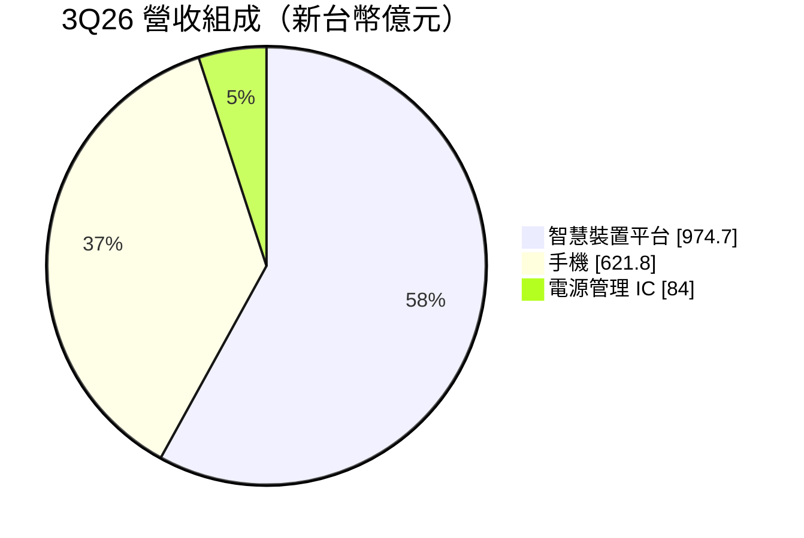
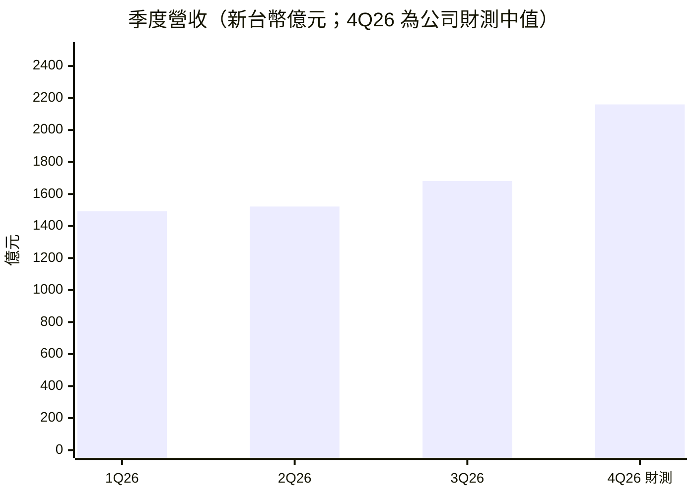
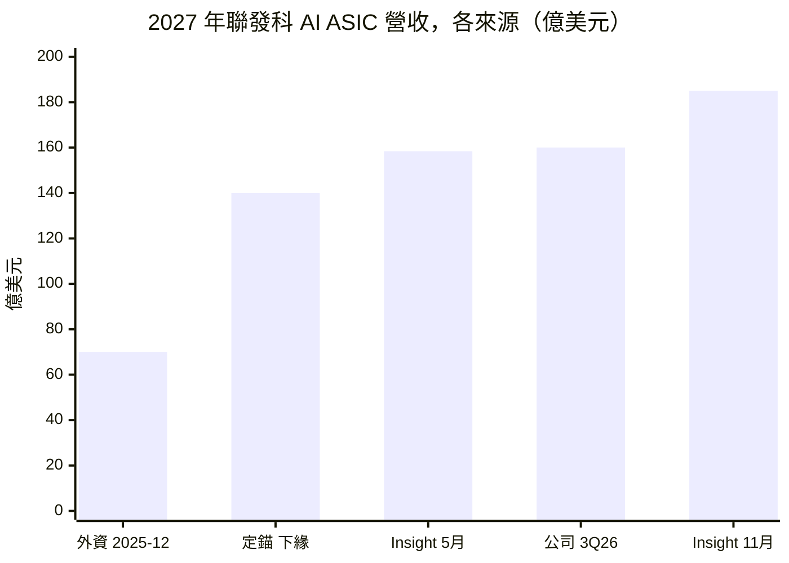
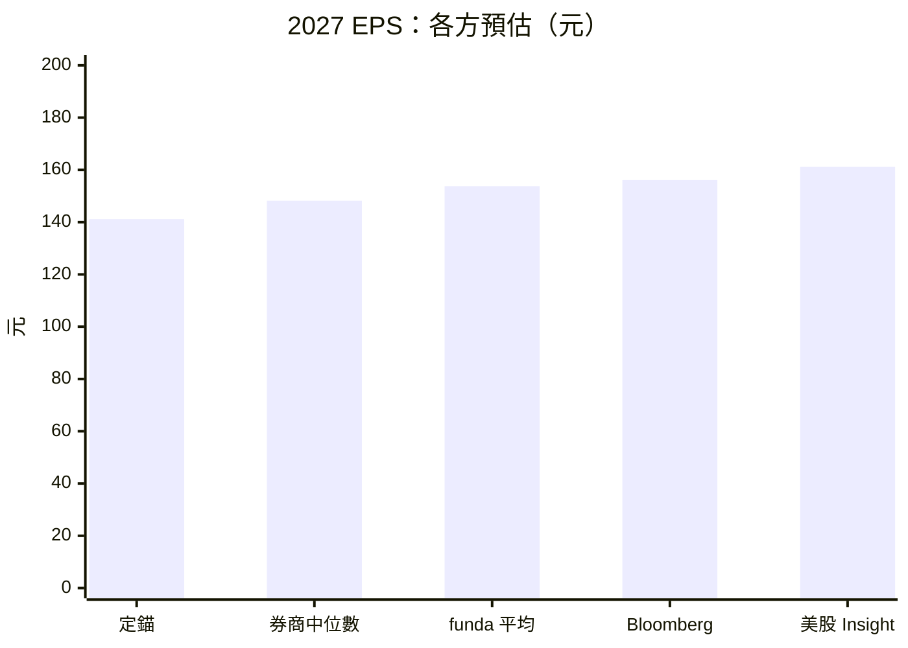

# 2454 聯發科 展望講義

> **全篇結論：聯發科 2027 年的成長，幾乎全部押在幫 Google 做的 TPU v8t（Zebrafish）能出貨多少。**
> 公司說 2027 年 AI ASIC 約 160 億美元；供應鏈調查用投片量拼出約 185 億美元。
> 差額來自投片量與單價，目前只有一個來源，還需要第二來源證實。

這份講義只放有出處的資料，不含我們自己的估算。
每一節的順序都一樣：一句話結論 → 解釋 → 原文關鍵句與連結。
每個來源截錄一句原文關鍵句，其餘只列原文中的數字、日期與名稱；要看完整上下文請點連結。

閱讀順序：
1. 成長引擎換了：從手機換成 AI ASIC
2. 為什麼是聯發科：Google 要壓低成本
3. 4Q26：第一顆 TPU 開始出貨
4. 2027：用算式拼出 AI ASIC 營收
5. 2028 以後：v9 延後、v10 未定
6. 新客戶：Google 以外還有誰
7. 風險：哪些事會讓數字變小
8. 市場怎麼看：共識與估值

先看懂幾個詞：
- **ASIC**：替特定客戶客製的晶片；Google 的 TPU 就是一種 ASIC。
- **TPU**：Google 自己設計、專門跑 AI 運算的晶片。
- **CoWoS**：台積電的先進封裝，AI 晶片產量的瓶頸。
- **投片量**：一年分到幾片 CoWoS 晶圓。
- **ASP**：平均單價。
- **channel check**：渠道調查，向供應鏈打聽到的消息，不是公司公告。

---

## 1. 聯發科的成長引擎，已經從手機換成 AI ASIC

**3Q26 手機年減 17%，智慧裝置平台年增 63%；4Q26 公司財測營收季增 25–32%，主要靠第一顆 AI 晶片放量。**

- 3Q26 營收 1,680.6 億元，年增 18.3%，EPS 17.50 元。
- 業務比重：智慧裝置平台 58%、手機 37%、電源管理 5%。
- 手機變弱的原因是記憶體漲價推高手機成本，需求被壓抑。
- AI ASIC 目前含在智慧裝置平台裡，公司沒有單獨揭露。

> [!quote] 原文｜Jon Peddie Research（2026-10，整理 3Q26 法說）
> 「Smart Edge Platforms grew 63% and now supplies 58% of sales」
> 原文要點（數字、日期、名稱照原文，未加入我們的判斷）：智慧裝置平台年增 63%，已占營收 58%；手機年減 17%，占 37%。
> 連結：https://www.jonpeddie.com/news/mediateks-q326-financial-results/

> [!quote] 原文｜科技新報（2026-10-30，3Q26 法說）
> 「在 AI 加速器產品強勁放量拉動下，聯發科預期營收將顯著成長」
> 原文要點（數字、日期、名稱照原文，未加入我們的判斷）：4Q26 營收財測 2,101–2,218 億元，季增 25–32%，毛利率約 45% ±1.5 個百分點。
> 連結：https://technews.tw/?p=1642229

---

## 2. Google 找聯發科，是因為便宜，不是因為技術比較好

**Google 自己設計運算晶片，聯發科只做 I/O 晶片和後段整合；Google 用聯發科來壓低博通的報價。**

- TPU v8 有兩顆：v8t Zebrafish（訓練用）由 Google 和聯發科合作，v8i Sunfish（推論用）由博通負責。
- 分工：Google 做運算晶片（compute die），聯發科做對外傳資料的 I/O 晶片和後段整合。
- 博通的報價包含 HBM 記憶體採購並從中賺差價；客戶改成自己買 HBM（這種做法叫 COT 模式）後，就能把設計交給比較便宜的聯發科。
- 博通管理層已經連續兩季承認 TPU 份額下滑，但仍說會保有「過半」。

> [!quote] 原文｜美股 Insight〈聯發科1Q26財報〉（2026-05-04）
> 「由 Google 負責前端、MTK 負責後端」
> 原文要點（數字、日期、名稱照原文，未加入我們的判斷）：v8t 的分工是 Google 設計前段運算晶片，聯發科負責後段；作者在留言中也確認聯發科沒有做運算晶片。
> 連結：https://vocus.cc/article/69f898ebfd89780001928b5f

> [!quote] 原文｜美股 Insight〈AVGO FY2Q26財報〉（2026-06）
> 「Google 正在分散 TPU 供應鏈」
> 原文要點（數字、日期、名稱照原文，未加入我們的判斷）：博通管理層在財報上首次承認這件事；作者認為 Google 刻意扶植聯發科，目的是壓低博通的毛利率。
> 連結：https://vocus.cc/article/6a22ab8efd89780001980558

> [!quote] 原文｜美股韭菜王 4Q26 直播逐字稿（2026-10-06，03:04:31 起）
> 「MTK 技術怎麼可能比 Broadcom 好，才沒有勒」
> 原文要點（數字、日期、名稱照原文，未加入我們的判斷）：講者認為聯發科拿到訂單的原因是便宜、願意配合客戶自己買 HBM。
> 來源：Downloads/4Q2026美股展望_完整繁中逐字稿.txt

> [!quote] 原文｜定錨產業筆記 台股產業週報 2026/5/3
> 「以委託設計服務角色，協助雲端服務商開發自研晶片」
> 原文要點（數字、日期、名稱照原文，未加入我們的判斷）：定錨認為聯發科不推出自己的 AI 晶片跟大廠正面競爭，而是幫雲端業者代工設計，這個策略比高通有效。
> 連結：https://investanchors.com/user/vip_contents/17772959451558（會員限定）

---

## 3. 4Q26：第一顆 TPU 已經開始出貨，公司說 AI ASIC 約 25 億美元

**v8t Zebrafish 9 月首批出貨；公司把 2026 年 AI ASIC 指引一路從 10 億上修到 25 億美元；換算約占 4Q26 財測營收的 37%。**

- 2026 年 AI ASIC 指引的變化：4Q25 法說「超過 10 億」→ 1Q26「20 億」→ 2Q26「超過 20 億」→ 3Q26「約 25 億」美元。
- 換算（推算）：25 億美元 × 匯率 31.7 ＝ 792.5 億元；占 4Q26 財測中值 2,159.5 億元的 36.7%。
- 「25 億美元」是全年還是單季，各來源寫法不同；因為 9 月才出貨，兩者差不多。
- 供應鏈的對照數字：美股 Insight 估 2026 年 Zebrafish 出貨約 60 萬顆 × 5,000 美元 ＝ 30 億美元。

> [!quote] 原文｜Jon Peddie Research（2026-10，整理 3Q26 法說）
> 「the first AI accelerator began shipping in September」
> 原文要點（數字、日期、名稱照原文，未加入我們的判斷）：第一顆 AI 加速器 9 月開始出貨。
> 連結：https://www.jonpeddie.com/news/mediateks-q326-financial-results/

> [!quote] 原文｜定錨產業筆記 台股產業週報 2026/11/1
> 「單季營收貢獻從20億美元上修至25億美元」
> 原文要點（數字、日期、名稱照原文，未加入我們的判斷）：定錨整理的法說內容寫成 Zebrafish 4Q26 單季放量出貨；AI ASIC 毛利率低於公司平均，但營收規模放大後營業利益率會改善。
> 連結：https://investanchors.com/user/vip_contents/17931733194710（會員限定）

> [!quote] 原文｜美股 Insight〈GOOG 3Q26財報〉（2026-10-31）
> 「預計 2026 年出貨僅約幾十萬顆」
> 原文要點（數字、日期、名稱照原文，未加入我們的判斷）：Zebrafish 延遲將近一季後開始爬坡，2026 年出貨量不多，2027 年才放量。
> 連結：https://vocus.cc/article/6ae4df10fd89780001b15fbd

---

## 4. 2027：AI ASIC 營收 ＝ 投片量 × 每片顆數 × 單價，公司說 160 億、供應鏈說 185 億

**公司用「市場規模 × 市占率」算出約 160 億美元；美股 Insight 用「22 萬片 × 約 16.8 顆 × 5,000 美元」算出 185 億美元。**

兩條算式：
- 公司：**SAM（公司能爭取的市場規模）800 億美元 × 市占率 20% ＝ 160 億美元**。
- 美股 Insight 最新：**22 萬片 × 約 16.8 顆 × 5,000 美元 ＝ 370 萬顆 × 5,000 美元 ＝ 185 億美元**；每片顆數是 370 ÷ 22 推算的。
- 美股 Insight 5 月版：**18 萬片 × 20 顆 × 4,400 美元 ＝ 158.4 億美元**。

| 來源（日期） | 投片量 | 每片顆數 | 出貨量 | 單價 | AI ASIC |
|---|---:|---:|---:|---:|---:|
| 聯發科 3Q26 法說（10/30） | — | — | — | — | 約 160 億美元 |
| 美股 Insight 3Q26（11/4） | 22 萬片 | 約 16.8（推算） | 370 萬顆 | 5,000 美元 | 185 億美元 |
| 美股 Insight 2Q26（8/3） | 20–25 萬片 | 尚無資料 | 400–500 萬顆 | 尚無資料 | 尚無資料 |
| 美股 Insight 1Q26（5/4） | 18 萬片 | 20 | 360 萬顆 | 4,400 美元 | 158.4 億美元 |
| 定錨週報（9/6） | — | — | — | — | 140–160 億美元 |
| 美系外資（2025-12，舊） | — | — | 200 萬顆 | 3,500 美元 | 70 億美元 |

- 2027 年只有 v8t Zebrafish 在出貨，所以這條算式只需要放 Zebrafish 一顆。
- 投片量、每片顆數、單價這三個數字，目前只有美股 Insight 一個來源。
- 公司的 160 億和美股 Insight 的 185 億差 25 億美元，公司沒有拆出量和價。

> [!quote] 原文｜中央社 Focus Taiwan（2026-10-31，3Q26 法說）
> 「generate about US$16.0 billion in sales next year」
> 原文要點（數字、日期、名稱照原文，未加入我們的判斷）：蔡力行說 2027 年客製晶片營收約 160 億美元，全球市占約 20%。
> 連結：https://focustaiwan.tw/business/202610310007

> [!quote] 原文｜美股 Insight〈聯發科2Q26財報〉（2026-08-03）
> 「獲得 20~25 萬片的 CoWoS 產能支持」
> 原文要點（數字、日期、名稱照原文，未加入我們的判斷）：作者預期聯發科 2027 年拿到 20–25 萬片 CoWoS，支撐 Zebrafish 出貨 400–500 萬顆；他的分配表裡 NVIDIA 110 萬片、博通 48 萬片、聯發科 22 萬片。
> 連結：https://vocus.cc/article/6a6f802bfd89780001b4a256
*目前是估363萬顆，產能上現在400-500萬顆（cowos)*
> [!quote] 原文｜美股 Insight〈聯發科3Q26財報〉（2026-11-04）
> 「ASP 為 5000 美元」
> 原文要點（數字、日期、名稱照原文，未加入我們的判斷）：作者預計 2027 年 Zebrafish 出貨 370 萬顆、單價 5,000 美元；2028 年降到 100 萬顆、單價 4,500 美元。
> 連結：https://vocus.cc/article/6aea61f2fd8978000145b0d2

> [!quote] 原文｜美股 Insight〈聯發科1Q26財報〉（2026-05-04）
> 「每片 CoWoS 可切出 20 顆封裝後晶片」
> 原文要點（數字、日期、名稱照原文，未加入我們的判斷）：這是每片顆數唯一明寫的出處；當時算出 360 萬顆 × 4,400 美元 ＝ 158.4 億美元。
> 連結：https://vocus.cc/article/69f898ebfd89780001928b5f

> [!quote] 原文｜定錨產業筆記 台股產業週報 2026/9/6
> 「2026、2027年分別貢獻營收20~30億美元、140~160億美元」
> 原文要點（數字、日期、名稱照原文，未加入我們的判斷）：定錨研調對 Zebrafish 營收的估計，和公司指引差不多。
> 連結：https://investanchors.com/user/vip_contents/17883608963331（會員限定）

---

## 5. 2028 以後：v9 延後一季到 1Q28，v10 聯發科還沒確定

**v9 Humufish 由原訂的 4Q27 延後到 1Q28 量產，所以 2027 年拿不到 v9 的營收；v10 聯發科可能有參與，但說法互相矛盾。**

| 世代              | 誰設計               | 封裝             | 時程                |
| --------------- | ----------------- | -------------- | ----------------- |
| v9t Humufish    | Google＋聯發科        | Intel EMIB-T   | 1Q28 量產（公司確認）     |
| v9 Triggerfish  | 聯發科               | EMIB-T         | 時程不明              |
| Pumafish（博通 v9） | 博通                | CoWoS-L        | 已取消               |
| Merope（v10）     | AMD 前段＋Marvell 後段 | CoWoS-S        | 4Q28              |
| Icefish（v10x）   | Google 前段＋聯發科後段   | EMIB-T，台積電 A14 | 原訂 4Q28，可能延到 2029 |

- Humufish 太大，CoWoS 裝不下，所以改用 Intel 的 EMIB-T 封裝。
- 單價：美股 Insight 5 月寫 13,000 美元，11 月改寫 12,000 美元。
- v10 的說法有矛盾：直播（10/6）說還沒看到聯發科拿到 v10，11/4 的文章改說「有理由相信已拿下 Icefish」。

> [!quote] 原文｜美股 Insight〈聯發科3Q26財報〉（2026-11-04）
> 「管理層並指引 TPUv9t 將在 1Q28 進入量產」
> 原文要點（數字、日期、名稱照原文，未加入我們的判斷）：比市場原本預期的 4Q27 晚一季；作者認為市場會因此下修 2027 年預估、上修 2028 年。
> 連結：https://vocus.cc/article/6aea61f2fd8978000145b0d2

> [!quote] 原文｜定錨產業筆記 台股產業週報 2026/8/9
> 「封裝面積約10.5倍reticle size」
> 原文要點（數字、日期、名稱照原文，未加入我們的判斷）：Humufish 的封裝面積是光罩尺寸的 10.5 倍，超過台積電 CoWoS-L 目前的極限，所以採用 EMIB-T。
> 連結：https://investanchors.com/user/vip_contents/17858137711607（會員限定）

> [!quote] 原文｜定錨產業筆記〈台積電(2330)：法說會報告〉（2026-10-26）
> 「皆不會對聯發科的專案營收造成影響」
> 原文要點（數字、日期、名稱照原文，未加入我們的判斷）：不論最後用 CoWoS 還是 EMIB-T，聯發科的專案營收都不受影響，但都會碰到載板供應瓶頸；最慢 2027 上半年要決定是否改回 CoWoS。
> 連結：https://investanchors.com/user/vip_contents/17929343424703（會員限定）

> [!quote] 原文｜大摩，轉引科技新報（2026-05-26）
> 「正參與1.4奈米TPU v10「Icefish」設計」
> 原文要點（數字、日期、名稱照原文，未加入我們的判斷）：大摩的供應鏈調查也說聯發科參與 v10，並估 Google TPU 在 2027、2028 年分別占聯發科營收 38% 與 63%。
> 連結：https://finance.technews.tw/2026/05/26/mediateks-2nm-tpu-design-services-demonstrate-strong-performance/

---

## 6. Google 以外的新客戶：第二家已確認，但要 2028 年才有營收

**公司說已拿到第二家 AI ASIC 客戶（非中國廠商），2028 年起貢獻；供應鏈消息指向 Meta 與 SpaceX。**

| 客戶       | 內容               | 時程                   | 可信度                      |
| -------- | ---------------- | -------------------- | ------------------------ |
| 第二家客戶    | 公司只說「非中國」        | 2028 年起              | 公司確認                     |
| Meta（推論） | 3 奈米、9 倍光罩       | 直播說 2027 年底；文章說 2H28 | 美股 Insight channel check |
| SpaceX   | Intel 14A、EMIB-T | 4Q28 小量              | 美股 Insight channel check |
| 字節跳動     | 量很小              | 不快                   | 作者留言，整個週期約 10 億美元        |

- Meta 的時程前後說法不一，以公司說的「2028 年起」為準。

> [!quote] 原文｜定錨產業筆記 台股產業週報 2026/11/1
> 「該客戶身份非中國」
> 原文要點（數字、日期、名稱照原文，未加入我們的判斷）：定錨整理的法說內容：公司已拿到第二家 AI ASIC 客戶的專案，還在定義規格，時機適當時會揭露。
> 連結：https://investanchors.com/user/vip_contents/17931733194710（會員限定）

> [!quote] 原文｜美股韭菜王 4Q26 直播逐字稿（2026-10-06，02:50:36 起）
> 「這顆晶片是用 3 奈米、9 倍光罩」
> 原文要點（數字、日期、名稱照原文，未加入我們的判斷）：講者說聯發科似乎拿到 Meta 的一顆晶片，但他坦言還沒向 Meta 那邊確認。
> 來源：Downloads/4Q2026美股展望_完整繁中逐字稿.txt

---

## 7. 風險：爬坡慢、封裝良率、手機與雲端資本支出

**最直接的風險是 v8t 爬坡比預期慢，要到 1Q27 才真正放量；其次是 v9 的 EMIB-T 良率與 2028 年雲端資本支出放緩。**

- **v8t 爬坡慢**：SerDes（晶片間高速傳輸電路）效能不如預期，加上物料被 NVIDIA 卡住。
- **EMIB-T 良率**：5 月時 Intel EMIB 良率約 90%、台積電約 98%，作者認為差距很大，但不會改變採用決定。
- **手機**：定錨因手機需求下滑幅度比預期大，把 2027 年 EPS 從 155.40 元下修到 141.15 元。
- **雲端資本支出**：作者認為 2028 年雲端業者的資本支出會放緩；德州新州長的政見可能延緩新資料中心開發。

> [!quote] 原文｜美股 Insight〈盤勢雜談：Anthropic IPO 前閉門投資者會議〉留言（2026-10-26）
> 「預計產能爬坡在 1Q27 左右才能開始」
> 原文要點（數字、日期、名稱照原文，未加入我們的判斷）：作者回覆讀者時說，Zebrafish 爬坡低於預期，原因是 SerDes 效能不如預期、物料被 NVIDIA 卡住。
> 連結：https://vocus.cc/article/6add192afd89780001b80fb2

> [!quote] 原文｜定錨產業筆記 台股產業週報 2026/11/1
> 「2026/2027年財測EPS下修至74.1/141.15元」
> 原文要點（數字、日期、名稱照原文，未加入我們的判斷）：前次預估是 73.92／155.40 元，下修原因是消費性電子需求下滑比預期大。
> 連結：https://investanchors.com/user/vip_contents/17931733194710（會員限定）

> [!quote] 原文｜大摩，轉引科技新報（2026-01-26）
> 「T-Glass/基板供應高度相關，目前似乎是主要瓶頸」
> 原文要點（數字、日期、名稱照原文，未加入我們的判斷）：聯發科 TPU 出貨量受限於載板與玻纖布供應。
> 連結：https://technews.tw/2026/01/26/morgan-stanley-see-mediatek-ai-asic/

---

## 8. 市場怎麼看：共識 EPS 落在 141–161 元，券商目標價中位數 5,608 元

**各方 2027 年 EPS 預估介於 141 元（定錨）到 161 元（美股 Insight），Bloomberg 共識 156 元；12 家券商中位數 148 元、目標價中位數 5,608 元；美股 Insight 作者個人給 2027 年 25 倍本益比。**

| 來源（日期）                          | 2026 EPS | 2027 EPS | 2027 營收（億元） |
| ------------------------------- | -------: | -------: | ----------: |
| 定錨產業筆記（11/1）                    |     74.1 |   141.15 |        尚無資料 |
| funda.ai 分析師平均（11/12）           |    72.48 |   153.76 |      11,800 |
| Bloomberg 共識（轉引美股 Insight 11/4） |    73.18 |   156.10 |    12,099.4 |
| 美股 Insight（11/4）                |    73.95 |   161.15 |    12,490.6 |
| 券商 12 家中位數（10/30–11/5）          |    72.79 |   148.21 |      11,908 |

- 12 家券商：2027 EPS 132.67–199.49 元，目標價 4,310–6,250 元；只有廣發評「持有」，其餘 11 家偏多；逐家數字見 [[2454 sellside 共識]]。
- 美股 Insight 對聯發科 2027 年 EPS 的預估變化：5/4 129.36 → 7/24 160.62 → 11/4 161.15 元。
- 作者對本益比的看法也在變：5 月說市場以前給 35 倍、現在 25 倍；8 月說 32 倍算中性合理；11 月說 25 倍，區間 20–30 倍。

> [!quote] 原文｜美股 Insight〈聯發科3Q26財報〉留言（2026-11-04）
> 「現在的市場環境，我個人可能會給 25x」
> 原文要點（數字、日期、名稱照原文，未加入我們的判斷）：作者說市場情緒好可以交易到 30 倍，情緒差可能剩 20 倍。
> 連結：https://vocus.cc/article/6aea61f2fd8978000145b0d2

> [!quote] 原文｜美股 Insight〈AVGO FY3Q26財報〉留言（2026-09-04）
> 「MTK 的風報比大於 AVGO」
> 原文要點（數字、日期、名稱照原文，未加入我們的判斷）：作者認為聯發科的風險報酬比博通好，擔心博通是價值陷阱。
> 連結：https://vocus.cc/article/6a99e2c4fd897800014842a8

---

## 從上到下，可以得出什麼？

**聯發科 2027 年的關鍵變數只有一個：Zebrafish 的出貨量 × 單價。**

- 第 1 節：成長引擎已經從手機換成 AI ASIC。
- 第 2 節：聯發科拿到 Google 訂單靠的是價格，所以單價有上限、毛利率低於公司平均。
- 第 3 節：4Q26 的出貨已經開始，公司給的 25 億美元有法說背書。
- 第 4 節：2027 年公司說 160 億美元，供應鏈說 185 億美元，差在投片量與單價。
- 第 5、6 節：v9 和新客戶要到 2028 年才貢獻，2027 年幾乎只有 Zebrafish。
- 第 7 節：爬坡慢、封裝良率、手機與雲端資本支出，都會讓 2027 年的數字變小。
- 第 8 節：市場共識 EPS 已經落在 141–161 元（券商中位數 148 元），要說服別人 EPS 更高，就要找到投片量或單價的第二來源。

**下一步要補的資料：**
- 聯發科實際拿到的 CoWoS 片數（第二來源）。
- Zebrafish 的每片良品顆數與單價（第二來源）。
- 2027-01-28 法說會：1Q27 財測與 2027 年 AI ASIC 指引是否再上修。

---

相關筆記：[[2454 聯發科 會前重點]]｜[[2454 sellside 共識]]｜模型檔：[[2454_簡明損益表.xlsx]]
