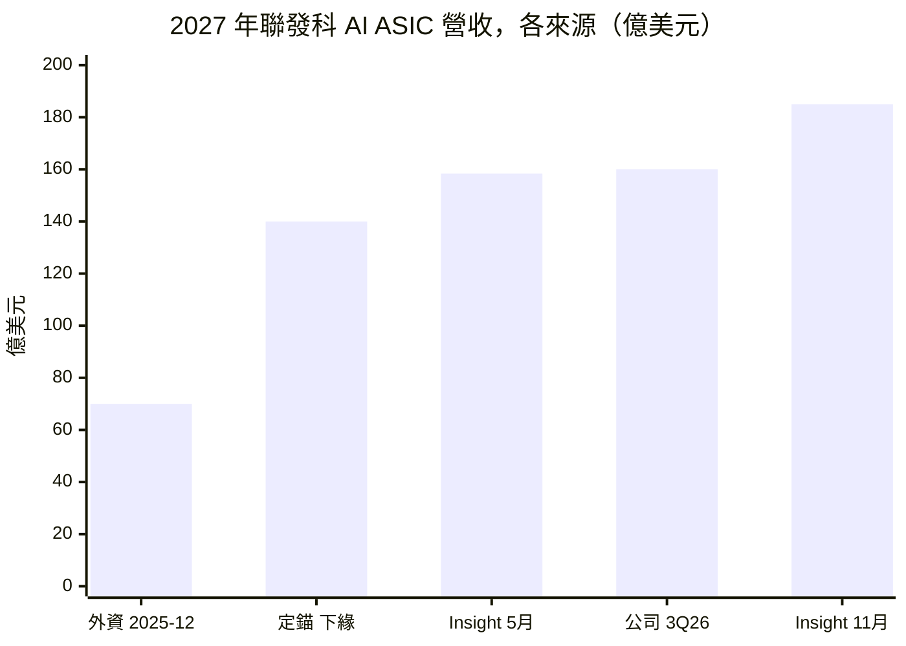
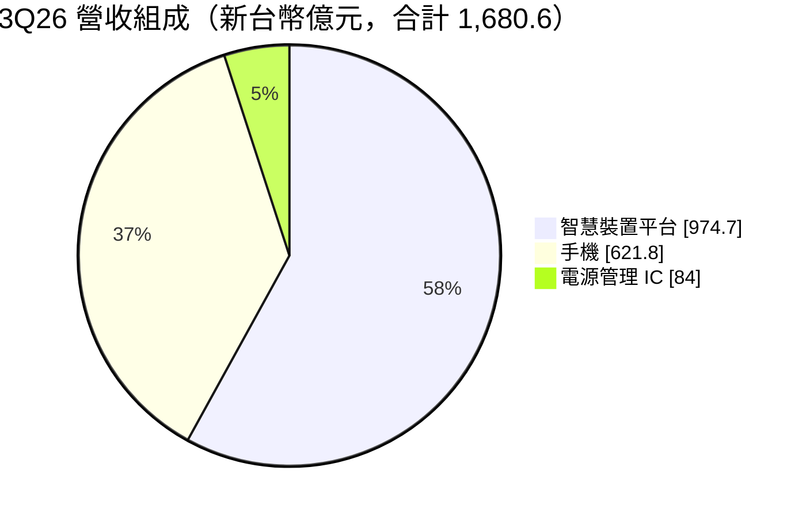
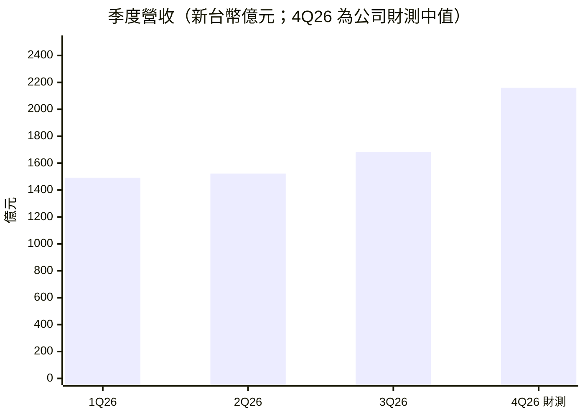
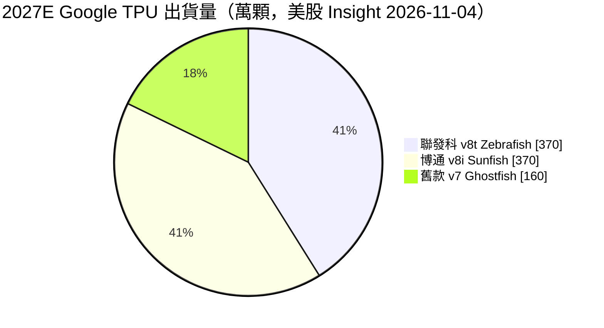
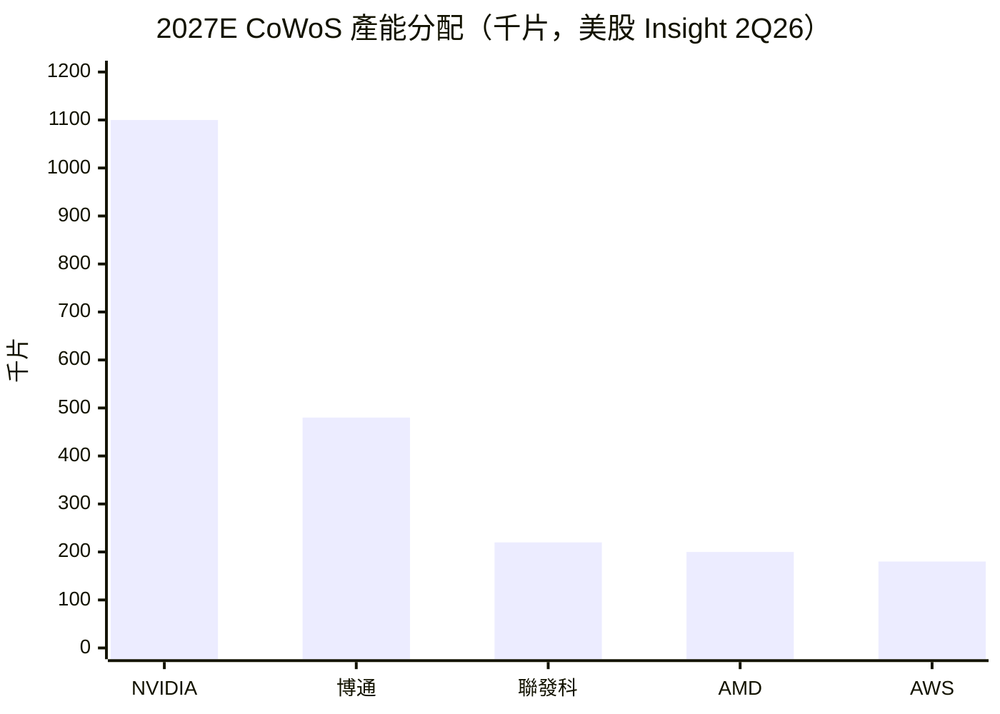

# 聯發科 2454：AI ASIC 營收現在能拼出多少？

> **目前只整理有出處的數字，還沒進入預測階段；本筆記不含我們自己的估算。**
> 4Q26：公司說 AI ASIC 約 25 億美元，約占 4Q26 財測營收中值的 37%。
> 2027：公司說約 160 億美元；美股 Insight 用投片量拼出約 185 億美元；兩者差 25 億美元，差在出貨量與單價，公司沒有拆。

模型檔：[[2454_簡明損益表.xlsx]]（「我的預估」欄先留空；各來源算式在「AI ASIC 算式」分頁）

---

## 先看懂這幾個詞

| 名詞 | 意思 |
|---|---|
| ASIC | 特定應用積體電路，替特定客戶客製的晶片；Google 的 TPU 就是一種 ASIC |
| TPU | Tensor Processing Unit，Google 自己設計、專門跑 AI 運算的晶片 |
| CoWoS | 台積電的先進封裝，把運算晶片和 HBM 記憶體封在一起，是 AI 晶片產量的瓶頸 |
| 投片量 | 一年分到幾片 CoWoS 晶圓 |
| ASP | Average Selling Price，平均單價 |
| SAM | Serviceable Addressable Market，公司能爭取的市場規模 |
| I/O die | 負責對外傳資料的晶片；聯發科在 TPU 主要做這塊和後段整合 |
| compute die | 負責運算的晶片；TPU 的運算晶片由 Google 自己設計 |
| EMIB-T | Intel 的先進封裝，能容納比 CoWoS 更大的晶片 |
| channel check | 渠道調查，向供應鏈專家打聽到的消息，不是公司公告 |

---

## AI ASIC 營收要怎麼算？

**AI ASIC 營收 ＝ CoWoS 投片量 × 每片良品顆數 × ASP**

- 投片量 × 每片良品顆數 ＝ 出貨顆數。
- 公司沒有公布這三個數字，只公布營收結果；三個數字目前都來自美股 Insight 的 channel check。
- 另一條公司自己的算法：**AI ASIC 營收 ＝ SAM × 市占率**。

---

## 4Q26 的 AI ASIC 能做到多少？

**公司說 2026 年 AI ASIC 約 25 億美元，換算約 792.5 億元，約占 4Q26 財測營收中值 2,159.5 億元的 37%。**

| 項目 | 數字 | 出處 |
|---|---:|---|
| 2026 AI ASIC 營收 | 約 25 億美元 | 聯發科 3Q26 法說（2026-10-30）；2Q26 時為「超過 20 億」、1Q26 時為 20 億 |
| 首批出貨時間 | 2026 年 9 月 | 聯發科 3Q26 法說 |
| 匯率 | 31.7 | 4Q26 財測匯率假設 |
| 4Q26 營收財測 | 2,101–2,218 億元（中值 2,159.5） | 聯發科 3Q26 法說 |

算式：**25 億美元 × 31.7 ＝ 792.5 億元；792.5 ÷ 2,159.5 ＝ 36.7%**（推算）

用投片量對照（美股 Insight）：

| 項目 | 數字 | 出處 |
|---|---:|---|
| 2026 CoWoS 投片量 | 2.5 萬片 | 美股 Insight 2Q26（2026-08-03） |
| 2026 Zebrafish 出貨量 | 40 萬顆（8 月）→ 60 萬顆（11 月表格） | 美股 Insight 2Q26、3Q26 |
| ASP | 5,000 美元 | 美股 Insight 3Q26（2026-11-04） |

算式：**60 萬顆 × 5,000 美元 ＝ 30 億美元**，比公司說的 25 億美元高 5 億。

- 「25 億美元」是全年還是單季，各來源寫法不同：美股 Insight 寫 2026 全年，定錨和 Jon Peddie 寫 4Q26 單季；因為 9 月才開始出貨，兩種說法差距不大。
- 美股 Insight 留言（2026-10-26）：Zebrafish 爬坡低於預期，原因是 SerDes 效能不如預期、物料被 NVIDIA 卡住，要到 1Q27 才真正放量。

---

## 2027 年的 AI ASIC 能做到多少？

**目前有出處的數字落在 140–185 億美元，公司自己說約 160 億美元。**

| 來源（日期） | 投片量 | 每片顆數 | 出貨量 | ASP | AI ASIC |
|---|---:|---:|---:|---:|---:|
| 聯發科 3Q26 法說（2026-10-30） | — | — | — | — | **約 160 億美元** |
| 美股 Insight 3Q26（2026-11-04） | 22 萬片 | 約 16.8（推算） | 370 萬顆 | 5,000 美元 | **185 億美元** |
| 美股 Insight 2Q26（2026-08-03） | 20–25 萬片 | 尚無資料 | 400–500 萬顆 | 尚無資料 | 尚無資料 |
| 美股 Insight 1Q26（2026-05-04） | 18 萬片 | 20 | 360 萬顆 | 4,400 美元 | **158.4 億美元** |
| 定錨產業筆記週報（2026-09-06） | — | — | — | — | **140–160 億美元** |
| 美系外資，轉引聯合報（2025-12） | — | — | 200 萬顆 | 3,500 美元 | 70 億美元（舊） |

各來源的算式：

- 公司：**SAM 800 億美元 × 市占率 20% ＝ 160 億美元**（2Q26 法說 SAM 800 億、市占 15–20%；3Q26 法說確認約 20%、約 160 億）。
- 美股 Insight 最新：**22 萬片 × 約 16.8 顆 × 5,000 美元 ＝ 370 萬顆 × 5,000 ＝ 185 億美元**；每片顆數是 370 ÷ 22 推算，文章沒寫。
- 美股 Insight 5 月版：**18 萬片 × 20 顆 × 4,400 美元 ＝ 360 萬顆 × 4,400 ＝ 158.4 億美元**（文章原算式）。
- 換成新台幣（匯率暫用 4Q26 的 31.7，2027 年匯率尚無資料）：160 億美元 ＝ 5,072 億元；185 億美元 ＝ 5,864.5 億元。

- 2027 年只有 Zebrafish（v8t）一顆在出貨：v9 Humufish 公司確認 1Q28 量產，Triggerfish 時程不明，Meta、SpaceX 專案 2028 年起才貢獻。
- 公司 160 億和美股 Insight 185 億差 25 億美元；**缺的資料是：公司實際拿到的 CoWoS 片數、每片良品數、Zebrafish 單價**，三個都還沒有官方或第二來源證實。
- 大摩（轉引科技新報 2026-01-26）說 Google 2027 年 TPU 合計 600–700 萬顆、由聯發科與博通供應，但沒拆分各家數量。

---

## 營收和業務組成現在長什麼樣？

**3Q26 智慧裝置平台占 58%、手機 37%、電源管理 5%；AI ASIC 目前含在智慧裝置平台裡，公司沒單獨揭露。**

| 期間 | 營收（億元） | EPS（元） | 出處 |
|---|---:|---:|---|
| 1Q26 實際 | 1,491.5 | 15.17 | 1Q26 法說 |
| 2Q26 實際 | 1,521.8 | 15.28 | 2Q26 法說 |
| 3Q26 實際 | 1,680.6 | 17.50 | 3Q26 法說；年增 18.3%、毛利率 46.3% |
| 4Q26 財測 | 2,101–2,218 | — | 3Q26 法說；毛利率 43.5–46.5% |
| 4Q26 Bloomberg 共識 | 2,186.7 | 25.34 | 轉引美股 Insight 2026-11-04 |
| 2027 Bloomberg 共識 | 12,099.4 | 156.10 | 轉引美股 Insight 2026-11-04 |
| 2027 券商 12 家中位數 | 11,908 | 148.21 | 券報 10/30–11/05，見 [[2454 sellside 共識]] |
| 2027 券商 12 家區間 | 11,122–13,135 | 132.67–199.49 | 同上 |

- 智慧裝置年增 63%、手機年減 17%、電源管理年增 18%（3Q26 法說）。
- 手機變弱的原因是記憶體漲價推高手機成本。

---

## 主要業務的對手是誰？市占多少？

**AI ASIC 的主要對手是博通；Google 把 TPU 訂單從博通移到聯發科，原因是聯發科便宜，不是技術比較好（美股 Insight）。**

- 博通管理層說仍會保有 TPU「過半」份額，但已連續兩季承認份額下滑。
- 美股 Insight 解釋：博通報價把 HBM 採購包進去賺一手；Google、Meta 改成自己買 HBM（COT 模式），設計交給報價較低的聯發科。
- 公司目標：2027 年 AI ASIC 市占約 20%。
- v10 多了 AMD（前段）＋ Marvell（後段）的組合。
- 手機晶片最新市占：尚無資料（2025 年報導約 39%、全球第一，對手是高通）。

---

## Google TPU 各代的進度如何？

**v8 已經在出貨；v9 延後一季到 2028 年第一季量產；v10 聯發科可能有拿到，但還沒確定。**

| 世代／代號                | 用途   | 誰設計                             | 製程／封裝                      | 進度                           |
| -------------------- | ---- | ------------------------------- | -------------------------- | ---------------------------- |
| v7 Ghostfish         | 推論   | 博通                              | —                          | 2027 年估 160 萬顆               |
| **v8t Zebrafish**    | 訓練   | Google 做運算晶片；**聯發科**做 I/O 晶片與後段 | N3P／CoWoS                  | 9 月首批出貨，4Q26 小量，2027 年放量     |
| v8i Sunfish          | 推論   | 博通                              | N3P／CoWoS-L                | 4Q26 開始生產，部分訂單被 Google 下修    |
| **v9t Humufish**     | 推論   | Google＋**聯發科**                  | 運算晶片 N2P、HBM4E 12 顆／EMIB-T | 原訂 4Q27，**延到 1Q28 量產**（公司確認） |
| **v9 Triggerfish**   | 推論   | **聯發科**                         | N2P／EMIB-T                 | 量產時間不明                       |
| Pumafish             | 訓練   | 博通                              | N2                         | **已取消**                      |
| Whalefish（v8i Ultra） | 訓練   | 博通                              | CoWoS-S                    | 1Q28                         |
| Merope（v10）          | 推論   | AMD 前段＋Marvell 後段               | CoWoS-S                    | 4Q28                         |
| **Icefish（v10x）**    | 尚無資料 | Google 前段＋**聯發科**後段，與創意合作 3D IC | 台積電 A14／EMIB-T             | 原訂 4Q28，可能延到 2029            |

- 除了公司確認的部分，以上都來自美股 Insight 的 channel check。
- v10 的說法有矛盾：Allen 10/6 直播說還沒看到聯發科拿到 v10，11/4 財報文改說「有理由相信已拿下 Icefish」。

---

## 產能和客戶現在知道多少？

**美股 Insight 估聯發科 CoWoS：2026 年 2.5 萬片、2027 年 22 萬片；目前出貨客戶只有 Google。**

| 客戶             | 晶片               | 時程       | 出處                              |
| -------------- | ---------------- | -------- | ------------------------------- |
| Google         | v8t、v9t、v9、v10x  | 2026Q4 起 | 公司確認 v8／v9                      |
| 第二家客戶（推論：Meta） | 3 奈米、9 倍光罩       | 2028 年起  | 公司只說「非中國客戶」；Meta 是美股 Insight 推測 |
| SpaceX         | Intel 14A、EMIB-T | 4Q28 小量  | 美股 Insight channel check        |

- 載板與 T-Glass 是瓶頸（大摩、定錨）。
- Humufish 封裝面積約 10.5 倍光罩，超過台積電 CoWoS-L 目前極限，所以改用 EMIB-T（定錨）。

---

## 每一代 TPU 的單價，各來源怎麼說？

| 世代                   |                                  單價 | 出處                          |
| -------------------- | ----------------------------------: | --------------------------- |
| 早期 TPU               |                            3,500 美元 | 美系外資，轉引聯合報 2025-12          |
| v8t Zebrafish        |                            4,400 美元 | 美股 Insight 1Q26（2026-05-04） |
| v8t Zebrafish        |       5,000 美元（2027）／4,500 美元（2028） | 美股 Insight 3Q26（2026-11-04） |
| v9t Humufish         |                           13,000 美元 | 美股 Insight 1Q26（2026-05-04） |
| v9t Humufish         |                           12,000 美元 | 美股 Insight 3Q26（2026-11-04） |
| Google TPU 混合（聯發科出貨） | 5,200 美元（2026–2027）／11,864 美元（2028） | 廣發券報（2026-11-02）            |
| 第二家客戶 ASIC           |                     18,000 美元（2028） | 廣發券報（2026-11-02）            |
| v10 Icefish          |                                尚無資料 | 只知道用 A14 與 3D IC            |

---

## 還缺哪些資料？

- 聯發科實際拿到的 CoWoS 片數：只有美股 Insight 一個來源。
- 每片良品顆數：只有美股 Insight 5 月的 20 顆，11 月版沒寫。
- Zebrafish 單價：只有美股 Insight，且 5 月到 11 月從 4,400 改成 5,000 美元。
- AI ASIC 毛利率：公司只說低於公司平均，沒給數字。
- 2027 年匯率：尚無資料。

---

## 資料來源

- 聯發科 3Q26 法說（2026-10-30）：科技新報 https://technews.tw/?p=1642229 ；中央社 https://focustaiwan.tw/business/202610310007 ；NeoTeo https://www.neoteo.com/en/mediatek-expects-2026-revenue-growth-to-exceed-its-prior-target
- 美股 Insight〈聯發科3Q26財報〉2026-11-04：https://vocus.cc/article/6aea61f2fd8978000145b0d2
- 美股 Insight〈聯發科2Q26財報〉2026-08-03：https://vocus.cc/article/6a6f802bfd89780001b4a256
- 美股 Insight〈聯發科1Q26財報〉2026-05-04：https://vocus.cc/article/69f898ebfd89780001928b5f
- 美股 Insight〈GOOG 3Q26財報〉2026-10-31：https://vocus.cc/article/6ae4df10fd89780001b15fbd
- 美股 Insight〈盤勢雜談：Anthropic IPO前閉門投資者會議〉留言 2026-10-26：https://vocus.cc/article/6add192afd89780001b80fb2
- 美股 Insight〈AVGO FY3Q26財報〉2026-09：https://vocus.cc/article/6a99e2c4fd897800014842a8
- 定錨產業筆記會員報告：台股產業週報 2026/11/1、2026/9/6、2026/8/9；台積電法說會報告 2026-10-26
- 直播逐字稿：Downloads/4Q2026美股展望_完整繁中逐字稿.txt；[[美股韭菜王第四季]]
- funda.ai 聯發科公司頁 2026-11-12：https://funda.ai/company/2454.TW
- 大摩，轉引科技新報 2026-01-26：https://technews.tw/2026/01/26/morgan-stanley-see-mediatek-ai-asic/
- 美系外資，轉引聯合報 2025-12：https://udn.com/news/story/7253/9173995
- 券商報告 12 份（合庫、第一金、群益、國泰、台新、統一、兆豐、永豐、元大、凱基、廣發、康和，2026-10-30～11-05）：原檔在 Downloads/聯發科；數字整理在 [[2454 sellside 共識]]
